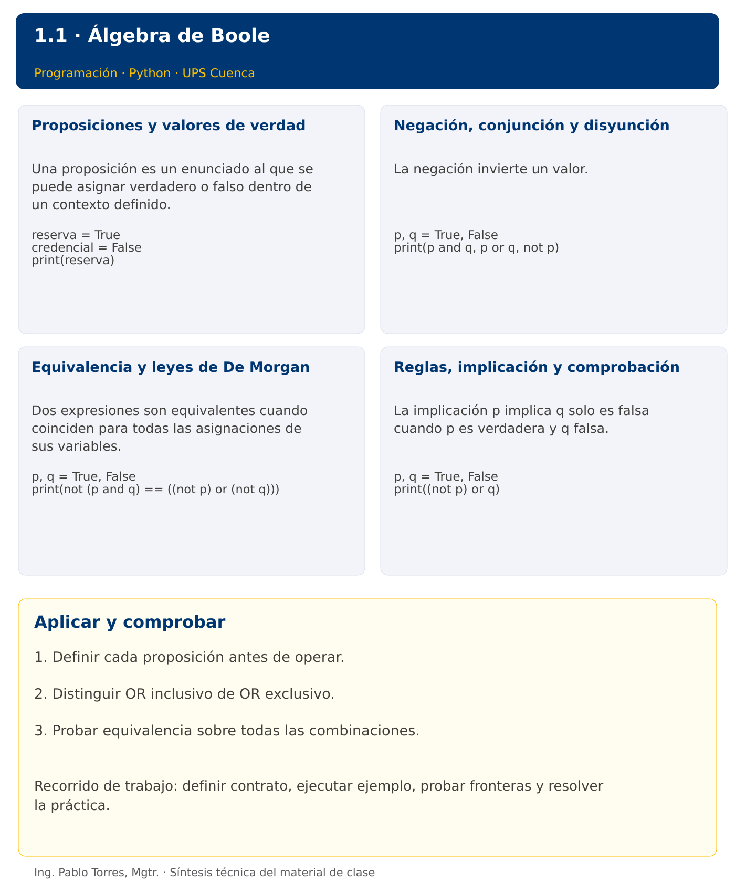

# Programación

## 1.1 · Álgebra de Boole · Java

**Autor:** Ing. Pablo Torres, Mgtr.  
**Unidad 1:** Lógica Matemática  
**Institución:** Universidad Politécnica Salesiana · Computación · Cuenca

[Índice del curso](../../../README.md) · [Versión Python](../python/material.md) · [Presentación](../presentacion-java.pptx) · [Siguiente](../../../02/2.1-algoritmos/java/material.md)

[Conceptos](#concepto-1) · [Demostración](#demostracion) · [Práctica de clase](#pc) · [Lo esencial](#esencial)

**Contexto.** Determinar cuándo permitir el acceso a una sala: disponer de credencial y reserva, o tener autorización del responsable. Convertir una regla verbal en una expresión permite revisar todos los casos, incluidos los que parecen excepcionales.

**Prerrequisitos.** Operaciones aritméticas y lectura de condiciones.

## 1. Conceptos y ejemplos

<a id="concepto-1"></a>

### 1.1. Proposiciones y valores de verdad

Una proposición es un enunciado al que se puede asignar verdadero o falso dentro de un contexto definido. “La reserva está vigente” requiere especificar fecha y hora; una pregunta o una orden no es una proposición. Representar cada condición mediante una letra y escribir su significado antes de operar. Una variable booleana solo modela dos estados, por lo que un dato desconocido exige una decisión explícita del problema. No confundir falso con información ausente.

**Aplicar en Java.** Usar boolean con true y false. Java exige una expresión booleana en una decisión; no convierte un número entero en una condición. La cadena "false" tampoco equivale al literal false.

```java
boolean reserva = true;
boolean credencial = false;
System.out.println(reserva);
```

<a id="concepto-2"></a>

### 1.2. Negación, conjunción y disyunción

La negación invierte un valor. La conjunción exige que ambas proposiciones sean verdaderas. La disyunción inclusiva permite que una o ambas sean verdaderas. Interpretar “o” en lenguaje cotidiano puede ser ambiguo: si exactamente una opción es válida, se necesita disyunción exclusiva. Construir una tabla con 2 elevado al número de variables para enumerar todas las combinaciones sin omisiones.

**Aplicar en Java.** Escribir !, && y ||. El operador ^ sobre booleanos representa disyunción exclusiva, pero no sustituye a ||. Evitar usar & y | cuando se pretende cortocircuito.

```java
boolean p = true, q = false;
System.out.println((p && q) + " " + (p || q) + " " + !p);
```

<a id="concepto-3"></a>

### 1.3. Equivalencia y leyes de De Morgan

Dos expresiones son equivalentes cuando coinciden para todas las asignaciones de sus variables. Una coincidencia aislada no demuestra equivalencia. Las leyes de De Morgan establecen que negar una conjunción equivale a disyuntar las negaciones, y negar una disyunción equivale a conjuntarlas. También se cumplen identidad, idempotencia, absorción y distributividad. Simplificar conserva el significado, no los pasos concretos de evaluación.

**Aplicar en Java.** Comparar !(p && q) con !p || !q. Los paréntesis hacen explícita la agrupación. Una expresión equivalente con llamadas que modifican estado puede ejecutar llamadas diferentes: usar condiciones sin efectos para estudiar álgebra.

```java
boolean p = true, q = false;
System.out.println(!(p && q) == (!p || !q));
```

<a id="concepto-4"></a>

### 1.4. Reglas, implicación y comprobación

La implicación p implica q solo es falsa cuando p es verdadera y q falsa. No expresa por sí misma una causa. Se puede reescribir como no p o q. Una tautología siempre es verdadera; una contradicción siempre es falsa; una contingencia depende de los valores. Para validar una regla de acceso, comprobar cada fila y explicar las filas que autorizan. Diferenciar la especificación de la política y su traducción al programa.

**Aplicar en Java.** Expresar una implicación como !p || q. Los bucles de la demostración enumeran combinaciones y todavía no constituyen un requisito de implementación autónoma.

```java
boolean p = true, q = false;
System.out.println(!p || q);
```

Los bloques breves anteriores ilustran una operación y pueden requerir variables o imports del contexto. Utilizar la demostración siguiente como programa completo.

### Tabla de operadores

| p | q | p AND q | p OR q | NOT p |
|---|---|---|---|---|
| 0 | 0 | 0 | 0 | 1 |
| 0 | 1 | 0 | 1 | 1 |
| 1 | 0 | 0 | 1 | 0 |
| 1 | 1 | 1 | 1 | 0 |

### Leyes para simplificar

| Ley | Equivalencia |
|---|---|
| Identidad | p AND 1 = p; p OR 0 = p |
| Idempotencia | p AND p = p; p OR p = p |
| Complemento | p AND NOT p = 0; p OR NOT p = 1 |
| Absorción | p OR (p AND q) = p |
| Distributiva | p AND (q OR r) = (p AND q) OR (p AND r) |
| De Morgan | NOT (p OR q) = NOT p AND NOT q |

### Síntesis visual



<a id="demostracion"></a>

## 2. Demostración guiada

**Problema.** Enumerar las cuatro combinaciones de credencial y reserva y autorizar únicamente cuando ambas sean verdaderas.

**Contrato de esta demostración.** Dos valores booleanos. No incluir todavía la autorización excepcional del contexto inicial; incorporarla en la PC. Mostrar credencial, reserva y permiso como 0 o 1. La tabla debe contener cuatro filas.

**Fuente:** [ejemplos/Demo.java](ejemplos/Demo.java).

<!-- example: Demo.java -->
```java
public class Demo {
    public static void main(String[] args) {
        for (boolean credencial : new boolean[]{false, true}) {
            for (boolean reserva : new boolean[]{false, true}) {
                boolean permitido = credencial && reserva;
                System.out.println((credencial ? 1 : 0) + " " + (reserva ? 1 : 0) + " " + (permitido ? 1 : 0));
            }
        }
    }
}
```

### Ejecutar

Abrir una terminal dentro de `01/1.1-algebra-boole/java/ejemplos/` y ejecutar:

```bash
javac -encoding UTF-8 -d build *.java
java -cp build Demo
```

### Salida esperada

```text
0 0 0
0 1 0
1 0 0
1 1 1
```

**Interpretación.** Seguir las asignaciones y los bloques en orden, identificar qué instrucción produce cada línea y contrastar con el contrato. Modificar un dato por vez y anticipar el resultado antes de ejecutar. La salida de referencia es una expectativa; el registro de verificaciones indica qué ejecuciones se realizaron.

<a id="pc"></a>

## 3. PC1.1 · Práctica de clase

Formalizar la regla “permitir acceso con credencial y reserva, o con autorización del responsable”. Definir las tres proposiciones, completar las ocho filas de su tabla y expresar la negación mediante De Morgan. Usar Python o Java solo para contrastar la tabla manual, sin exigir todavía escribir bucles desde cero.

### Requisitos y restricciones

- Resolver en una sola versión, Python o Java.
- Mantener nombres y responsabilidades indicados; explicar cualquier adaptación idiomática.
- Aplicar únicamente los conceptos ya introducidos.
- Conservar las entradas cuando el enunciado lo exija.
- Distinguir valores fuera de contrato de errores que el programa debe gestionar.

### Casos de aceptación de la PC

| Entrada / escenario | Resultado esperado |
|---|---|
| 0, 0, 0 | 0 |
| 1, 1, 0 | 1 |
| 0, 0, 1 | 1 |
| 1, 0, 0 | 0 |

### Probar y registrar evidencia

Crear una carpeta personal `PC1.1` separada de las demostraciones. Guardar cada caso con entrada, resultado esperado y resultado real. Compilar `javac -encoding UTF-8 -d build *.java` y ejecutar `java -cp build Solucion`; usar `Solucion.java` como entrada personal. Para entradas de teclado, guardar `casos/entrada-01.txt` y redirigirla con `< casos/entrada-01.txt`. Para funciones, crear llamadas con los datos de la tabla.

- Registrar `evidencias/PC1.1.md` con comandos, versión real, salidas y explicación.
- Crear un commit funcional como `feat(pc1.1): implementar-regla-principal`.
- Obtener el hash real con `git rev-parse HEAD` y anotarlo en la evidencia.
- Revisar el cambio con `git show HASH` y comparar avances con `git diff HASH_ANTERIOR HASH_ACTUAL`. Sustituir los marcadores por hashes reales.
- Agregar una prueba de frontera distinta de las incluidas y justificar qué error detectaría.

No se requiere proyecto acumulativo ni rúbrica individual de esta PC.

<a id="esencial"></a>

## Lo esencial

- Definir cada proposición antes de operar.
- Distinguir OR inclusivo de OR exclusivo.
- Probar equivalencia sobre todas las combinaciones.

## Referencias técnicas

- [Aprender Java, sitio oficial](https://dev.java/learn/)
- [API de Java SE 27](https://docs.oracle.com/en/java/javase/27/docs/api/)

[Índice del curso](../../../README.md) · [Versión Python](../python/material.md) · [Presentación](../presentacion-java.pptx) · [Siguiente](../../../02/2.1-algoritmos/java/material.md)
