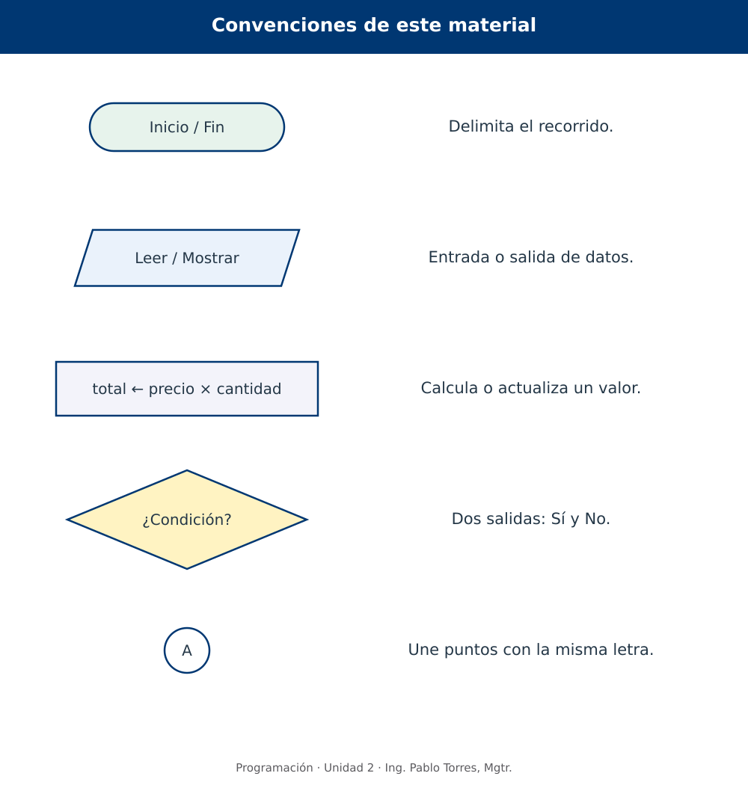
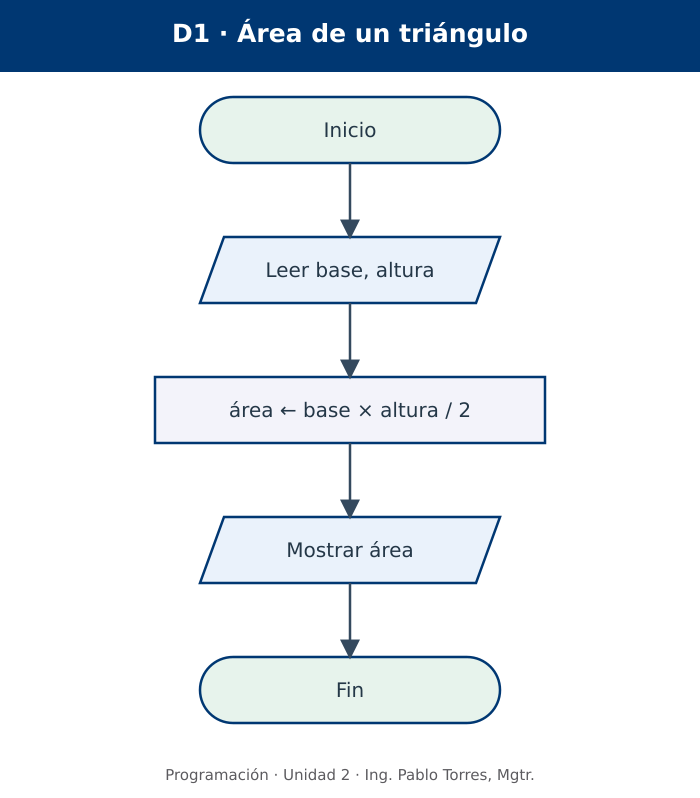
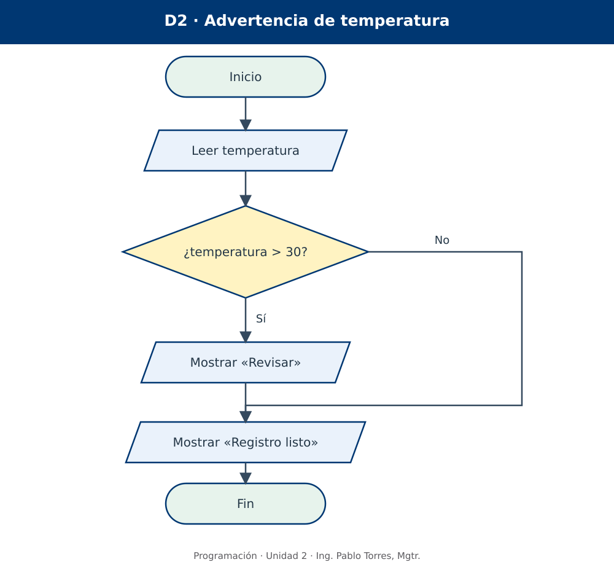
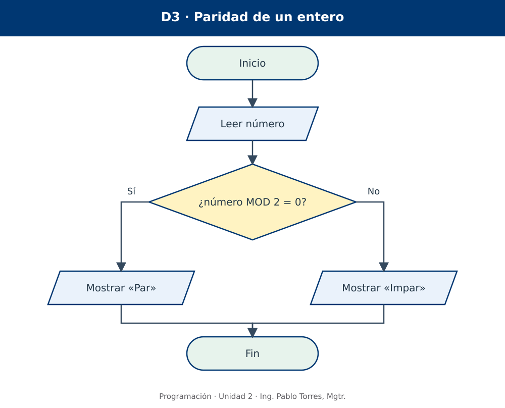
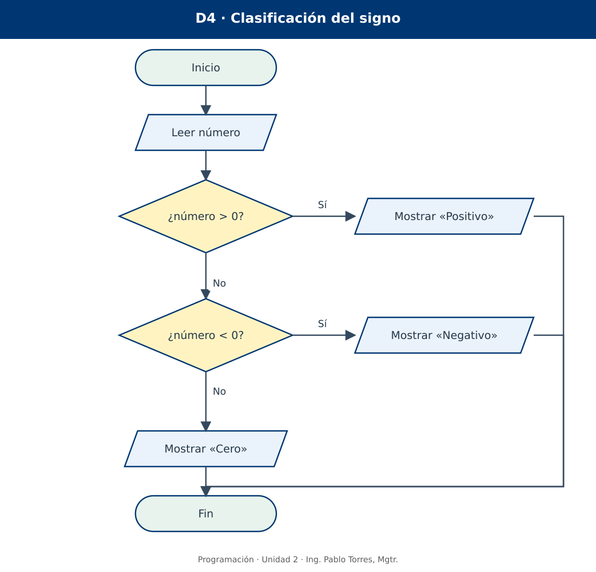
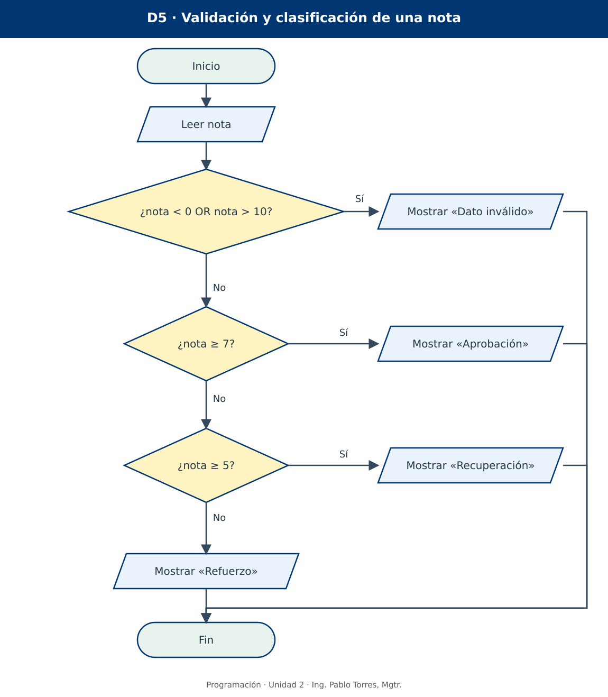
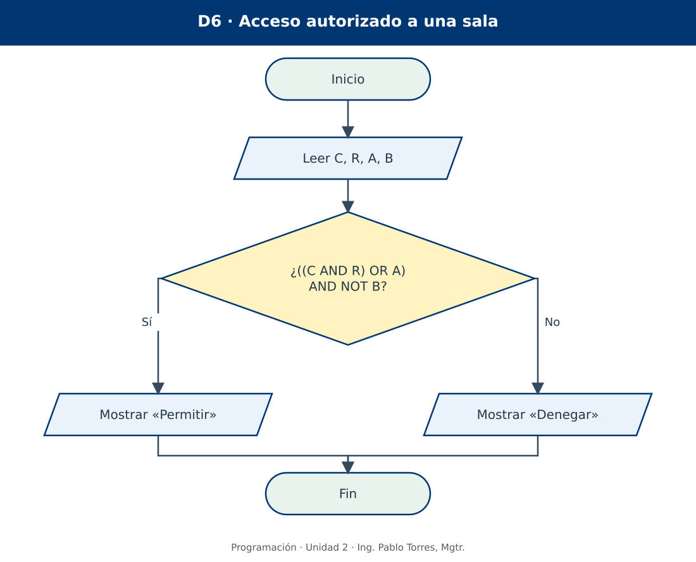

# Programación


## 2.1 · Algoritmos, representaciones y decisiones · Java

**Autor:** Ing. Pablo Torres, Mgtr.  
**Unidad 2:** Algoritmos · sección de organización didáctica  
**Institución:** Universidad Politécnica Salesiana · Computación · Cuenca

[Versión Python](../python/material.md) · [Siguiente: bucles](../../2.2-algoritmos/java/material.md)

[Conceptos](#concepto-1) · [Demostraciones](#demostracion) · [Práctica de clase](#pc) · [Lo esencial](#esencial)

**Contexto.** Describir un problema, definir sus datos y elegir los pasos que producen una respuesta. El foco está en el algoritmo y su representación gráfica; el lenguaje aparece solo como una conexión complementaria.

**Prerrequisitos.** Variables booleanas, AND, OR y NOT; operaciones aritméticas y comparación de valores.

**Cómo estudiar.** Leer la teoría, seguir cada diagrama con un lápiz o una traza y resolver los enunciados en un editor de diagramas. Las versiones Python y Java comparten los problemas, figuras y casos; estudiar una sola versión es suficiente. No se exige programar en esta unidad.

<a id="concepto-1"></a>

## 1. Conceptos y ejemplos

### 1.1. Problema, solución y algoritmo

Un **problema** expresa una situación que se desea resolver. Una **solución** describe el resultado que satisface esa necesidad. Un **algoritmo** organiza las operaciones y decisiones necesarias para obtener ese resultado a partir de unos datos. No basta con decir «calcular el pago»: es necesario precisar qué datos intervienen, cómo se combinan y qué debe comunicarse.

Pensemos en una papelería: se conoce el precio de un cuaderno y la cantidad comprada. El resultado buscado es el importe. El procedimiento consiste en obtener ambos datos, multiplicarlos y comunicar el producto. La fórmula `importe = precio × cantidad` explica el cálculo, pero no representa por sí sola todo el recorrido de entrada, procesamiento y salida.

Un algoritmo puede ejecutarlo una persona o una máquina capaz de realizar sus operaciones. No depende de Python ni de Java; la implementación en un lenguaje es una etapa posterior. En esta sección se diseñan procedimientos finitos para tareas delimitadas. Los servicios que permanecen activos continuamente se estudiarán en otros contextos.

| Propiedad | Significado operativo | Cómo revisarla |
|---|---|---|
| Precisión | Cada instrucción tiene una interpretación suficiente para ejecutarse. | Cambiar «dar un buen descuento» por una regla numérica. |
| Orden | El resultado de un paso está disponible cuando se necesita. | Leer el precio antes de calcular el importe. |
| Efectividad | Las operaciones son realizables con los recursos previstos. | Especificar una fórmula, no «adivinar el resultado». |
| Terminación | Para las entradas admitidas, el procedimiento alcanza su cierre. | Comprobar que los caminos de esta sección llegan a Fin. |
| Corrección | El resultado satisface el problema y su contrato. | Contrastar casos normales y de frontera. |
| Generalidad | Resuelve una clase de casos, no solamente un ejemplo. | Usar precio y cantidad, no fijar siempre 2 y 5. |

La precisión no obliga a detallar acciones irrelevantes. «Leer cantidad» es suficiente si ya se acordó qué cantidad se solicita; «procesar todo» no identifica una operación verificable. El nivel de detalle debe permitir que otra persona reproduzca la solución sin preguntar por reglas esenciales.

### 1.2. El contrato: entradas, proceso y salidas

Antes del dibujo, redactar el **contrato del problema**: qué recibe, qué supone sobre esos datos y qué garantiza al terminar. Una entrada válida cumple el dominio especificado. Una precondición es un requisito que se da por cumplido antes de ejecutar; una validación es una comprobación que el propio procedimiento debe realizar. No son intercambiables.

| Elemento | Ejemplo: importe de una compra | Pregunta que resuelve |
|---|---|---|
| Entradas | precio real no negativo; cantidad entera positiva | ¿Qué información llega del exterior? |
| Precondición | Los datos recibidos cumplen esos dominios | ¿Qué puede suponerse? |
| Proceso | importe ← precio × cantidad | ¿Cómo se transforman los datos? |
| Salida | importe, expresado en dólares | ¿Qué resultado debe observarse? |
| Poscondición | El importe coincide con el producto de las entradas | ¿Qué se garantiza al terminar? |

Si el enunciado exige rechazar cantidades negativas, esa situación debe tener un recorrido explícito. Si garantiza entradas positivas, se puede diseñar primero el cálculo sin validación y declarar esa limitación. No es correcto afirmar que un diagrama valida datos si únicamente calcula con ellos.

**Ejemplo de análisis.** Para convertir minutos a horas y minutos restantes, la entrada es un entero `m ≥ 0`; el proceso obtiene el cociente entero entre 60 y el resto de esa división; la salida son ambas cantidades. Para `m = 135`, se esperan 2 horas y 15 minutos. Es importante diferenciar esta salida de 2,25 horas: representan la misma duración con formatos distintos.

### 1.3. Variables, expresiones y estado

Una **variable** es un nombre asociado a un valor que puede cambiar durante el procedimiento. El **estado** es el conjunto de valores relevantes en un instante. Una expresión combina valores, variables y operaciones para producir un resultado; no siempre modifica el estado.

En los diagramas usamos `←` para **asignar**: primero se calcula lo que está a la derecha y luego se guarda en el nombre de la izquierda. En `total ← precio × cantidad`, cambian los datos asociados a `total`; no cambian `precio` ni `cantidad`. En una condición, `=` significa comparar igualdad. Esta convención evita confundir una actualización con una pregunta.

| Escritura conceptual | Interpretación | Ejemplo |
|---|---|---|
| `cantidad ← 3` | Guardar un valor | cantidad pasa a valer 3 |
| `importe ← precio × cantidad` | Evaluar y guardar | Con precio 2,50 y cantidad 3, importe vale 7,50 |
| `cantidad > 0` | Preguntar por una relación | Con cantidad 3, la respuesta es verdadera |
| `autorizada ← verdadero` | Guardar un valor booleano | La condición autorizada queda satisfecha |
| `válida ← nota ≥ 0 AND nota ≤ 10` | Guardar el resultado de una condición | Con nota 8, válida es verdadera |

Una condición debe tener respuesta **Sí/No**, equivalente a verdadero/falso. «Nota del estudiante» no es una condición; «¿nota ≥ 7?» sí lo es. Cuando un dato puede ser desconocido, el contrato debe precisar cómo tratarlo; desconocido no significa automáticamente falso.

<a id="representaciones"></a>

### 1.4. Formas de representar un algoritmo

| Forma | Qué muestra | Ventaja | Límite |
|---|---|---|---|
| Descripción narrativa | Instrucciones en lenguaje cotidiano | Facilita conversar con quien plantea el problema | Puede esconder ambigüedades y saltos |
| Pseudocódigo | Pasos estructurados con palabras y expresiones | Facilita revisar cálculos y orden | No existe una única sintaxis universal |
| Diagrama de flujo | Operaciones y caminos conectados por flechas | Hace visibles decisiones y retornos | Los diagramas enormes son difíciles de leer |
| Código fuente | Instrucciones en un lenguaje ejecutable | Permite automatizar la solución | Exige sintaxis y decisiones de implementación |

**Un mismo procedimiento, dos descripciones.** Narrativa: obtener base y altura positivas, multiplicarlas, dividir entre dos y comunicar el área. Pseudocódigo conceptual:

```text
Inicio
    Leer base, altura
    área ← base × altura / 2
    Mostrar área
Fin
```

No son dos algoritmos distintos si conservan el mismo contrato y las mismas operaciones. Cambiar de representación no debe introducir nuevas reglas. El diagrama correspondiente aparece en la demostración D1.

<a id="figuras"></a>

### 1.5. Qué es un diagrama de flujo y cómo se lee

Un **diagrama de flujo** representa gráficamente el orden de ejecución de un procedimiento. Los símbolos identifican clases de pasos; las flechas indican el siguiente paso. Para leerlo, se comienza en Inicio y se sigue una flecha cada vez. Un dibujo con figuras correctas y flechas ambiguas todavía no expresa un algoritmo preciso.



| Figura | Nombre y función | Contenido apropiado | Error frecuente |
|---|---|---|---|
| Óvalo o rectángulo de esquinas muy redondeadas | Terminal: inicio o fin | Inicio; Fin | Usarlo para cálculos |
| Paralelogramo | Entrada o salida de datos | Leer edad; Mostrar importe | Usar un rectángulo para toda lectura |
| Rectángulo | Proceso: cálculo o actualización | importe ← precio × cantidad | Colocar una pregunta sin ramificar |
| Rombo | Decisión: evaluar una condición | ¿edad ≥ 18? | Dejar salidas sin identificar |
| Flecha | Línea de flujo: orden y dirección | Conexión entre dos pasos | Usar una línea sin dirección |
| Círculo pequeño con etiqueta | Conector dentro de una página | A, emparejado con otro A | Hacer desaparecer un camino sin destino |

Estas son las convenciones adoptadas en el material, suficientes para los ejercicios. Otros documentos pueden incorporar símbolos de archivos, subprocesos o conectores entre páginas. Se deben explicar antes de usarlos; no se necesita memorizar un catálogo exhaustivo para diseñar los primeros algoritmos.

**Reglas de dibujo y lectura.** Usar preferentemente dirección de arriba hacia abajo. Cada operación tiene una salida de control. En este material, cada rombo tiene dos salidas rotuladas Sí y No; el texto del rombo explica exactamente qué se evalúa. Los caminos pueden reunirse antes de una operación común. Evitar cruces; si son inevitables, utilizar conectores identificados. Una unión debe ser deliberada y visible, no una superposición accidental de líneas.

Una flecha no representa un dato viajando: representa **qué paso sigue**. Tampoco una bifurcación implica ejecutar dos ramas al mismo tiempo. En una decisión binaria, se toma solamente la rama que corresponde al resultado de la condición.

### 1.6. Secuencia: entrada, proceso y salida

Una **secuencia** ejecuta pasos en el orden establecido, sin elegir caminos. Puede haber varias lecturas y varios cálculos antes de una salida. La regla básica es que cada dato exista antes de utilizarse.

Para un pago con recargo fijo, una posible secuencia es leer consumo, calcular recargo, obtener total y mostrar total. Si se muestra total antes de calcularlo, el diagrama no cumple el propósito aunque todas sus figuras estén bien elegidas. Separar un cálculo largo en pasos con nombres significativos ayuda a revisarlo.

En los ejercicios iniciales, «Leer» supone recibir un valor del tipo acordado. Distinguir un dato numérico fuera del intervalo de una entrada de texto que no puede convertirse en número: esta segunda dificultad pertenece a la implementación y solo se exige cuando el enunciado la solicita.

<a id="decisiones"></a>

### 1.7. Decisiones: acción opcional, alternativas y encadenamiento

Una **decisión de acción opcional** ejecuta una acción si se cumple una condición y continúa directamente si no se cumple. Ejemplo: mostrar una advertencia cuando la temperatura supera 30 °C. Ambas rutas se reúnen para registrar que la revisión terminó. No se necesita inventar una acción para la ruta No.

Una **decisión de dos alternativas** elige entre dos acciones diferentes: mostrar «Par» cuando el resto entre dos es cero o mostrar «Impar» cuando no lo es. Las alternativas son excluyentes para una misma evaluación. La acción situada después de la unión pertenece a ambos recorridos.

Un **encadenamiento de decisiones** plantea otra pregunta cuando la anterior no determinó el resultado. Para clasificar un número se puede preguntar si es mayor que cero; si no lo es, preguntar si es menor que cero. Si las dos respuestas son No, el número es cero. Esa conclusión utiliza las condiciones descartadas, no una suposición nueva.

| Organización | Cuándo resulta útil | Cuidado principal |
|---|---|---|
| Acción opcional | Agregar una advertencia o una tarea adicional | Mantener la continuación del camino No |
| Dos alternativas | Elegir exactamente una de dos respuestas | No ejecutar las dos acciones |
| Decisiones encadenadas | Clasificar en categorías excluyentes | Ordenar los umbrales y cubrir las fronteras |
| Decisión dentro de una rama | Evaluar algo solo después de cumplir un requisito | No omitir el requisito que permite llegar allí |
| Decisiones independientes | Varias acciones pueden aplicarse al mismo caso | No confundirlas con una clasificación única |

**Ejemplo de orden.** Si se pregunta primero «¿nota ≥ 5?» y se asigna inmediatamente «Recuperación», una nota 9 también tomaría esa ruta. Para clasificar con umbrales superiores, se debe comenzar por el mayor o formular intervalos completos. Las reglas del problema determinan el orden; dibujar no corrige una regla mal expresada.

<a id="logica"></a>

### 1.8. Condiciones compuestas: AND, OR y NOT

Una condición simple compara datos o consulta una variable booleana. Una condición compuesta combina proposiciones. AND exige que ambas sean verdaderas; OR es inclusivo y admite una o ambas; NOT invierte el valor de una condición. Los paréntesis expresan la agrupación. Es preferible escribirlos a depender de una prioridad que el lector podría interpretar mal.

| P | Q | P AND Q | P OR Q | NOT P |
|---|---|---|---|---|
| Falso | Falso | Falso | Falso | Verdadero |
| Falso | Verdadero | Falso | Verdadero | Verdadero |
| Verdadero | Falso | Falso | Verdadero | Falso |
| Verdadero | Verdadero | Verdadero | Verdadero | Falso |

| Necesidad | Condición conceptual | Caso que ayuda a revisar |
|---|---|---|
| Edad entre 18 y 65, incluidos | edad ≥ 18 AND edad ≤ 65 | 18 y 65 deben aceptarse |
| Nota fuera de 0 a 10 | nota < 0 OR nota > 10 | −1 y 11 deben rechazarse |
| Cuenta no bloqueada | NOT bloqueada | bloqueada = verdadero impide continuar |
| Credencial y reserva, o autorización especial | (credencial AND reserva) OR autorización | La autorización permite pasar sin reserva |
| Cualquiera de dos alertas | alertaTemperatura OR alertaHumo | Dos alertas simultáneas también activan la respuesta |

**Dentro de un intervalo se usa conjunción; fuera, disyunción.** La expresión `nota < 0 AND nota > 10` nunca es verdadera para un mismo número real. La expresión `edad ≥ 18 OR edad ≤ 65` resulta verdadera para cualquier edad real: no restringe al intervalo buscado. Esos errores se detectan con contraejemplos, no mirando únicamente la forma del rombo.

Un rombo con `P AND Q` puede representarse también mediante dos decisiones: si P es falsa se toma la salida negativa; si P es verdadera se evalúa Q. Con `P OR Q`, si P es verdadera ya se conoce la respuesta afirmativa; en otro caso se evalúa Q. Esta equivalencia se estudia con condiciones sin efectos sobre el estado. Para la primera lectura, una condición compuesta breve es clara; si mezcla muchas reglas, conviene dividirla y explicar la política.

**Negación y fronteras.** NOT (edad ≥ 18) equivale a edad < 18. No equivale a edad ≤ 18, porque esta última incluye 18. Las leyes de De Morgan permiten negar una regla compuesta: NOT (P AND Q) equivale a (NOT P) OR (NOT Q). Se conserva así la conexión con el álgebra de Boole de la unidad anterior.

### 1.9. Prueba de escritorio y revisión de caminos

Una **prueba de escritorio** ejecuta el algoritmo manualmente con datos concretos. Se anotan los valores, las respuestas de cada rombo y las salidas en el orden en que aparecen. No se cambia el dibujo para que coincida con el caso: si la traza contradice el contrato, se corrige el algoritmo y se repite la prueba.

| Tipo de caso | Qué busca | Ejemplo para nota válida entre 0 y 10 |
|---|---|---|
| Normal | Comportamiento habitual | 8 |
| Frontera | Inclusión exacta de un límite | 0 y 10 |
| Justo fuera | Error de desigualdad o de operador | −0,1 y 10,1 |
| Cada alternativa | Que todas las salidas sean alcanzables cuando corresponde | Aprobación, recuperación y refuerzo |
| Combinación lógica | Que AND, OR y NOT respeten la política | Autorización especial con cuenta bloqueada |

Probar un solo caso demuestra únicamente qué ocurrió en ese caso. Para condiciones booleanas pequeñas se pueden enumerar todas las combinaciones. Para dominios numéricos grandes se eligen clases y fronteras, y se razona sobre las reglas; una lista de ejemplos no constituye por sí sola una demostración general de corrección.

### 1.10. Conexión breve con Java — lectura complementaria

La teoría y los diagramas anteriores no dependen del lenguaje. Al estudiar implementación, Java utiliza el tipo `boolean`, los literales `true` y `false`, `=` para asignar y `==` para comparar igualdad. Los operadores lógicos se escriben `&&`, `||` y `!`. En los diagramas se mantiene `←` para distinguir asignación de comparación.

```java
int edad = 20;
boolean bloqueada = false;
boolean admitida = (edad >= 18) && (!bloqueada);
```

El fragmento guarda un resultado booleano y se ubicaría dentro de un método; no es un archivo ejecutable autónomo. Java exige expresiones booleanas para decidir; un entero no reemplaza una condición. No se pide usar sintaxis de Java para resolver la PC.


<a id="demostracion"></a>

## 2. Demostraciones guiadas

Las salidas de las tablas son **resultados esperados del modelo**. La actividad consiste en recorrer los diagramas y reproducir las trazas, sin escribir todavía un programa ejecutable. Los dibujos están disponibles en SVG y PNG dentro de `../assets/`.

### D1. Secuencia: área de un triángulo

**Problema y contrato.** Recibir base y altura reales positivas, medidas en centímetros, y mostrar el área en centímetros cuadrados. Se supone que las entradas cumplen el contrato. No se valida en esta primera demostración.



| Paso | Operación | Estado con base 8 y altura 3 |
|---|---|---|
| 1 | Leer base, altura | base = 8; altura = 3 |
| 2 | área ← base × altura / 2 | área = 12 |
| 3 | Mostrar área | Se comunica 12 cm² |

**Interpretación.** El paralelogramo obtiene o comunica información; el rectángulo la transforma. Cambiar el orden de los pasos 2 y 3 dejaría una salida sin calcular. Un área negativa revelaría una entrada fuera del contrato o un cálculo incorrecto. Una futura versión que deba aceptar cualquier número necesitará una decisión de validación.

### D2. Decisión con acción opcional: temperatura

**Problema y contrato.** Leer una temperatura real. Mostrar «Revisar» si es mayor que 30 y mostrar siempre «Registro listo». Es una regla didáctica de aviso, no una recomendación técnica de operación de equipos.



| Temperatura | ¿temperatura > 30? | Salida, en orden |
|---|---|---|
| 29 | No | Registro listo |
| 30 | No | Registro listo |
| 31 | Sí | Revisar; Registro listo |

La ruta No evita únicamente la advertencia. La salida común se sitúa después de la reunión. Cambiar `>` por `≥` modificaría el contrato para el valor 30.

### D3. Dos alternativas: paridad

**Problema y contrato.** Leer un entero y mostrar exactamente una clasificación: Par o Impar. `MOD` representa el resto de la división entera; un entero es par cuando su resto al dividir entre dos es cero. La comparación con cero funciona también con enteros negativos.



| Número | ¿número MOD 2 = 0? | Salida |
|---|---|---|
| 8 | Sí | Par |
| 7 | No | Impar |
| 0 | Sí | Par |
| −4 | Sí | Par |

No se pregunta si un número es positivo: el signo y la paridad son propiedades diferentes. Un dato 2,5 queda fuera del contrato; no se debe clasificar como entero sin una regla adicional.

### D4. Decisiones encadenadas: signo

**Problema y contrato.** Recibir un número real finito y mostrar Positivo, Negativo o Cero. Las categorías son excluyentes y cubren todo el dominio.



| Número | Primera decisión: > 0 | Segunda decisión: < 0 | Salida |
|---|---|---|---|
| 4 | Sí | No se evalúa | Positivo |
| −2 | No | Sí | Negativo |
| 0 | No | No | Cero |

**Por qué funciona.** Al llegar a la segunda pregunta se sabe que el número no es mayor que cero. Si tampoco es menor, solo queda la igualdad. «No se evalúa» no significa «Falso»: significa que el recorrido no visita ese rombo.

### D5. Validación y categorías: nota

**Problema y contrato.** Recibir una nota numérica. Si está fuera de [0, 10], mostrar Dato inválido. Si está dentro, clasificar: [7, 10] Aprobación; [5, 7) Recuperación; [0, 5) Refuerzo. Esta es una política ficticia para estudiar intervalos, no una norma de evaluación institucional.



| Nota | ¿Fuera de [0, 10]? | ¿≥ 7? | ¿≥ 5? | Resultado |
|---|---|---|---|---|
| −0,1 | Sí | No se evalúa | No se evalúa | Dato inválido |
| 0 | No | No | No | Refuerzo |
| 5 | No | No | Sí | Recuperación |
| 7 | No | Sí | No se evalúa | Aprobación |
| 10 | No | Sí | No se evalúa | Aprobación |
| 10,1 | Sí | No se evalúa | No se evalúa | Dato inválido |

La validación precede a la clasificación. La condición `nota ≥ 5` se evalúa solo después de descartar `nota ≥ 7`; por eso no necesita repetir `nota < 7`. Si se cambia el orden de los rombos sin cambiar las condiciones, cambia el significado del diagrama.

### D6. Política de acceso: AND, OR y NOT

**Problema y contrato.** Una sala admite a quien tenga credencial y reserva, o autorización especial, siempre que no esté bloqueado. Se reciben cuatro booleanos ya determinados: C = credencial; R = reserva; A = autorización especial; B = bloqueo. No se verifica ninguna contraseña ni se consultan sistemas externos.

La política es `((C AND R) OR A) AND NOT B`. El bloqueo tiene prioridad incluso frente a una autorización especial. Primero se explicita esa prioridad en lenguaje natural; luego se escribe la expresión y finalmente se dibuja.



| C | R | A | B | C AND R | (C AND R) OR A | NOT B | Salida |
|---|---|---|---|---|---|---|---|
| V | V | F | F | V | V | V | Permitir |
| F | F | V | F | F | V | V | Permitir |
| V | V | V | V | V | V | F | Denegar |
| V | F | F | F | F | F | V | Denegar |

**Contraste.** `C AND R OR (A AND NOT B)` no expresa la misma política: permitiría el primer camino aunque hubiese bloqueo. Los paréntesis de la formulación elegida ayudan a impedir esa interpretación. Estas cuatro filas ilustran situaciones relevantes; una comprobación exhaustiva requiere las 16 combinaciones.

<a id="pc"></a>

## 3. PC2.1 · Diseñar, justificar y probar diagramas

### Forma de trabajo y evidencia

Construir los diagramas en un **editor de diagramas** que permita figuras, flechas conectadas y etiquetas. Entregar el archivo editable y una exportación SVG o PNG legible. No se exige implementar código. Trabajar en una sola versión del material: los problemas y los casos son iguales en Python y Java.

Para cada ejercicio: (1) escribir entradas, dominios y salidas; (2) separar supuestos de validaciones exigidas; (3) dibujar el recorrido completo; (4) realizar al menos tres pruebas pertinentes, incluyendo una frontera cuando exista; (5) registrar valores, decisiones visitadas y resultados. Si el dominio es booleano y pequeño, enumerar todas sus combinaciones. No colocar respuestas ni capturas de las demostraciones como solución de un enunciado diferente.

### Serie A · Secuencia y análisis del contrato

1. **Rectángulo.** Leer largo y ancho positivos en metros. Mostrar área y perímetro con sus unidades. Probar largo 5 y ancho 3: área 15 m² y perímetro 16 m. Declarar que no se validan entradas en esta versión.
2. **Compra de útiles.** Leer precio unitario no negativo y cantidad entera positiva. Calcular subtotal, recargo didáctico del 8 % y total. Para precio 10 y cantidad 2, el total esperado es 21,60. El porcentaje es una regla del ejercicio, no un impuesto oficial.
3. **Duración.** Recibir minutos enteros no negativos. Mostrar horas completas y minutos restantes. Casos: 0 → 0 h, 0 min; 60 → 1 h, 0 min; 135 → 2 h, 15 min. Usar cociente entero y resto.
4. **Transferencia estimada.** Se recibe un tamaño positivo en MB y una tasa positiva en MB/s. Estimar segundos mediante tamaño/tasa, sin considerar sobrecarga. Identificar esta suposición y no mezclar MB con Mb. Caso: 120 MB y 10 MB/s → 12 s.
5. **Respaldo local.** Leer tamaño de tres carpetas, en GB, como valores no negativos. Calcular tamaño total y espacio requerido añadiendo 20 % de margen. Para 2, 3 y 5 GB, se esperan 12 GB. Es una estimación, no una operación real sobre archivos.

### Serie B · Decisiones y clasificación

6. **Advertencia opcional.** Leer antigüedad de un respaldo, en días enteros no negativos. Mostrar «Revisar respaldo» solo si supera 7 y mostrar siempre «Evaluación terminada». Probar 6, 7 y 8.
7. **Mayoría de edad.** Recibir una edad entera entre 0 y 120, garantizada válida. Mostrar «Mayor de edad» desde 18 y «Menor de edad» en otro caso. Incluir 17 y 18.
8. **Mayor de dos.** Leer dos números reales. Mostrar el mayor cuando sean distintos y «Iguales» cuando coincidan. No imponer una precondición de valores diferentes para evitar resolver la igualdad.
9. **Saldo de una compra.** Leer saldo y precio no negativos. Si alcanza, calcular saldo restante y mostrar «Compra autorizada» junto al saldo nuevo. Si no alcanza, mostrar «Saldo insuficiente» y conservar el saldo original. Caso frontera: saldo igual al precio.
10. **Clasificar una temperatura.** Recibir un valor real. Menor que 10: Fría; desde 10 hasta menos de 25: Templada; desde 25: Cálida. Mostrar una sola categoría. Probar 9,9; 10; 24,9; 25.
11. **División controlada.** Leer numerador y denominador reales. Mostrar cociente si el denominador es distinto de cero; de lo contrario, mostrar «División no definida». Ningún camino inválido debe ejecutar la división.
12. **Tarifa por peso.** Una mensajería cobra 3 dólares para peso positivo hasta 1 kg; 5 dólares para más de 1 y hasta 5 kg; 8 dólares para más de 5 y hasta 10 kg. Rechazar peso ≤ 0 o > 10. Dibujar validación y clasificación sin repetir categorías.

### Serie C · Reglas con operadores lógicos

13. **Intervalo permitido.** Leer un número real y decidir si pertenece a [20, 80]. Elaborar dos formulaciones equivalentes: condición de aceptación con AND y condición de rechazo con OR. Entregar un diagrama para cada formulación y probar 19, 20, 80 y 81.
14. **Aviso combinado.** Se reciben dos booleanos: humo y temperaturaAlta. Mostrar «Alerta» si cualquiera es verdadero; mostrar «Sin alerta» en otro caso. Probar las cuatro combinaciones, incluida la activación simultánea.
15. **Equipo habilitado.** Recibir mantenimiento y licenciaVigente. Habilitar únicamente cuando no esté en mantenimiento y la licencia esté vigente. Formular con NOT y AND; no usar el texto de una variable como si fuera una instrucción.
16. **Descuento con condición doble.** Aplicar 10 % de descuento si una compra alcanza 50 dólares y la persona tiene membresía. Recibir importe no negativo y membresía booleana. Mostrar total; sin descuento debe conservarse el importe. Casos: (50,V) → 45; (49,V) → 49; (50,F) → 50.
17. **Prioridad de atención.** Se reciben urgencia, reserva y documentaciónCompleta. Dar prioridad si hay urgencia o si se tiene reserva y documentación completa. Escribir los paréntesis, dibujar y proponer un caso que distinga esa regla de «tener documentación completa en todos los casos».
18. **Archivo permitido.** Se recibe tamaño en MB, extensión y marcaSospechosa. Admitir solo tamaño entre 0 y 10, ambos incluidos; extensión PDF o TXT; y ausencia de marca sospechosa. Las cadenas se reciben normalizadas en mayúsculas. No se inspecciona realmente ningún archivo. Probar cada motivo de rechazo por separado.

### Serie D · Requerimientos y contexto de ciberseguridad

19. **Registro de una capacitación.** Un área necesita clasificar solicitudes. La edad debe estar entre 16 y 80; hay dos modalidades, PRESENCIAL y VIRTUAL. Rechazar datos fuera de esos dominios. Si la modalidad es presencial se requiere cupo; si es virtual, conexión confirmada. Mostrar una respuesta única y su motivo. Cupo y conexión son booleanos. Construir casos que recorran cada rechazo.
20. **Revisión simulada de una sesión.** Recibir cuentaActiva, dispositivoConocido y segundoFactorConfirmado. Una cuenta inactiva siempre se rechaza. Para una cuenta activa, aceptar si el dispositivo es conocido o si el segundo factor está confirmado. Es una política ficticia simplificada; no solicitar credenciales. Definir las ocho combinaciones.
21. **Alerta de capacidad.** Un administrador solicita un diagnóstico único a partir de porcentaje de uso y respaldoVigente. Validar porcentaje en [0,100]. Si alcanza 90 y no hay respaldo vigente, mostrar «Atención prioritaria»; si alcanza 90 con respaldo vigente, «Revisar capacidad»; en otro caso, «Sin alerta de capacidad». Probar la frontera 90 y el dato inválido 101.
22. **Permiso para modificar una configuración.** Recibir rol, autorizaciónTemporal y cuentaSuspendida. Los roles admitidos son ADMIN, OPERADOR y VISITANTE; cualquier otro valor es inválido. Una cuenta suspendida se rechaza. ADMIN puede modificar; OPERADOR solo con autorización temporal; VISITANTE no puede modificar. Mostrar una única decisión y distinguir rol inválido de permiso denegado.

### Actividad integradora de la PC: recepción de una solicitud

Un laboratorio recibe solicitudes de uso de un equipo. Se conocen `horas` (real), `capacitaciónVigente`, `equipoDisponible` y `bloqueoAdministrativo` (booleanos). La duración permitida está entre 0 y 4 horas, con 0 excluido y 4 incluido. Un bloqueo impide la solicitud; además se requieren capacitación vigente y disponibilidad. El sistema conceptual debe mostrar una sola respuesta: Dato inválido, Bloqueada, Capacitación requerida, Equipo no disponible o Aceptada. **El orden de prioridad es exactamente el orden de esa lista.**

Entregar análisis, diagrama con decisiones identificadas, pruebas de escritorio y justificación de una condición compuesta equivalente a la aceptación. La expresión no sustituye el diagrama con motivos. No hay bucles: se analiza una solicitud y se termina.

| horas | capacitación | disponible | bloqueo | Resultado esperado |
|---|---|---|---|---|
| 0 | V | V | F | Dato inválido |
| 4 | V | V | F | Aceptada |
| 4,1 | V | V | F | Dato inválido |
| 2 | V | V | V | Bloqueada |
| 2 | F | F | F | Capacitación requerida |
| 2 | V | F | F | Equipo no disponible |
| −1 | F | F | V | Dato inválido |

Añadir un caso válido interior y justificar una frontera adicional. 

<a id="esencial"></a>

## Lo esencial

- Un algoritmo necesita un contrato y pasos ejecutables; una fórmula aislada no describe todo el recorrido.
- Las figuras distinguen funciones, mientras que las flechas expresan el orden.
- Las decisiones deben cubrir el dominio y conservar una interpretación precisa de sus salidas.
- AND, OR y NOT permiten combinar reglas; las fronteras y los paréntesis cambian el resultado.
- Una prueba de escritorio registra los rombos realmente visitados y las salidas observadas en el modelo.

## Referencias de preparación

- Torres, Pablo. *02.01 Algoritmos*. Presentación proporcionada para esta asignatura: definición y entrada/proceso/salida, pp. 7–8; representaciones y figuras, pp. 12–16; situaciones de práctica, pp. 17–21. El presente material desarrolla y reorganiza esos contenidos; los diagramas y enunciados se elaboraron para esta revisión.
- Material de la asignatura, *1.1 · Álgebra de Boole*, versión proporcionada como referencia: variables booleanas, operadores y leyes. Las condiciones compuestas de esta sección aplican esos conceptos.
- [Java: documentación oficial sobre operadores](https://dev.java/learn/language-basics/using-operators/).

[Versión Python](../python/material.md) · [Siguiente: bucles](../../2.2-algoritmos/java/material.md)
