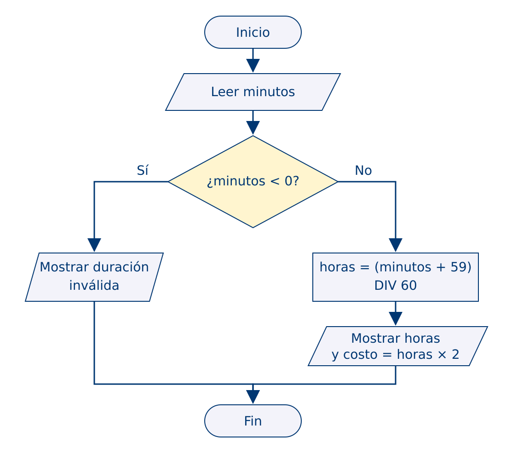
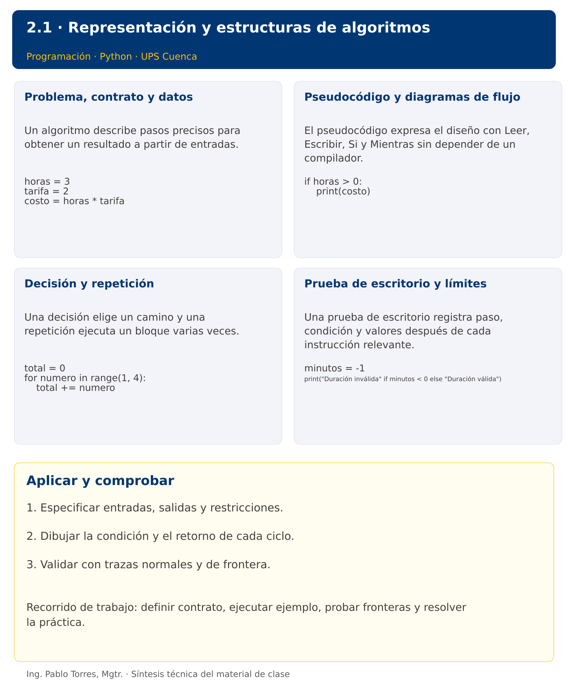

# Programación


## 2.1 · Representación y estructuras de algoritmos · Python

**Autor:** Ing. Pablo Torres, Mgtr.  
**Unidad 2:** Algoritmos  


[Índice del curso](../../../README.md) · [Versión Java](../java/material.md) 

[Conceptos](#concepto-1) · [Demostración](#demostracion) · [Práctica de clase](#pc) · [Lo esencial](#esencial)

**Contexto.** Calcular el costo de un estacionamiento exige acordar qué significa una fracción de hora y qué ocurre con una duración inválida. El algoritmo debe resolver esas decisiones antes de elegir Python o Java.

**Prerrequisitos.** Álgebra de Boole y operaciones aritméticas.

## 1. Conceptos y ejemplos

<a id="concepto-1"></a>

### 1.1. Problema, contrato y datos

Un algoritmo describe pasos precisos para obtener un resultado a partir de entradas. Delimitar qué datos recibe, sus unidades y rangos, qué entrega y qué casos rechaza. Un contrato distingue precondiciones de postcondiciones. “Calcular un promedio” es incompleto si no se define qué ocurre con cero observaciones. Descomponer el problema en lectura, procesamiento y presentación evita mezclar reglas con mensajes.

**Aplicar en Python.** Usar nombres descriptivos y traducir una operación por paso. La ejecución secuencial permite observar cómo cambia cada variable. En esta unidad, priorizar el diseño y la traza sobre la sintaxis.

```python
horas = 3
tarifa = 2
costo = horas * tarifa
```

<a id="concepto-2"></a>

### 1.2. Pseudocódigo y diagramas de flujo

El pseudocódigo expresa el diseño con Leer, Escribir, Si y Mientras sin depender de un compilador. Un diagrama de flujo representa inicio y fin con terminales, entrada y salida con paralelogramos, procesos con rectángulos y decisiones con rombos. Rotular las ramas de una decisión. Un retorno de una flecha debe mostrar dónde se vuelve a comprobar la condición. Mantener correspondencia entre ambos formatos.

**Aplicar en Python.** La sangría de Python también delimita bloques: no es solo presentación. Al traducir pseudocódigo, reemplazar palabras de diseño por instrucciones válidas y conservar la misma condición.

```python
if horas > 0:
    print(costo)
```

<a id="concepto-3"></a>

### 1.3. Decisión y repetición

Una decisión elige un camino y una repetición ejecuta un bloque varias veces. Definir primero si se conoce el número de repeticiones. Un ciclo necesita estado inicial, condición de permanencia y actualización que acerque al final. Un contador mide ocurrencias y un acumulador combina valores. En una suma, inicializar el acumulador en cero; en un producto, en uno.

**Aplicar en Python.** Usar if para selección, while para repetición condicionada y for para recorrer una secuencia. No modificar la variable de control por intuición: escribir la traza y observar si progresa.

```python
total = 0
for numero in range(1, 4):
    total += numero
```

<a id="concepto-4"></a>

### 1.4. Prueba de escritorio y límites

Una prueba de escritorio registra paso, condición y valores después de cada instrucción relevante. Seleccionar un caso normal, el mínimo permitido, un valor fuera de dominio y un caso que tome la otra rama. La traza permite encontrar errores lógicos aun cuando el programa ejecuta. Terminar no demuestra que el resultado sea correcto; una prueba aislada tampoco cubre todas las entradas.

**Aplicar en Python.** Comparar la salida del programa con una tabla calculada de forma independiente. Mostrar datos concretos y mensajes de rechazo, sin presentar una excepción técnica como respuesta del dominio.

```python
minutos = -1
print("Duración inválida" if minutos < 0 else "Duración válida")
```

Los bloques breves anteriores ilustran una operación y pueden requerir variables o imports del contexto. Utilizar la demostración siguiente como programa completo.


### Diagrama de la demostración



### Síntesis visual



<a id="demostracion"></a>

## 2. Demostración guiada

**Problema.** Calcular las horas iniciadas y el costo de una estancia de 125 minutos a tarifa 2 por hora iniciada.

**Contrato de esta demostración.** Recibir minutos enteros no negativos. Para cero, obtener cero horas y costo cero. Rechazar negativos. La demostración fija 125; modificar esa asignación para probar 0, 60, 61 y -1.

**Regla de estacionamiento.** Cobrar 2 por cada hora iniciada. Una duración de cero minutos cuesta cero. Rechazar duraciones negativas. Para enteros no negativos, calcular horas como (minutos + 59) dividido enteramente por 60.

```text
Leer minutos
Si minutos < 0 Entonces
    Escribir "Duración inválida"
SiNo
    horas <- (minutos + 59) DIV 60
    Escribir horas, horas * 2
FinSi
```

**Fuente:** [ejemplos/demo.py](ejemplos/demo.py).

<!-- example: demo.py -->
```python
minutos = 125
if minutos < 0:
    print("Duración inválida")
else:
    horas = (minutos + 59) // 60
    print(f"Horas: {horas}")
    print(f"Costo: {horas * 2}")
```

### Ejecutar

Abrir una terminal dentro de `02/2.1-algoritmos/python/ejemplos/` y ejecutar:

```bash
python3 demo.py
```

En Windows, usar `py` en lugar de `python3` si esa es la instalación disponible. Comprobar primero su versión.

### Salida esperada

```text
Horas: 3
Costo: 6
```

**Interpretación.** Seguir las asignaciones y los bloques en orden, identificar qué instrucción produce cada línea y contrastar con el contrato. Modificar un dato por vez y anticipar el resultado antes de ejecutar. La salida de referencia es una expectativa; el registro de verificaciones indica qué ejecuciones se realizaron.

<a id="pc"></a>

## 3. PC2.1 · Práctica de clase

Diseñar un algoritmo para sumar consumos enteros no negativos hasta recibir -1. Rechazar otros negativos sin acumularlos. Producir pseudocódigo, diagrama y prueba de escritorio. Mostrar cantidad y suma; no calcular promedio cuando no existan datos. Implementar en un lenguaje solo después de comprobar el diseño.

### Requisitos y restricciones

- Resolver en una sola versión, Python o Java.
- Mantener nombres y responsabilidades indicados; explicar cualquier adaptación idiomática.
- Aplicar únicamente los conceptos ya introducidos.
- Conservar las entradas cuando el enunciado lo exija.
- Distinguir valores fuera de contrato de errores que el programa debe gestionar.

### Casos de aceptación de la PC

| Entrada / escenario | Resultado esperado |
|---|---|
| 5, 3, -1 | cantidad 2; suma 8 |
| -1 | cantidad 0; suma 0 |
| -2, 4, -1 | rechazar -2; cantidad 1; suma 4 |

### Probar y registrar evidencia

Crear una carpeta personal `PC2.1` separada de las demostraciones. Guardar cada caso con entrada, resultado esperado y resultado real. Ejecutar `python3 solucion.py` desde esa carpeta. Para entradas de teclado, guardar `casos/entrada-01.txt` y redirigirla con `< casos/entrada-01.txt`. Para funciones, crear llamadas con los datos de la tabla.

- Registrar `evidencias/PC2.1.md` con comandos, versión real, salidas y explicación.
- Crear un commit funcional como `feat(pc2.1): implementar-regla-principal`.
- Obtener el hash real con `git rev-parse HEAD` y anotarlo en la evidencia.
- Revisar el cambio con `git show HASH` y comparar avances con `git diff HASH_ANTERIOR HASH_ACTUAL`. Sustituir los marcadores por hashes reales.
- Agregar una prueba de frontera distinta de las incluidas y justificar qué error detectaría.

No se requiere proyecto acumulativo ni rúbrica individual de esta PC.

<a id="esencial"></a>

## Lo esencial

- Especificar entradas, salidas y restricciones.
- Dibujar la condición y el retorno de cada ciclo.
- Validar con trazas normales y de frontera.

## Referencias técnicas

- [Tutorial oficial de Python](https://docs.python.org/3.14/tutorial/)
- [Biblioteca estándar de Python](https://docs.python.org/3.14/library/)

[Índice del curso](../../../README.md) · [Versión Java](../java/material.md) 