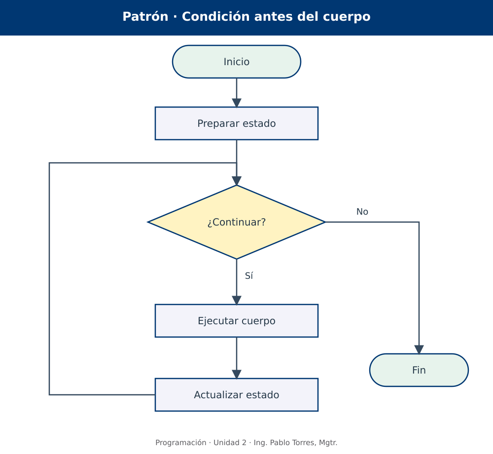
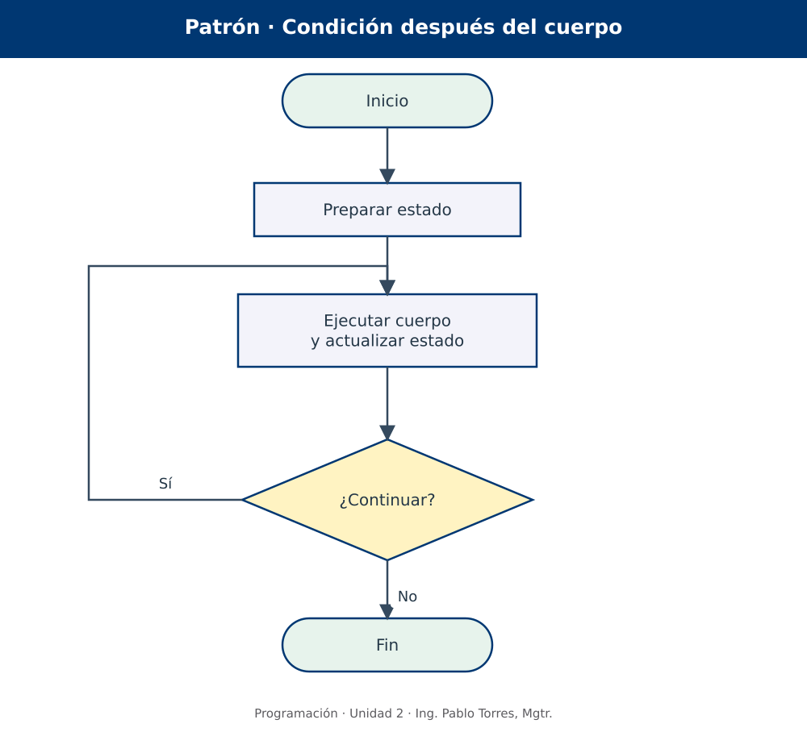
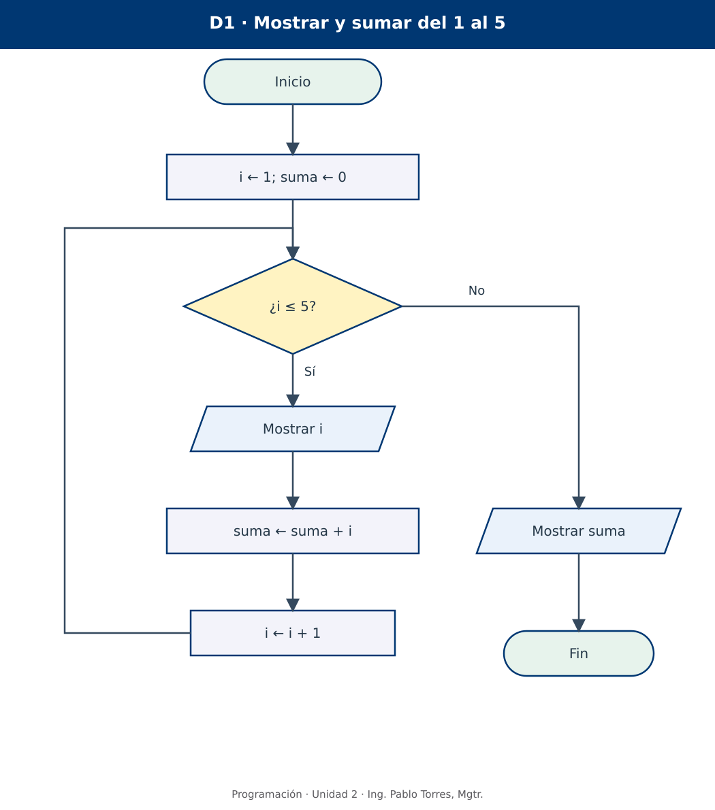
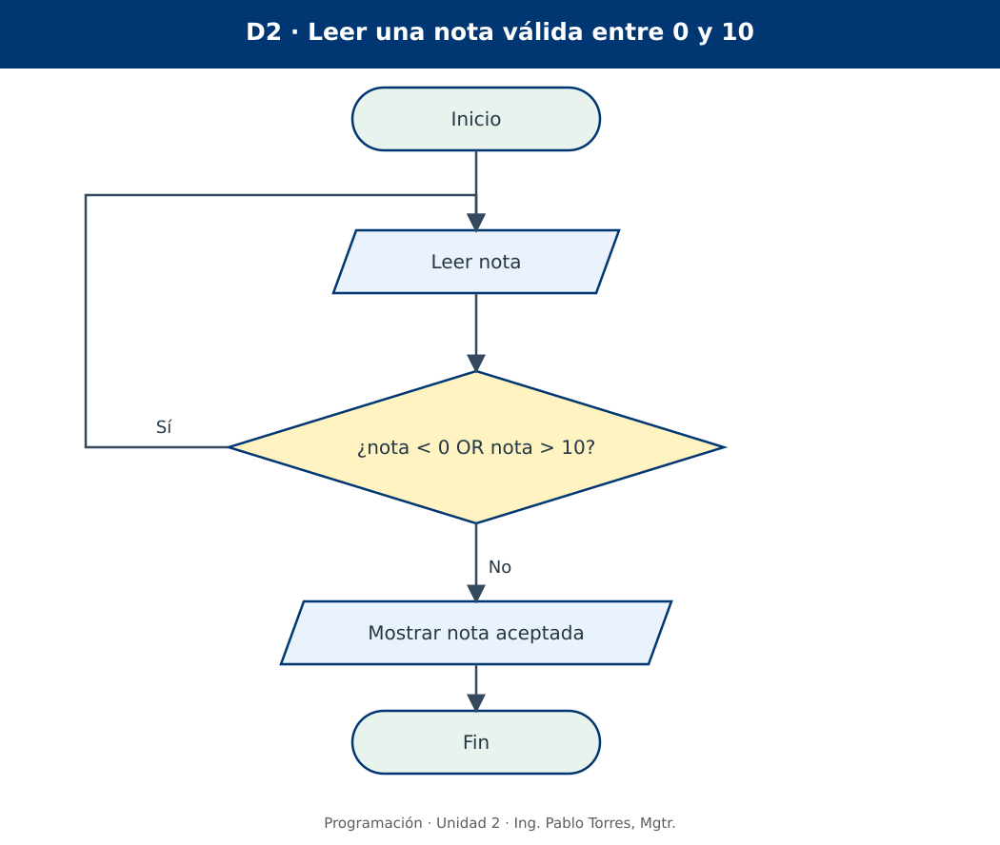
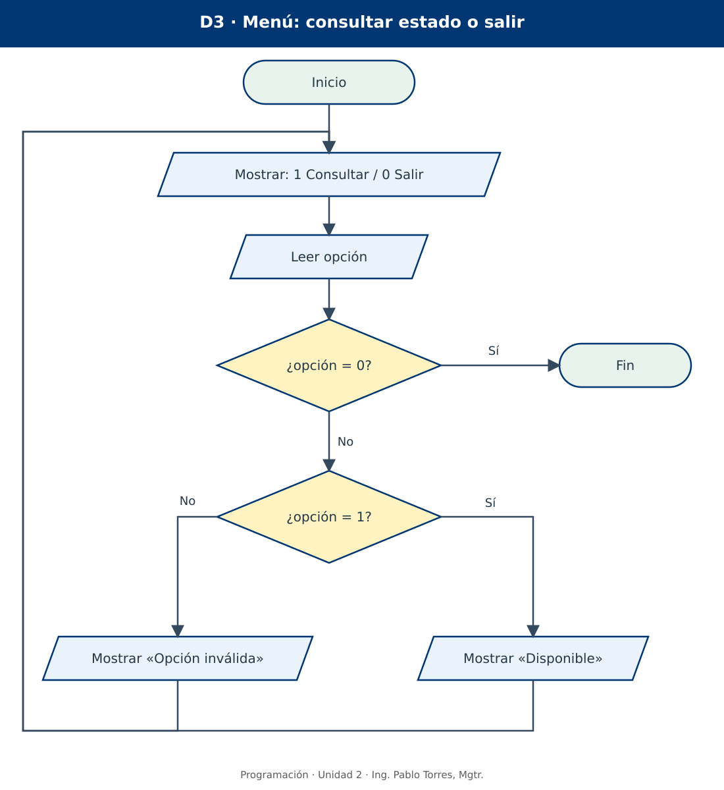
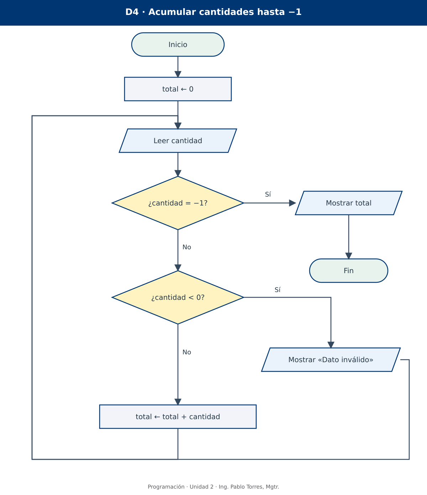
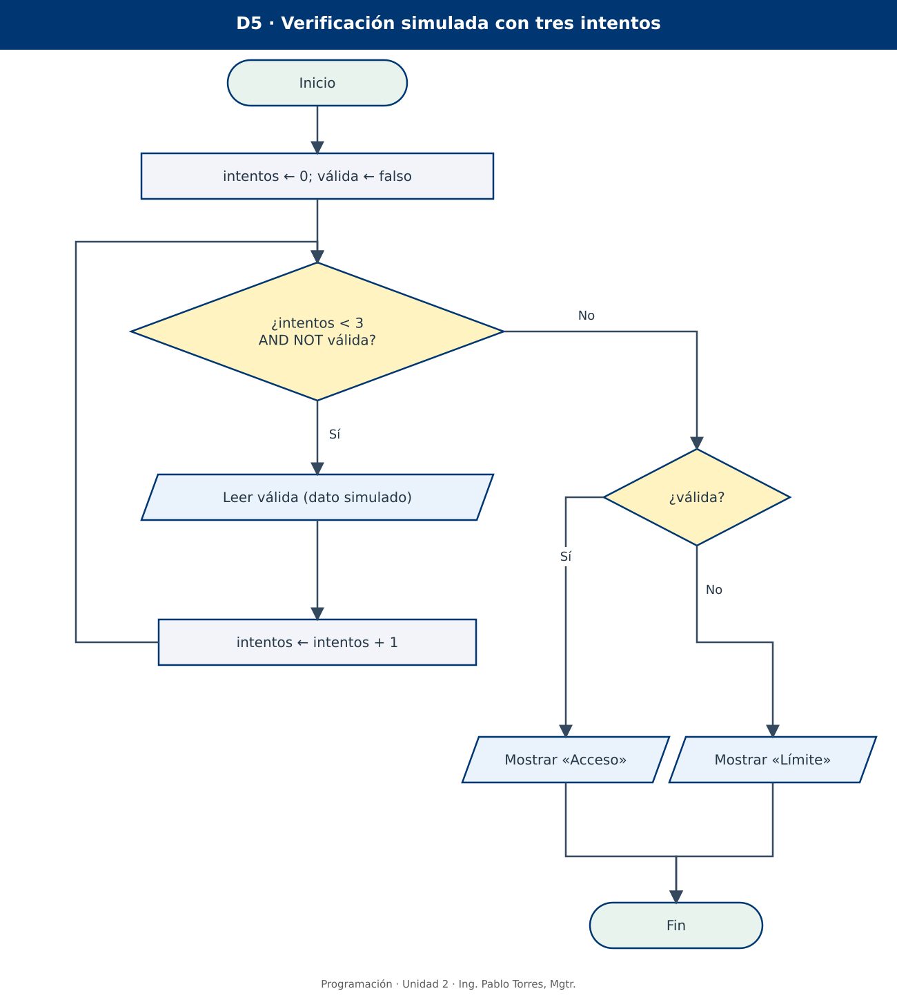

# Programación

## 2.2 · Algoritmos con bucles · Python

**Autor:** Ing. Pablo Torres, Mgtr.  
**Unidad 2:** Algoritmos · sección de organización didáctica  
**Institución:** Universidad Politécnica Salesiana · Computación · Cuenca

[Versión Java](../java/material.md) · [Anterior: fundamentos y decisiones](../../2.1-algoritmos/python/material.md)

[Conceptos](#concepto-1) · [Demostraciones](#demostracion) · [Práctica de clase](#pc) · [Lo esencial](#esencial)

**Contexto.** Organizar acciones que se repiten sin perder el control de los datos, las condiciones ni el final del procedimiento. Los diagramas permiten estudiar la repetición antes de escribir código.

**Prerrequisitos.** Sección 2.1: contrato, asignación, figuras, decisiones, condiciones compuestas y pruebas de escritorio.

**Cómo estudiar.** Leer la teoría, seguir cada diagrama con un lápiz o una traza y resolver los enunciados en un editor de diagramas. Las versiones Python y Java comparten los problemas, figuras y casos; estudiar una sola versión es suficiente. No se exige programar en esta unidad.

<a id="concepto-1"></a>

## 1. Conceptos y ejemplos

### 1.1. De una decisión a una repetición

Una decisión permite elegir un camino; un **bucle** permite volver a ejecutar una parte del procedimiento. Cada recorrido completo del cuerpo se llama **iteración**. Revisar una sola solicitud requiere decisiones. Revisar varias solicitudes hasta recibir una señal de cierre requiere, además, una repetición.

Repetir no significa copiar muchas veces los mismos rectángulos. Si se deben registrar cien mediciones, una cadena de cien lecturas sería difícil de mantener y no serviría para otra cantidad. Un bucle expresa la regla que organiza esas lecturas, el estado que cambia y el criterio que determina cuándo dejar de repetir.

En un diagrama, el retorno se representa mediante una flecha que vuelve a un punto anterior. El retorno por sí solo no basta: debe existir una condición comprensible de continuación o salida, y alguna operación debe permitir que cambie. Las figuras conservan las funciones de la sección anterior: paralelogramo para entrada/salida, rectángulo para proceso y rombo para decisión.

| Elemento del bucle | Función | Ejemplo al mostrar del 1 al 5 |
|---|---|---|
| Preparación | Establece el estado inicial | i ← 1 |
| Condición | Decide si se realiza otra iteración | ¿i ≤ 5? |
| Cuerpo | Trabajo que se repite | Mostrar i |
| Actualización | Cambia el estado relevante | i ← i + 1 |
| Salida | Continuación cuando termina la repetición | Mostrar resumen o Fin |

La actualización puede ser una suma, una nueva lectura o el cambio de una bandera booleana. No todos los bucles tienen un contador. Lo importante es identificar qué permite que el recorrido avance hacia su terminación.

### 1.2. Estado y asignación: por qué i ← i + 1 es posible

La expresión `i ← i + 1` no es una igualdad matemática. Ordena tomar el valor anterior de i, sumarle uno y almacenar el resultado en i. Si antes valía 2, después vale 3. El valor anterior se usa en la evaluación y luego se reemplaza.

| Antes | Instrucción | Después |
|---|---|---|
| i = 2 | i ← i + 1 | i = 3 |
| total = 12; dato = 5 | total ← total + dato | total = 17; dato = 5 |
| válida = falso | válida ← resultado de una comprobación verdadera | válida = verdadero |

Un bucle puede depender de varios valores. Para entenderlo, no registrar únicamente el contador: también la suma, el dato leído o las banderas que intervienen en la condición. Un estado inicial omitido produce ambigüedad; un valor que «parece obvio» para el autor no necesariamente lo es para quien ejecuta el diagrama.

<a id="patrones"></a>

### 1.3. Condición antes del cuerpo: cero o más iteraciones

Se prepara el estado y se pregunta si debe continuar. Si la respuesta es Sí, se ejecuta el cuerpo, se actualiza el estado y se vuelve a preguntar. Si es No desde el principio, el cuerpo no se ejecuta ninguna vez.



Este patrón es apropiado cuando el trabajo podría no ser necesario: procesar solicitudes mientras queden, mostrar números hasta un límite o repetir mientras no se alcance una meta. La condición se vuelve a evaluar con el estado actualizado; no se decide una sola vez al inicio.

**Ejemplo mental.** Con `i ← 1` y condición `i ≤ N`, si N vale 0 no se muestra ningún número. Eso puede ser correcto si el contrato permite una cantidad cero. Cambiar a una condición posterior introduciría una ejecución no solicitada.

### 1.4. Condición después del cuerpo: una o más iteraciones

Se ejecuta el cuerpo al menos una vez y luego se evalúa si debe repetirse. Resulta natural para solicitar un dato que todavía no existe: primero leer una nota, después revisar si está dentro del intervalo permitido. El mínimo de una iteración describe el cuerpo del bucle, no cualquier operación del diagrama.



Hay dos maneras equivalentes de formular la pregunta final, pero **las etiquetas del retorno cambian**:

| Pregunta al final | Volver al cuerpo cuando… | Salir cuando… |
|---|---|---|
| ¿El dato es inválido? | Sí | No |
| ¿El dato es válido? | No | Sí |

No se debe copiar una flecha de retorno sin leer la pregunta del rombo. «Repetir mientras sea inválido» y «repetir hasta que sea válido» describen el mismo objetivo con condiciones opuestas. Para una nota de 0 a 10, la condición de invalidez es `nota < 0 OR nota > 10`; la de validez es `nota ≥ 0 AND nota ≤ 10`.

### 1.5. Repetición contada: cantidad conocida

Cuando se conoce la cantidad de repeticiones, se organiza un contador con inicio, límite y paso. Para mostrar del 1 al 5: iniciar i en 1; repetir si i ≤ 5; mostrar i; aumentar i en 1. La condición es previa y el valor 5 está incluido.

| Recorrido | Inicio | Condición de continuación | Actualización | Valores visitados |
|---|---|---|---|---|
| Ascendente inclusivo | i ← 1 | i ≤ 5 | i ← i + 1 | 1, 2, 3, 4, 5 |
| Ascendente de dos en dos | i ← 2 | i ≤ 8 | i ← i + 2 | 2, 4, 6, 8 |
| Descendente inclusivo | i ← 5 | i ≥ 1 | i ← i − 1 | 5, 4, 3, 2, 1 |
| Cero tareas | i ← 1 | i ≤ 0 | i ← i + 1 | Ninguno |

Para enteros consecutivos desde a hasta b incluidos, con paso 1 y a ≤ b, hay `b − a + 1` valores. Si a > b, el recorrido ascendente anterior no tiene iteraciones. No aplicar esa fórmula sin considerar el sentido y el paso. Si se requiere un paso positivo, un paso cero es un dato inválido porque impide avanzar.

### 1.6. Contadores, acumuladores y banderas

Un **contador** registra cuántas veces ocurre un evento. Un **acumulador** combina valores sucesivos. Una **bandera** es una variable booleana que registra un estado relevante. Sus nombres no los distinguen: los distingue su función.

| Recurso | Inicialización habitual | Actualización | Qué expresa |
|---|---|---|---|
| Contador de lecturas | lecturas ← 0 | lecturas ← lecturas + 1 tras cada lectura | Cuántos intentos se realizaron |
| Contador de aceptados | aceptados ← 0 | Aumentar solo si el dato es válido | Cuántos datos se procesaron |
| Acumulador de suma | total ← 0 | total ← total + dato | Suma de los valores admitidos |
| Acumulador de producto | producto ← 1 | producto ← producto × factor | Producto de los factores |
| Bandera de éxito | logrado ← falso | Cambiar a verdadero al alcanzar la meta | Si ocurrió la condición buscada |

Inicializar un producto en cero anula todos los factores. Inicializar una suma dentro del cuerpo borra el progreso anterior. Incrementar «aceptados» antes de validar cuenta datos que no debían contarse. Estas decisiones deben aparecer en la posición correcta del diagrama.

**Promedio.** El promedio de los datos aceptados es `total / aceptados`, pero solo si aceptados > 0. Cuando no hay datos, se necesita una salida definida, por ejemplo «Sin datos». No se reemplaza automáticamente esa situación por promedio cero: cero podría ser un promedio legítimo de datos existentes.

<a id="validacion"></a>

### 1.7. Validación, centinelas y menús

**Validación repetida.** Si el dato es inválido, se solicita uno nuevo. El retorno debe alcanzar la lectura, no solamente el rombo: reevaluar el mismo valor no lo corrige. El contrato también debe indicar si los intentos están limitados o si se supone que eventualmente llegará un dato válido.

**Dato centinela.** Es un valor reservado que indica el final de las entradas. Para acumular cantidades no negativas, se puede reservar −1. Ese valor controla el recorrido y no se suma. Conviene comprobar primero si llegó el centinela y después validar los datos ordinarios. Si −1 fuera una cantidad legítima del dominio, ya no serviría como centinela sin una regla adicional.

**Menú repetitivo.** Se muestran opciones, se lee una elección, se realiza una acción y se vuelve a mostrar el menú, salvo que se haya elegido salir. Una opción inválida debe tener comportamiento definido. El menú no obliga a usar un rombo con muchas salidas: se puede representar mediante decisiones binarias encadenadas.

| Situación | Motivo para repetir | Salida prevista | Caso crítico |
|---|---|---|---|
| Validar una nota | La nota no pertenece al dominio | Llega una nota válida | El retorno debe leer otra nota |
| Recibir cantidades | No ha llegado −1 | Llega el centinela | −1 como primera entrada |
| Consultar un menú | No se eligió terminar | Opción de salida | Opción desconocida |
| Intentos limitados | No hay éxito y quedan intentos | Éxito o límite alcanzado | Éxito en el último intento |

### 1.8. Condiciones compuestas para controlar repeticiones

Si un procedimiento continúa solamente mientras quedan intentos **y** no ha tenido éxito, su condición es `intentos < máximo AND NOT logrado`. La salida ocurre al alcanzar el máximo **o** al lograr el objetivo. La conjunción de continuación y la disyunción de salida son negaciones entre sí, según De Morgan.

Usar OR en la continuación de ese ejemplo sería un error: aunque se hubiera alcanzado el máximo, «no logrado» seguiría siendo verdadero y permitiría más intentos. También podría continuar después de un éxito mientras quedaran intentos. Probar esos dos casos es más esclarecedor que memorizar una expresión.

En una simulación de acceso, una entrada booleana puede representar que una verificación externa fue satisfactoria. El diagrama estudia el control de intentos; no demuestra que exista autenticación segura ni requiere contraseñas reales.

<a id="terminacion"></a>

### 1.9. Terminación, errores de frontera e invariantes

Una repetición debe tener una explicación de su avance. En el conteo 1 a 5, i aumenta y supera un límite fijo. En la validación sin límite, el algoritmo solo termina si finalmente se recibe un dato válido: no se puede prometer terminación independientemente de la entrada. En un menú, se requiere que la persona elija salir. Limitar intentos transforma esa dependencia en una cota explícita para las lecturas.

Un **invariante de bucle** es una propiedad que se conserva cada vez que se alcanza un punto acordado de la repetición. No significa que todas las variables permanezcan iguales. En la suma del 1 al 5, justo antes de evaluar `i ≤ 5`, la variable suma contiene la suma de los enteros desde 1 hasta i − 1. Al principio, i = 1 y suma = 0: todavía no se ha incluido ningún entero. Después de añadir i y aumentarlo en uno, la misma relación vuelve a cumplirse.

Para justificar un bucle conviene revisar tres aspectos: la preparación establece la propiedad; el cuerpo la conserva al avanzar; y al salir, la propiedad junto con la condición falsa explica el resultado. En este nivel basta escribir ese razonamiento con palabras y una traza breve.

| Error | Consecuencia | Cómo detectarlo |
|---|---|---|
| No actualizar i | La condición podría no cambiar nunca | Trazar dos iteraciones y comparar el estado |
| Aumentar i cuando debería disminuir | Se aleja del límite de salida | Revisar sentido, condición y paso juntos |
| Usar `<` en lugar de `≤` | Se omite el extremo superior | Probar el último valor esperado |
| Actualizar antes de mostrar sin ajustar el diseño | Se omite el primer valor o se agrega uno extra | Trazar la primera y la última iteración |
| Reiniciar total dentro del cuerpo | Solo queda el último dato | Probar al menos dos valores distintos |
| Sumar antes de comprobar el centinela | Se contamina el resultado | Probar el centinela como primera entrada |
| Dividir entre cero aceptados | El resumen no está definido | Probar una secuencia sin datos válidos |

### 1.10. Bucles anidados: una repetición dentro de otra

Un bucle puede contener otro. Si se recorren dos filas y, para cada una, tres columnas, el cuerpo interior se ejecuta seis veces. El contador de columna debe reiniciarse para cada nueva fila. Si no se reinicia, después de la primera fila puede quedar fuera de su límite y omitir las siguientes.

| Fila exterior | Valores de columna | Pares producidos |
|---|---|---|
| 1 | 1, 2, 3 | (1,1), (1,2), (1,3) |
| 2 | 1, 2, 3 | (2,1), (2,2), (2,3) |

El producto de cantidades sirve cuando ambos límites son fijos e independientes. Si el interior depende de la fila o puede terminar antes, el número de ejecuciones se debe analizar de otra manera. El objetivo inicial es reconocer el reinicio, no introducir todavía estructuras de datos bidimensionales.

### 1.11. Conexión breve con Python — lectura complementaria

Las operaciones de actualización del diagrama se expresarán en Python con asignaciones. Esta secuencia muestra un solo cambio de estado, no implementa todavía el bucle:

```python
i = 1
total = 0
total = total + i
i = i + 1
```

Al terminar el fragmento, total vale 1 e i vale 2. Al implementar repeticiones habrá que añadir su estructura de control; la flecha de retorno del diagrama no se traduce como un salto escrito libremente. La práctica actual exige diseñar y trazar diagramas, sin requerir programación.


<a id="demostracion"></a>

## 2. Demostraciones guiadas

Los resultados son **salidas esperadas del modelo** y las tablas muestran pruebas de escritorio desarrolladas. No es necesario ejecutar Python o Java para verificar el razonamiento. Leer cada rombo antes de seguir su flecha de retorno.

### D1. Repetición contada con acumulación

**Problema y contrato.** Mostrar los enteros del 1 al 5 y, al terminar, mostrar su suma. No se reciben entradas. El contador comienza en 1 y el acumulador en 0; la suma se muestra una sola vez, fuera del bucle.



| Evaluación | i antes | suma antes | ¿i ≤ 5? | Acción del cuerpo | i después | suma después |
|---|---|---|---|---|---|---|
| 1 | 1 | 0 | Sí | Mostrar 1; sumar 1 | 2 | 1 |
| 2 | 2 | 1 | Sí | Mostrar 2; sumar 2 | 3 | 3 |
| 3 | 3 | 3 | Sí | Mostrar 3; sumar 3 | 4 | 6 |
| 4 | 4 | 6 | Sí | Mostrar 4; sumar 4 | 5 | 10 |
| 5 | 5 | 10 | Sí | Mostrar 5; sumar 5 | 6 | 15 |
| 6 | 6 | 15 | No | No se ejecuta | 6 | 15 |

**Resultado:** se muestran 1, 2, 3, 4 y 5; después, suma = 15. Hay cinco ejecuciones del cuerpo y seis evaluaciones de la condición. El valor final i = 6 no se muestra como parte de la secuencia. Termina porque i aumenta en uno y el límite 5 no cambia.

### D2. Validación con condición posterior

**Problema y contrato.** Solicitar notas numéricas hasta recibir una en [0,10]. Las entradas ya son números; no se estudia aquí la conversión de texto. El procedimiento acepta 0 y 10. El único mensaje de resultado es la nota aceptada.



| Lectura | Nota | ¿nota < 0 OR nota > 10? | Recorrido |
|---|---|---|---|
| 1 | −2 | Sí | Volver a Leer nota |
| 2 | 11 | Sí | Volver a Leer nota |
| 3 | 8 | No | Mostrar nota aceptada: 8; terminar |

La lectura pertenece al cuerpo y se realiza al menos una vez. No existe un contador porque no se limita el número de intentos. Si nunca llega una nota válida, este modelo no termina. **Positivo** significa mayor que cero; **no negativo** significa mayor o igual que cero. Confundir esas expresiones cambia el contrato y el camino del cero.

### D3. Menú con salida explícita

**Problema y contrato.** Presentar dos opciones: 1 Consultar; 0 Salir. La opción 1 muestra «Disponible» y vuelve al menú. Cualquier otra opción entera muestra «Opción inválida» y vuelve al menú. La opción 0 termina sin ejecutar una consulta.



| Opción leída | ¿opción = 0? | ¿opción = 1? | Resultado antes del siguiente paso |
|---|---|---|---|
| 7 | No | No | Opción inválida; volver a mostrar menú |
| 1 | No | Sí | Disponible; volver a mostrar menú |
| 0 | Sí | No se evalúa | Fin |

El retorno incluye la presentación del menú y una nueva lectura. La condición de salida se prueba antes de ejecutar acciones. Este menú termina si se recibe 0; no existe un máximo de consultas en el contrato.

### D4. Centinela, validación y acumulador

**Problema y contrato.** Leer cantidades enteras no negativas y sumarlas. El valor −1 señala el final; otros negativos se rechazan con un mensaje y no alteran el total. Al terminar, mostrar total. Se supone que eventualmente se recibirá −1.



| Lectura | Cantidad | ¿Es −1? | ¿Es negativa ordinaria? | Total después | Acción |
|---|---|---|---|---|---|
| 1 | 4 | No | No | 4 | Acumular y leer otra |
| 2 | −3 | No | Sí | 4 | Mostrar Dato inválido y leer otra |
| 3 | 0 | No | No | 4 | Acumular y leer otra |
| 4 | 6 | No | No | 10 | Acumular y leer otra |
| 5 | −1 | Sí | No se evalúa | 10 | Mostrar total 10; terminar |

**Caso vacío:** si la primera entrada es −1, se muestra total 0. Ese cero procede del elemento neutro de la suma; no significa que se haya procesado un dato con valor cero. El orden de comprobación impide rechazar por error la señal de cierre o incluirla en la suma.

### D5. Tres intentos de verificación simulada

**Problema y contrato.** Recibir resultados booleanos de verificaciones simuladas, uno por intento. Permitir como máximo tres lecturas. Terminar al primer resultado verdadero o al agotarse los intentos. Mostrar «Acceso» si hubo éxito y «Límite» si no. El proceso representa control de flujo, no un mecanismo real de autenticación.



| Estado antes del rombo | ¿intentos < 3 AND NOT válida? | Entrada si se repite | Estado tras el cuerpo |
|---|---|---|---|
| intentos = 0; válida = F | Sí | F | intentos = 1; válida = F |
| intentos = 1; válida = F | Sí | F | intentos = 2; válida = F |
| intentos = 2; válida = F | Sí | V | intentos = 3; válida = V |
| intentos = 3; válida = V | No | No se lee | Mostrar Acceso |

| Secuencia disponible | Entradas consumidas | Resultado |
|---|---|---|
| V | 1 | Acceso |
| F, V | 2 | Acceso |
| F, F, V | 3 | Acceso |
| F, F, F, V | 3 | Límite; el cuarto valor no se lee |

El éxito en el tercer intento es válido. Por eso, después de salir, se consulta la bandera válida; no se decide el éxito únicamente por `intentos < 3`. El contador aumenta después de cada lectura, sea favorable o desfavorable. La terminación está acotada por tres lecturas.

<a id="pc"></a>

## 3. PC2.2 · Construir y comprobar repeticiones

### Forma de trabajo y evidencia

Usar un editor de diagramas y entregar archivo editable más exportación SVG o PNG. No se exige código ni herramientas con una marca determinada. Cada diagrama debe incluir preparación, cuerpo, condición, actualización y salida reconocibles. Las flechas de retorno deben llegar al paso correcto y los rombos deben tener salidas Sí/No.

Antes de dibujar, explicar si la cantidad de iteraciones es conocida, si puede ser cero y qué garantiza o condiciona la terminación. Después, hacer una traza que registre **estado antes, condición, datos consumidos, estado después y salida**. Un conjunto de valores de entrada se consume en orden; no se supone que todas las entradas se leen si el bucle termina antes.

### Serie A · Conteos y límites

1. **Conteo ascendente.** Mostrar del 1 al 8, incluidos. Registrar primera y última iteración y la evaluación que permite salir. No mostrar el 9.
2. **Cuenta regresiva.** Mostrar del 5 al 1 y luego «Inicio de actividad». Explicar por qué aumentar el contador impediría cumplir el contrato.
3. **Pares.** Mostrar 2, 4, 6, 8, 10 y 12 mediante un paso de dos. No usar una decisión de paridad dentro del cuerpo. Registrar el valor del contador al salir.
4. **Límite variable.** Recibir N entero no negativo, garantizado válido. Mostrar del 1 a N. Para N = 0 no mostrar números; para N = 1 mostrar solo 1. Explicar el mínimo de iteraciones.
5. **Tabla de productos.** Recibir un entero n y mostrar n × i para i de 1 a 10. Incluir multiplicador y producto en cada salida. Probar n = 0 y n = −2.
6. **Intervalo descendente.** Recibir enteros a y b con a ≥ b. Mostrar desde a hasta b, incluidos. Para a = b debe existir una sola salida. Formular la condición y el paso de manera coherente.

### Serie B · Acumulación y conteos selectivos

7. **Suma de N entradas.** Recibir N entero no negativo y luego exactamente N números reales. Mostrar la suma. Caso N = 0 → suma 0; N = 3 y datos 2, −1, 4 → suma 5.
8. **Promedio fijo.** Leer cinco notas ya garantizadas en [0,10]. Mostrar el promedio. No validar en esta versión. Si todas son 7, se espera 7.
9. **Positivos y no positivos.** Leer seis enteros. Contar por separado los mayores que cero y los demás. Para 2, 0, −1, 5, 3, −7 se esperan tres en cada grupo. El cero pertenece a no positivos.
10. **Producto.** Recibir N entero no negativo y después N factores reales. Mostrar el producto; se acuerda producto 1 cuando N = 0. Probar N = 3 con 2, 3, 4 → 24 y otra secuencia que incluya cero.
11. **Mayor de varias lecturas.** Recibir N entero positivo y luego N reales, que pueden ser negativos. Mostrar el mayor. No inicializar el mayor en cero: proponer una inicialización basada en los datos. Casos: N = 1 con −8 → −8; N = 3 con −4, −9, −2 → −2.
12. **Ahorro por aportes.** Recibir aportes positivos hasta alcanzar o superar 100. Mostrar total y cantidad de aportes. Con 40, 35, 30 se esperan total 105 y tres aportes. Se supone que los aportes recibidos permiten llegar a la meta en un número finito de lecturas.

### Serie C · Validación y finalización

13. **Número estrictamente positivo.** Leer enteros hasta obtener uno mayor que cero. Rechazar también el cero. Para −2, 0, 4, aceptar 4 después de tres lecturas. Mostrar el número de lecturas.
14. **No negativo.** Modificar el requisito anterior para aceptar cero. Para −2, 0, 4, aceptar 0 después de dos lecturas; el 4 no se consume. Explicar qué cambió en la condición.
15. **Confirmación.** Leer un texto hasta recibir SI o NO. Se garantiza que las entradas están en mayúsculas y sin espacios. Cualquier otro valor debe producir «Respuesta inválida» y una nueva lectura. Al terminar, mostrar la respuesta aceptada.
16. **Tres notas válidas.** Recibir entradas numéricas hasta reunir tres notas en [0,10]. Las inválidas no cuentan ni se suman. Mostrar promedio y cantidad total de lecturas. Para 11, 6, −1, 8, 10 se esperan promedio 8 y cinco lecturas.
17. **Centinela textual.** Leer cantidades enteras no negativas hasta recibir la señal textual FIN. Se garantiza que cada entrada es FIN o un entero no negativo. Mostrar cantidad de datos y suma. Con FIN como primera entrada, ambos resultados son cero. Explicar cómo se evita confundir la señal con un dato.
18. **Temperaturas con centinela separado.** Recibir primero un booleano hayDato. Mientras sea verdadero, leer una temperatura real, acumularla y volver a leer hayDato. Mostrar promedio si hubo temperaturas; en otro caso, «Sin datos». Las temperaturas negativas son válidas y no deben usarse como señal de cierre.

### Serie D · Menús y requerimientos aplicados

19. **Menú de conversión.** Repetir un menú con 1 Convertir minutos a segundos y 0 Salir. Para opción 1, leer minutos no negativos garantizados y mostrar segundos. Otras opciones enteras muestran aviso. Con entradas de opciones 1, 7, 0 y minutos 2 para la primera acción, deben aparecer 120 segundos y un aviso; después terminar.
20. **Conteo de solicitudes.** Procesar estados APROBADA o RECHAZADA hasta recibir FIN. Otros textos muestran aviso y no cuentan. Mostrar total procesado y porcentaje de aprobadas cuando exista al menos una. Con FIN inicial, mostrar «Sin solicitudes» sin dividir entre cero.
21. **Revisión simulada de alertas.** Recibir N entero no negativo y luego N niveles ya válidos: BAJO, MEDIO o ALTO. Contar los ALTO y mostrar el resumen. N = 0 es válido. No se accede a equipos ni registros reales.
22. **Comprobaciones con límite.** Permitir hasta cuatro entradas booleanas de una verificación simulada y terminar al primer verdadero. Mostrar éxito o agotamiento junto al número de lecturas. Probar éxito en la primera, éxito en la cuarta y cuatro fallos. No solicitar claves reales.
23. **Control de espacio de respaldo.** Recibir capacidad positiva y luego tamaños positivos de archivos simulados; el valor 0 termina. Aceptar un tamaño solo si cabe en el espacio restante; si no cabe, avisar y continuar leyendo. Mostrar usados, restantes y cantidad de archivos aceptados. Con capacidad 10 y tamaños 4, 7, 6, 0: usados 10, restantes 0, aceptados 2. No dividir ni modificar archivos reales.
24. **Rondas de revisión.** Simular dos rondas de tres equipos. Mostrar todos los pares (ronda, equipo) en orden. Usar una repetición dentro de otra y señalar dónde se reinicia el contador de equipo. Escribir los seis pares esperados antes de dibujar.

### Actividad integradora de la PC: recepción limitada de mediciones

Un laboratorio desea aceptar **tres mediciones válidas** de uso de disco expresadas como porcentajes en [0,100], pero permite **como máximo cinco lecturas** numéricas en total. Cada valor fuera del intervalo debe generar «Dato inválido», consumir un intento y no alterar la suma ni la cantidad de aceptados. Detenerse al reunir tres válidos o al realizar cinco lecturas. No usar centinela.

Al terminar, mostrar lecturas realizadas, aceptados, cantidad de aceptados que alcanzan o superan 90, y promedio de los aceptados si hay alguno. Si no hay aceptados, mostrar «Sin datos válidos». Indicar además «Objetivo completo» si se reunieron tres o «Límite alcanzado» si no. Son mediciones simuladas, sin conexión con un sistema real.

| Secuencia disponible | Lecturas | Aceptados | Valores ≥ 90 | Promedio | Estado |
|---|---|---|---|---|---|
| 20, 90, 100 | 3 | 3 | 2 | 70 | Objetivo completo |
| −1, 20, 101, 40, 60 | 5 | 3 | 0 | 40 | Objetivo completo |
| −1, 101, −2, 102, −3 | 5 | 0 | 0 | Sin datos válidos | Límite alcanzado |
| 90, −1, 100, 101, −2 | 5 | 2 | 2 | 95 | Límite alcanzado |
| 0, 0, 0, 100 | 3 | 3 | 0 | 0 | Objetivo completo; no leer el cuarto valor |

**Entregables.** Análisis de entradas y salidas; diagrama editable; imagen; tabla de prueba para todos los casos; explicación de la condición compuesta y de la terminación. Distinguir contadores de lecturas y de aceptados. Proponer una propiedad que se conserve durante la repetición, por ejemplo una relación entre ambos contadores, y justificarla. No entregar una solución de código como sustitución del diagrama.

Guardar `evidencias/PC2.2.md` en la carpeta personal. Si se usa Git, crear un commit identificable como `feat(pc2.2): diagramar-recepcion-limitada`, obtener el hash real con `git rev-parse HEAD` y registrar qué error se corrigió respecto de un avance anterior. Revisar el avance con `git show HASH` o `git diff HASH_ANTERIOR HASH_ACTUAL`. No se requiere proyecto acumulativo ni rúbrica individual.

<a id="esencial"></a>

## Lo esencial

- Un bucle combina estado inicial, condición, cuerpo y cambio de estado.
- Una condición previa admite cero ejecuciones; una posterior exige al menos una.
- Contar lecturas no equivale a contar datos aceptados.
- Un centinela controla la terminación y debe excluirse de los datos procesados.
- La salida depende de la pregunta exacta del rombo; invertir la condición exige invertir sus rutas.
- Revisar la primera iteración, la última y el caso sin datos revela muchos errores.
- Explicar la terminación es parte del diseño, incluso si depende de futuras entradas.

## Referencias de preparación

- Torres, Pablo. *02.02 Algoritmos bucles*. Presentación proporcionada para la asignatura: repetición y patrones, pp. 3–9; validación, pp. 10–13; menú, pp. 14–15; conteos y ejercicios, pp. 16–20. Este material reorganiza los ejemplos y distingue expresamente la aceptación de cero, los contadores y las condiciones de salida.
- Torres, Pablo. *02.01 Algoritmos*. Presentación proporcionada: entrada/proceso/salida y figuras básicas, pp. 7–8 y 14. Se conservan sus objetivos conceptuales y se unifica la notación de los diagramas.
- [Python: referencia oficial de expresiones y operaciones booleanas](https://docs.python.org/3/reference/expressions.html#boolean-operations).

[Versión Java](../java/material.md) · [Anterior: fundamentos y decisiones](../../2.1-algoritmos/python/material.md)
