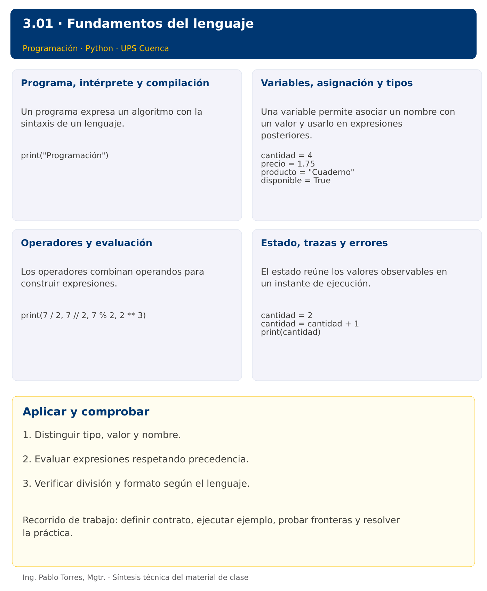

# Programación


## 3.01 · Fundamentos del lenguaje · Java

**Autor:** Ing. Pablo Torres, Mgtr.  
**Unidad 3:** Lenguaje de Programación  


[Versión Python](../python/material.md) · [Presentación Python](../presentacion.pptx) · [Anterior](../../../02/2.1-algoritmos/java/material.md) · [Siguiente](../../3.02-entradas-salidas/java/material.md)

[Conceptos](#concepto-1) · [Demostración](#demostracion) · [Práctica de clase](#pc) · [Lo esencial](#esencial)

**Contexto.** Modelar una compra de cuadernos permite distinguir datos, nombres, expresiones y resultados. El mismo cálculo sirve para contrastar cómo Python y Java representan números y ejecutan instrucciones.

**Prerrequisitos.** Diseño de algoritmos y manejo básico de archivos.

**Versión complementaria.** Estudiar el mismo problema y los mismos casos de Python mediante construcciones idiomáticas de Java. La presentación compartida corresponde a Python.

## 1. Conceptos y ejemplos

<a id="concepto-1"></a>

### 1.1. Programa, intérprete y compilación

Un programa expresa un algoritmo con la sintaxis de un lenguaje. La sintaxis determina las construcciones válidas y la semántica su significado. Distinguir errores de escritura, errores detectados durante la ejecución y resultados lógicamente incorrectos. Guardar los fuentes como texto y ejecutar desde una terminal ubicada en la carpeta correcta. Un editor permite escribir; el intérprete o el JDK permiten ejecutar.

**Aplicar en Java.** Guardar Demo.java, ejecutar javac Demo.java y luego java Demo. El compilador produce bytecode para la JVM. Utilizar JDK 27 y conservar public class Demo con el mismo nombre del archivo. No se necesitan Maven ni Gradle.

```java
public class Demo {
    public static void main(String[] args) {
        System.out.println("Programación");
    }
}
```

<a id="concepto-2"></a>

### 1.2. Variables, asignación y tipos

Una variable permite asociar un nombre con un valor y usarlo en expresiones posteriores. La asignación evalúa primero la expresión derecha. Usar nombres que expresen el significado y las unidades. Un entero representa cantidades discretas, un real aproximado representa mediciones, una cadena representa texto y un booleano una condición. No confundir apariencia numérica con tipo: un identificador con ceros iniciales puede requerir texto.

**Aplicar en Java.** Java verifica tipos estáticamente. int ocupa 32 bits y puede desbordarse; long amplía el rango, no lo hace ilimitado. double representa valores aproximados. String es un tipo de referencia y boolean expresa condiciones. Inicializar variables locales antes de leerlas.

```java
int cantidad = 4;
double precio = 1.75;
String producto = "Cuaderno";
boolean disponible = true;
```

<a id="concepto-3"></a>

### 1.3. Operadores y evaluación

Los operadores combinan operandos para construir expresiones. Multiplicación y división tienen mayor precedencia que suma y resta; usar paréntesis cuando una agrupación sea esencial. El residuo ayuda a comprobar divisibilidad. La división por cero requiere un contrato que la excluya o una validación. Los decimales binarios no representan exactamente todos los decimales habituales, por lo que no basar cálculos monetarios exigentes en igualdad exacta entre aproximaciones.

**Aplicar en Java.** Entre enteros / trunca hacia cero: 7 / 2 da 3 y -7 / 2 da -3. Convertir al menos un operando a double para obtener cociente real. Usar Math.pow para potencias; ^ es XOR, no potencia. Math.floorDiv permite división hacia menos infinito.

```java
System.out.println(7 / 2.0);
System.out.println(7 / 2);
System.out.println(7 % 2);
System.out.println(Math.pow(2, 3));
```

<a id="concepto-4"></a>

### 1.4. Estado, trazas y errores

El estado reúne los valores observables en un instante de ejecución. Una traza explica por qué una expresión utiliza un valor anterior o uno actualizado. Distinguir asignación de comparación, nombre de variable de cadena literal y comentario de instrucción. Elegir casos que permitan calcular la respuesta manualmente antes de confiar en el resultado del programa.

**Aplicar en Java.** Usar // para comentarios de línea. El compilador informa variables inexistentes y asignaciones incompatibles. Una excepción durante la ejecución incluye una traza. Corregir primero el primer error de compilación relevante y volver a compilar.

```java
int cantidad = 2;
cantidad = cantidad + 1;
System.out.println(cantidad);
```

Los bloques breves anteriores ilustran una operación y pueden requerir variables o imports del contexto. Utilizar la demostración siguiente como programa completo.


### Síntesis visual



<a id="demostracion"></a>

## 2. Demostración guiada

**Problema.** Calcular el importe de cuatro cuadernos a 1.75 cada uno y mostrar cantidad e importe.

**Contrato de esta demostración.** Cantidad entera no negativa y precio no negativo. Multiplicar ambos sin entrada de teclado. Mostrar el total con dos decimales. Esta versión supone datos dentro del dominio y no implementa validación.

**Fuente:** [ejemplos/Demo.java](ejemplos/Demo.java).

<!-- example: Demo.java -->
```java
import java.util.Locale;
public class Demo {
    public static void main(String[] args) {
        int cantidad = 4;
        double precio = 1.75;
        double total = cantidad * precio;
        System.out.println("Cantidad: " + cantidad);
        System.out.printf(Locale.ROOT, "Total: %.2f%n", total);
    }
}
```

### Ejecutar

Abrir una terminal dentro de `03/3.01-introduccion/java/ejemplos/` y ejecutar:

```bash
javac -encoding UTF-8 -d build *.java
java -cp build Demo
```

### Salida esperada

```text
Cantidad: 4
Total: 7.00
```

**Interpretación.** Seguir las asignaciones y los bloques en orden, identificar qué instrucción produce cada línea y contrastar con el contrato. Modificar un dato por vez y anticipar el resultado antes de ejecutar. La salida de referencia es una expectativa; el registro de verificaciones indica qué ejecuciones se realizaron.

<a id="ejercicios"></a>

### Ejercicios prácticos progresivos

Resolver los siguientes ejercicios en orden. Entregar enunciado, fuente y resultado propio. Los casos mostrados permiten comprobar el contrato y no sustituyen una prueba adicional de frontera.

Adaptar los mismos datos y resultados a Java. Usar `record` para registros y bibliotecas estándar para archivos y procesos. Para resultados booleanos, aceptar `true/false` en Java frente a `True/False` en Python. Los ejercicios que inspeccionan el intérprete deben inspeccionar la JVM y el JDK equivalentes.

#### Ejercicio 01. Mensaje inicial

Mostrar el nombre de la asignatura y la sede, una línea por dato.

**Caso de comprobación:**

```text
Programación
Cuenca
```

#### Ejercicio 02. Ficha de producto

Definir producto="Lápiz" y cantidad=6. Mostrar el nombre y la cantidad separados por un espacio.

**Caso de comprobación:**

```text
Lápiz 6
```

#### Ejercicio 03. Área rectangular

Definir base=8 y altura=3. Calcular el área sin escribir el resultado como constante.

**Caso de comprobación:**

```text
24
```

#### Ejercicio 04. Conversión de minutos

Convertir 135 minutos en horas completas y minutos sobrantes. Trabajar con enteros no negativos.

**Caso de comprobación:**

```text
2 15
```

#### Ejercicio 05. Promedio aritmético

Calcular el promedio de 7, 8 y 9 y mostrar dos decimales.

**Caso de comprobación:**

```text
8.00
```

#### Ejercicio 06. Cambio de unidades

Convertir 2.5 kilómetros a metros y centímetros. Mostrar ambos con un decimal.

**Caso de comprobación:**

```text
2500.0 250000.0
```

#### Ejercicio 07. Compra con descuento

Definir 5 artículos a 4.0 cada uno y descuento del 15%. Calcular subtotal y total con dos decimales.

**Caso de comprobación:**

```text
20.00 17.00
```

#### Ejercicio 08. Intercambio de valores

Intercambiar a=12 y b=5 usando una variable auxiliar. No sustituir directamente por constantes.

**Caso de comprobación:**

```text
5 12
```

#### Ejercicio 09. Descomposición de segundos

Descomponer 7384 segundos en horas, minutos y segundos. Usar cocientes y residuos.

**Caso de comprobación:**

```text
2 3 4
```

#### Ejercicio 10. Recibo ponderado

Calcular la nota ponderada de 8, 6 y 9 con pesos 20%, 30% y 50%. Mostrar dos decimales y comprobar que los pesos suman uno.

**Caso de comprobación:**

```text
7.90
```

<a id="pc"></a>

## 3. PC3.01 · Práctica de clase

Calcular paquetes completos y unidades sobrantes al distribuir materiales. Definir unidades y capacidad como enteros, sin leer teclado todavía. Exigir unidades >= 0 y capacidad > 0 como precondiciones; documentar qué dato viola el contrato. Mostrar también el costo de los paquetes completos a una tarifa dada. No utilizar decisiones todavía.

### Requisitos y restricciones

- Resolver en una sola versión, Python o Java.
- Mantener nombres y responsabilidades indicados; explicar cualquier adaptación idiomática.
- Aplicar únicamente los conceptos ya introducidos.
- Conservar las entradas cuando el enunciado lo exija.
- Distinguir valores fuera de contrato de errores que el programa debe gestionar.

### Casos de aceptación de la PC

| Entrada / escenario | Resultado esperado |
|---|---|
| unidades=23, capacidad=5, tarifa=2.5 | 4 paquetes; 3 sobrantes; costo 10.00 |
| unidades=0, capacidad=5 | 0 paquetes; 0 sobrantes |
| capacidad=0 | fuera de contrato; no ejecutar división |

### Probar y registrar evidencia

Crear una carpeta personal `PC3.01` separada de las demostraciones. Guardar cada caso con entrada, resultado esperado y resultado real. Compilar `javac -encoding UTF-8 -d build *.java` y ejecutar `java -cp build Solucion`; usar `Solucion.java` como entrada personal. Para entradas de teclado, guardar `casos/entrada-01.txt` y redirigirla con `< casos/entrada-01.txt`. Para funciones, crear llamadas con los datos de la tabla.

- Registrar `evidencias/PC3.01.md` con comandos, versión real, salidas y explicación.
- Crear un commit funcional como `feat(pc3.01): implementar-regla-principal`.
- Obtener el hash real con `git rev-parse HEAD` y anotarlo en la evidencia.
- Revisar el cambio con `git show HASH` y comparar avances con `git diff HASH_ANTERIOR HASH_ACTUAL`. Sustituir los marcadores por hashes reales.
- Agregar una prueba de frontera distinta de las incluidas y justificar qué error detectaría.

No se requiere proyecto acumulativo ni rúbrica individual de esta PC.

<a id="esencial"></a>

## Lo esencial

- Distinguir tipo, valor y nombre.
- Evaluar expresiones respetando precedencia.
- Verificar división y formato según el lenguaje.

## Referencias técnicas

- [Aprender Java, sitio oficial](https://dev.java/learn/)
- [API de Java SE 27](https://docs.oracle.com/en/java/javase/27/docs/api/)

[Versión Python](../python/material.md) · [Presentación Python](../presentacion.pptx) · [Anterior](../../../02/2.1-algoritmos/java/material.md) · [Siguiente](../../3.02-entradas-salidas/java/material.md)
