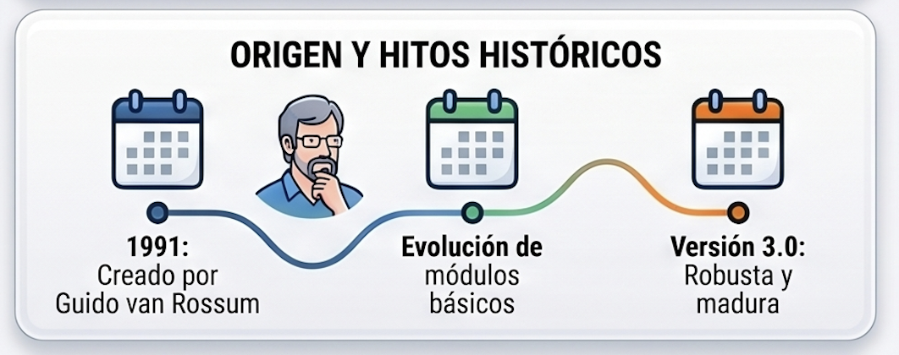
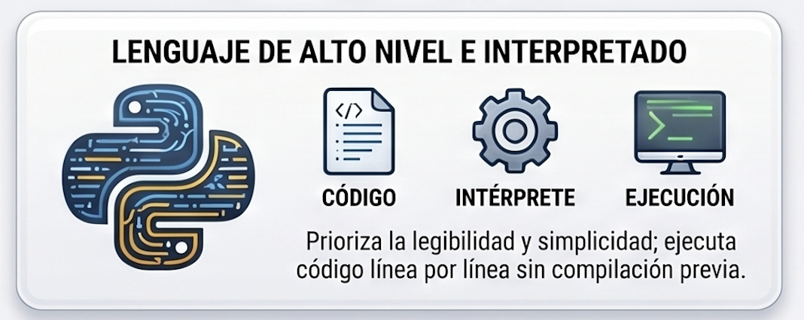
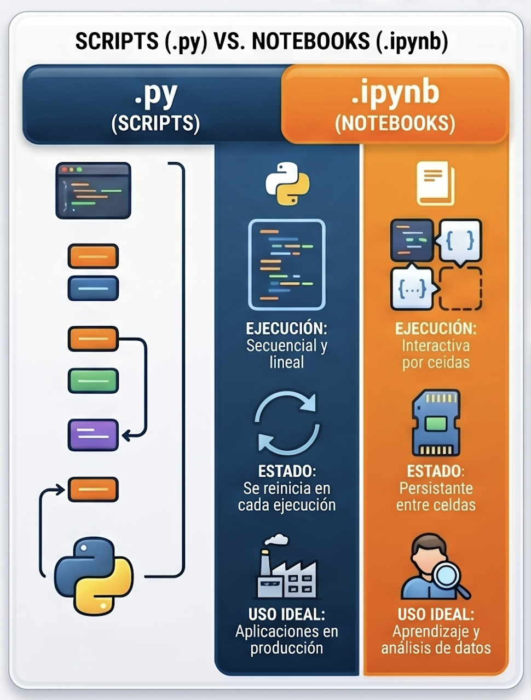
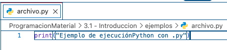
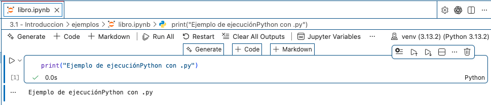

# Programación


## 3.01 · Introducción y fundamentos de Python


**Docente:** Ing. Pablo Torres, Mgtr.  
**Contacto:** [ptorresp@ups.edu.ec](mailto:ptorresp@ups.edu.ec)


### Descripción general

Este tema introduce Python, sus características y aplicaciones, y explica cómo ejecutar programas desde archivos `.py` y notebooks `.ipynb`. A partir de ejemplos sencillos se estudian variables, tipos, expresiones y cambios de estado.

El cálculo de una compra de cuadernos permite relacionar datos, instrucciones y resultados. Primero se comprende el lenguaje; después se ejecuta una demostración y finalmente se resuelven ejercicios con datos definidos en el código.

**Prerrequisitos:** diseño básico de algoritmos y manejo de archivos y carpetas. No se requiere conocer funciones, clases, decisiones ni bucles de Python.

### Índice

1. [Conceptos](#conceptos)
   - [1.1. Qué es Python](#que-es-python)
   - [1.2. Historia y evolución](#historia-python)
   - [1.3. Características](#caracteristicas-python)
   - [1.4. Ventajas, aplicaciones y límites](#aplicaciones-python)
   - [1.5. Programa, intérprete y compilación](#concepto-1)
   - [1.6. Variables, asignación y tipos](#concepto-2)
   - [1.7. Operadores y evaluación](#concepto-3)
   - [1.8. Estado, trazas y errores](#concepto-4)
   - [1.9. Archivos `.py`](#archivos-py)
   - [1.10. Notebooks `.ipynb`](#notebooks-ipynb)
   - [1.11. Diferencias y elección del formato](#diferencias-formatos)
2. [Demostraciones](#demostracion)
   - [2.1. Preparar Python y VS Code](#preparar-entorno)
   - [2.2. Ejecutar un programa `.py`](#demo-archivo)
   - [2.3. Calcular el importe de una compra](#demo-compra)
   - [2.4. Ejecutar la compra en un notebook](#demo-notebook)
   - [2.5. Comprobar el estado entre celdas](#estado-notebook)
3. [Ejercicios](#ejercicios)
   - [3.1. Indicaciones de trabajo](#indicaciones-ejercicios)
   - [3.2. Ejercicios prácticos progresivos](#ejercicios-progresivos)
   - [3.3. Comprobación del entorno y del notebook](#ejercicios-entorno)
   - [3.4. PC3.01 · Distribución de materiales](#pc)


[Lo esencial](#esencial) · [Recursos](#recursos) · [Referencias](#referencias)

---

<a id="conceptos"></a>
## 1. Conceptos

<a id="que-es-python"></a>
### 1.1. Qué es Python

Python es un lenguaje de programación de **alto nivel y propósito general**. Permite expresar algoritmos mediante instrucciones legibles y utilizar estructuras que abstraen muchos detalles del funcionamiento del equipo.

Que sea de propósito general significa que no está limitado a una sola clase de problema: puede utilizarse para automatizar tareas, procesar datos, desarrollar servicios web o construir herramientas científicas.

**Ejemplo básico:**

```python
print("Hola, mundo")
```

`print` muestra información. El texto entre comillas es una cadena de caracteres. Al ejecutar esta instrucción se obtiene:

```text
Hola, mundo
```

Python es el lenguaje; **CPython** es su implementación más utilizada. El editor permite escribir el archivo, mientras que la implementación de Python instalada permite ejecutarlo. Instalar VS Code no equivale a instalar Python.

<a id="historia-python"></a>
### 1.2. Historia y evolución



Python fue creado por **Guido van Rossum** y su primera versión pública apareció en **1991**. Su diseño buscó facilitar la escritura de programas mediante una sintaxis clara.

| Etapa | Aspecto destacado |
|---|---|
| Primeras versiones | Desarrollo de las bases del lenguaje y de su comunidad. |
| Python 1 | Consolidación del lenguaje y de su biblioteca. |
| Python 2 | Ampliación de capacidades y crecimiento de su adopción. |
| Python 3 | Cambios incompatibles con Python 2 para mejorar la consistencia del lenguaje. |

En este curso se utiliza **Python 3**. Los materiales antiguos pueden incluir instrucciones de Python 2 que ya no son válidas.

**Comparación histórica de la impresión:**

```text
Python 2: print "Hola"
Python 3: print("Hola")
```

La línea de Python 2 se muestra únicamente para reconocer material antiguo; no debe copiarse como código ejecutable de esta unidad. Las diferencias entre ambas generaciones no se limitan a `print`.

<a id="caracteristicas-python"></a>
### 1.3. Características



#### Sintaxis legible

La sintaxis favorece instrucciones breves y nombres descriptivos. La legibilidad también depende del programador: un nombre como `cantidad_cuadernos` comunica mejor su propósito que un nombre arbitrario.

Cuando se introduzcan bloques, la indentación tendrá significado sintáctico. Se utilizarán cuatro espacios por nivel y se evitará mezclar tabulaciones y espacios.

#### Tipado dinámico

Los objetos tienen un tipo y los nombres se asocian con ellos durante la ejecución. No se exige declarar el tipo del nombre antes de asignar un valor.

```python
cantidad = 4
producto = "Cuaderno"
```

Esto no significa que cualquier operación entre tipos sea válida: sumar un número a un texto sin una conversión apropiada puede producir un error.

#### Multiparadigma

Python permite trabajar con distintos estilos:

- **Procedimental:** organizar instrucciones en procedimientos y funciones.
- **Orientado a objetos:** representar entidades mediante objetos y clases.
- **Funcional:** utilizar funciones como valores y construir transformaciones de datos.

En los primeros temas se escribirán instrucciones secuenciales. Los demás recursos se incorporarán progresivamente.

#### Biblioteca estándar

Incluye módulos para matemáticas, fechas, archivos y otras tareas. Un módulo agrupa recursos reutilizables; `import` permite acceder a ellos.

```python
import math

radio = 5
area = math.pi * radio ** 2
print(f"Área: {area:.2f}")
```

Salida:

```text
Área: 78.54
```

`math` forma parte de la biblioteca estándar y no requiere instalar un paquete adicional. `math.pi` proporciona una aproximación de π y `**` expresa una potencia.

<a id="aplicaciones-python"></a>
### 1.4. Ventajas, aplicaciones y límites

Python facilita la escritura de prototipos y tareas de automatización. Su documentación y ecosistema proporcionan recursos para numerosos dominios.

| Área | Aplicación posible | Ejemplos de herramientas externas |
|---|---|---|
| Automatización | Procesar archivos y generar reportes | Depende de la tarea; puede bastar la biblioteca estándar. |
| Desarrollo web | Construir servicios y aplicaciones | Django, Flask. |
| Análisis de datos | Transformar y analizar conjuntos de datos | pandas, NumPy. |
| Inteligencia artificial | Entrenar y utilizar modelos | PyTorch, TensorFlow. |

Las herramientas externas se instalan cuando el proyecto las necesita. No forman todas parte de la instalación básica y no se requieren para los ejercicios de este tema.

**Límites.** Una sintaxis breve no garantiza un algoritmo eficiente. El rendimiento depende del problema, la implementación y las bibliotecas utilizadas. Elegir Python exige considerar también requisitos de ejecución, despliegue e integración.

<a id="concepto-1"></a>
### 1.5. Programa, intérprete y compilación

Un **programa** expresa un algoritmo mediante la sintaxis de un lenguaje. La sintaxis establece cómo se escriben las instrucciones; la semántica determina qué significan.

En CPython, el código fuente se compila internamente a **bytecode**, que después ejecuta su máquina virtual. Al ejecutar un archivo normalmente no se necesita una fase manual de compilación, pero eso no significa que internamente no exista compilación.

| Elemento | Función |
|---|---|
| Archivo fuente | Guarda el código del programa. |
| Editor, como VS Code | Permite escribir y revisar el código. |
| Intérprete de Python | Ejecuta el programa mediante la implementación instalada. |
| Terminal | Permite introducir comandos y observar su salida. |
| Kernel de notebook | Mantiene una sesión de ejecución para las celdas. |

Describir Python únicamente como «leer línea por línea» resulta incompleto. El código se analiza y su ejecución sigue el flujo definido por las instrucciones; después aparecerán decisiones, bucles y funciones que alteran ese flujo.

<a id="concepto-2"></a>
### 1.6. Variables, asignación y tipos

Una variable permite asociar un nombre con un valor. En una asignación, primero se evalúa la expresión de la derecha y después se asocia su resultado con el nombre de la izquierda.

```python
cantidad = 4
precio = 1.75
producto = "Cuaderno"
disponible = True
```

| Nombre | Valor | Tipo | Interpretación |
|---|---|---|---|
| `cantidad` | `4` | `int` | Cantidad entera de productos. |
| `precio` | `1.75` | `float` | Precio representado mediante punto flotante. |
| `producto` | `"Cuaderno"` | `str` | Texto. |
| `disponible` | `True` | `bool` | Condición verdadera. |

Un identificador como `"00125"` puede necesitar texto para conservar los ceros iniciales. Que contenga dígitos no obliga a tratarlo como una cantidad numérica.

Python permite reasociar un nombre con otro objeto, pero conviene conservar su significado dentro del mismo algoritmo. Los enteros admiten precisión arbitraria limitada por memoria; los valores `float` representan aproximaciones binarias de muchos números reales.

**Asignar no es comparar.** `cantidad = 4` guarda un valor; `cantidad == 4` evalúa si el valor actual es igual a 4.

<a id="concepto-3"></a>
### 1.7. Operadores y evaluación

Los operadores combinan valores para formar expresiones. La multiplicación y la división tienen mayor precedencia que la suma y la resta. Los paréntesis hacen explícita una agrupación.

| Operador | Operación | Ejemplo | Resultado |
|---|---|---|---|
| `+` | Suma numérica | `3 + 2` | `5` |
| `-` | Resta | `7 - 4` | `3` |
| `*` | Multiplicación | `4 * 1.75` | `7.0` |
| `/` | División | `7 / 2` | `3.5` |
| `//` | División con redondeo hacia menos infinito | `7 // 2` | `3` |
| `%` | Residuo | `7 % 2` | `1` |
| `**` | Potencia | `2 ** 3` | `8` |

Para cantidades enteras no negativas, `//` permite calcular grupos completos y `%` las unidades sobrantes. Con negativos, `-7 // 2` produce `-4`: no se limita a eliminar la parte decimal hacia cero.

```python
print(7 / 2, 7 // 2, 7 % 2, 2 ** 3)
```

Salida:

```text
3.5 3 1 8
```

**Formato numérico.** La expresión `f"{valor:.2f}"` muestra un número con dos decimales. Cambia su representación textual; no convierte internamente el número en un decimal exacto.

```python
valor = 7 / 3
print(f"{valor:.2f}")
```

Salida:

```text
2.33
```

**Error que evitar.** Ejecutar una división con divisor cero. En estos primeros ejercicios se establecen precondiciones y se usan datos válidos; la validación mediante decisiones se estudiará después. Para cálculos monetarios reales deben elegirse representaciones y reglas de redondeo apropiadas; aquí se usan importes sencillos como ejemplos didácticos.

<a id="concepto-4"></a>
### 1.8. Estado, trazas y errores

El estado reúne los valores disponibles en un instante de ejecución. Una traza permite seguir cómo cambian después de cada instrucción.

```python
cantidad = 2
cantidad = cantidad + 1
print(cantidad)
```

| Paso | Instrucción | Estado o salida |
|---|---|---|
| 1 | `cantidad = 2` | `cantidad` vale 2. |
| 2 | `cantidad = cantidad + 1` | Se calcula 2 + 1 y `cantidad` pasa a valer 3. |
| 3 | `print(cantidad)` | Se muestra `3`. |

| Error | Ejemplo de causa | Corrección |
|---|---|---|
| Sintaxis | Falta una comilla o un paréntesis. | Revisar la instrucción señalada y sus delimitadores. |
| `NameError` | Se usa un nombre que todavía no fue definido. | Corregir el nombre o ejecutar su asignación antes de usarlo. |
| `TypeError` | Se intenta una operación incompatible entre tipos. | Revisar los tipos y las conversiones necesarias. |
| `ZeroDivisionError` | El divisor vale cero. | Corregir los datos para cumplir el contrato. |
| Lógico | El programa ejecuta, pero usa una fórmula incorrecta. | Contrastar la expresión con el enunciado y una traza manual. |

Los comentarios comienzan con `#` y no se ejecutan como instrucciones. Ante un error, leer el mensaje y localizar el archivo y la línea indicados antes de modificar el programa.

<a id="archivos-py"></a>
### 1.9. Archivos `.py`

Un archivo `.py` es un archivo de texto que contiene código Python. Puede ejecutarse como programa o utilizarse como módulo desde otro programa.

Al ejecutar `python archivo.py` desde la terminal, se inicia normalmente un proceso nuevo. Las instrucciones de nivel superior se ejecutan siguiendo el flujo del programa. En los ejemplos secuenciales de este tema se recorren en el orden escrito.

**Características:**

- Permite organizar código en uno o varios archivos.
- Facilita la ejecución mediante comandos y la automatización.
- Se integra con editores, depuradores y herramientas de pruebas.
- Sus diferencias de texto se pueden revisar con Git.

Guardar los cambios antes de ejecutar evita probar una versión anterior del archivo. El programa puede mostrar resultados en consola y también producir archivos, ventanas o gráficos, según las bibliotecas que utilice.

<a id="notebooks-ipynb"></a>
### 1.10. Notebooks `.ipynb`

Un notebook es un documento estructurado en formato JSON que combina celdas de código, texto y resultados. Las celdas Markdown permiten documentar el procedimiento; las de código se envían a un kernel para ejecutarlas.

**Características:**

- Permite ejecutar y revisar partes del trabajo.
- Integra explicaciones, tablas y visualizaciones con el código.
- Conserva variables en la memoria del kernel mientras esa sesión permanece activa.
- Puede guardar resultados visibles que proceden de ejecuciones anteriores.

Las celdas se pueden ejecutar en distinto orden, pero las dependencias siguen existiendo. Una celda que usa `total` necesita que el kernel ya haya ejecutado la instrucción que lo define.

**Persistencia del estado.** Guardar el notebook no guarda toda la memoria del kernel. Después de reiniciarlo, las variables desaparecen y deben reconstruirse ejecutando las celdas. Una salida antigua visible tampoco demuestra que el código actual pueda reproducirla.

Jupyter Notebook, JupyterLab, VS Code y Google Colab permiten trabajar con notebooks, con diferencias en su instalación y entorno de ejecución.

<a id="diferencias-formatos"></a>
### 1.11. Diferencias y elección del formato

| Aspecto | Archivo `.py` | Notebook `.ipynb` |
|---|---|---|
| Estructura | Código fuente en texto plano. | Celdas y metadatos en JSON; puede incluir salidas. |
| Ejecución habitual | Programa completo desde una terminal. | Celdas enviadas a un kernel. |
| Estado | Un comando normal inicia un proceso nuevo. | Se conserva mientras el kernel siga activo. |
| Explicación | Comentarios y documentación complementaria. | Celdas Markdown junto al código. |
| Resultados | Consola, archivos u otras interfaces. | Salidas integradas bajo las celdas. |
| Git | Diferencias de código generalmente fáciles de revisar. | Las salidas y los metadatos pueden añadir ruido. |
| Uso frecuente | Automatización y proyectos organizados en módulos. | Exploración, análisis y explicaciones ejecutables. |

Usar `.py` cuando interese ejecutar y organizar un programa como código fuente. Usar `.ipynb` cuando resulte útil combinar explicación, experimentación y resultados en el mismo documento. Ambos requieren revisar datos, dependencias y reproducibilidad.



---

<a id="demostracion"></a>
## 2. Demostraciones

<a id="preparar-entorno"></a>
### 2.1. Preparar Python y VS Code

#### Comprobar Python

Instalar Python 3 desde [python.org](https://www.python.org/downloads/) si no está disponible. Usar la versión indicada para el curso y registrar la versión realmente instalada.

En macOS o Linux:

```bash
python3 --version
```

En Windows, si está disponible el lanzador `py`:

```powershell
py --version
```

#### Seleccionar el intérprete

Abrir la carpeta de trabajo en VS Code. Instalar la extensión [Python](https://marketplace.visualstudio.com/items?itemName=ms-python.python) y utilizar **Python: Select Interpreter** para seleccionar la instalación del curso.

[Pylance](https://marketplace.visualstudio.com/items?itemName=ms-python.vscode-pylance) proporciona asistencia de edición y [Python Debugger](https://marketplace.visualstudio.com/items?itemName=ms-python.debugpy) permite depurar. Si ya están instaladas, no es necesario repetir su instalación.

El intérprete seleccionado debe corresponder con el entorno que se utiliza para ejecutar los ejemplos.

<a id="demo-archivo"></a>
### 2.2. Ejecutar un programa `.py`

Crear `hola.py` y guardar:

```python
print("Programación")
print("Universidad Politécnica Salesiana")
print("Cuenca")
```

Abrir **Terminal > New Terminal**, situarse en la carpeta que contiene el archivo y ejecutar:

```bash
python3 hola.py
```

En Windows puede utilizarse `py hola.py`. Dentro de un entorno virtual activado puede utilizarse `python hola.py`.

También se puede utilizar **Run Python File in Terminal** desde el editor; esa opción ejecuta el archivo en la terminal integrada.



**Salida esperada:**

```text
Programación
Universidad Politécnica Salesiana
Cuenca
```

Si el mensaje indica que no encuentra el archivo, comprobar la carpeta actual y su nombre. Si no reconoce el comando, comprobar la instalación o el lanzador disponible.

<a id="demo-compra"></a>
### 2.3. Calcular el importe de una compra

**Problema.** Calcular el importe de cuatro cuadernos a 1.75 cada uno y mostrar cantidad e importe.

**Contrato.** Cantidad entera no negativa y precio no negativo. Los datos se definen en el código, sin entrada de teclado ni validación. El total se presenta con dos decimales.

Guardar el siguiente programa en `ejemplos/demo.py`:

<!-- example: demo.py -->
```python
cantidad = 4
precio = 1.75
total = cantidad * precio

print(f"Cantidad: {cantidad}")
print(f"Total: {total:.2f}")
```

Desde la carpeta `03/3.01-introduccion/python/`:

```bash
python3 ejemplos/demo.py
```

En Windows puede utilizarse `py ejemplos/demo.py`.

**Salida esperada:**

```text
Cantidad: 4
Total: 7.00
```

| Instrucción | Interpretación |
|---|---|
| `cantidad = 4` | Define la cantidad. |
| `precio = 1.75` | Define el precio por unidad. |
| `total = cantidad * precio` | Evalúa el producto usando los valores actuales. |
| `print(f"Cantidad: {cantidad}")` | Inserta el valor de cantidad en el texto. |
| `print(f"Total: {total:.2f}")` | Muestra el total con dos decimales. |

Modificar `cantidad` después de calcular `total` no actualiza automáticamente el resultado. Es necesario volver a evaluar la multiplicación.

<a id="demo-notebook"></a>
### 2.4. Ejecutar la compra en un notebook

#### Preparar un entorno virtual

Un entorno virtual separa las dependencias del trabajo de las de otros proyectos. Desde la carpeta del tema, crear `.venv`.

**macOS o Linux:**

```bash
python3 -m venv .venv
source .venv/bin/activate
python -m pip install ipykernel
```

**Windows con PowerShell:**

```powershell
py -m venv .venv
.\.venv\Scripts\Activate.ps1
python -m pip install ipykernel
```

Si PowerShell impide activar el entorno, se puede instalar usando directamente su intérprete, sin cambiar la política de ejecución:

```powershell
.\.venv\Scripts\python.exe -m pip install ipykernel
```

`ipykernel` permite ejecutar Python como kernel. Esta preparación está orientada a notebooks dentro de VS Code; no instala por sí sola la interfaz web de JupyterLab.

#### Crear el notebook y seleccionar el kernel

Instalar la extensión [Jupyter](https://marketplace.visualstudio.com/items?itemName=ms-toolsai.jupyter). Crear `compra.ipynb` y elegir el entorno `.venv` mediante **Select Kernel**.

Agregar una celda Markdown con la descripción de la compra. Después crear tres celdas de código:

**Celda 1 · Datos**

```python
cantidad = 4
precio = 1.75
```

**Celda 2 · Cálculo**

```python
total = cantidad * precio
```

**Celda 3 · Resultado**

```python
print(f"Cantidad: {cantidad}")
print(f"Total: {total:.2f}")
```

Ejecutar las celdas en orden. La salida de la tercera debe coincidir con la demostración del archivo `.py`.



Para comprobar que el documento es reproducible, **reiniciar el kernel y ejecutar todas las celdas desde el principio**. No basta con que existan salidas guardadas en el archivo.

<a id="estado-notebook"></a>
### 2.5. Comprobar el estado entre celdas

Después de ejecutar las tres celdas anteriores, cambiar la primera a `cantidad = 6` y volver a ejecutar **solo esa celda**. Ejecutar a continuación la tercera, sin recalcular el total.

Se obtiene:

```text
Cantidad: 6
Total: 7.00
```

El estado es inconsistente con el cálculo deseado: `cantidad` cambió, pero `total` conserva el resultado anterior. Al ejecutar nuevamente la segunda y la tercera celda se obtiene:

```text
Cantidad: 6
Total: 10.50
```

No es un error de la multiplicación. La causa es el orden de ejecución y la dependencia entre datos y resultados. El mismo principio se aplica a un archivo `.py`: cambiar una variable no recalcula otras expresiones evaluadas anteriormente.

---

<a id="ejercicios"></a>
## 3. Ejercicios

<a id="indicaciones-ejercicios"></a>
### 3.1. Indicaciones de trabajo

Resolver primero con datos definidos directamente en el código. No utilizar todavía entrada de teclado, decisiones ni bucles. Los enunciados no incluyen soluciones completas.

Para cada ejercicio:

1. Identificar datos, operación y resultado solicitado.
2. Predecir manualmente la salida del caso indicado.
3. Escribir y ejecutar el programa.
4. Comparar resultado esperado y obtenido.
5. Añadir un caso válido distinto, preferiblemente de frontera cuando tenga sentido.

Los ejemplos de salida permiten comprobar el contrato; no deben escribirse como constantes para reemplazar el cálculo.

<a id="ejercicios-progresivos"></a>
### 3.2. Ejercicios prácticos progresivos

#### Ejercicio 01. Mensaje inicial

Mostrar el nombre de la asignatura y la sede, una línea por dato.

**Salida esperada:**

```text
Programación
Cuenca
```

#### Ejercicio 02. Ficha de producto

Definir `producto = "Lápiz"` y `cantidad = 6`. Mostrar el nombre y la cantidad separados por un espacio.

**Salida esperada:**

```text
Lápiz 6
```

#### Ejercicio 03. Área rectangular

Definir `base = 8` y `altura = 3`. Calcular el área sin escribir el resultado como constante. Utilizar dimensiones no negativas.

**Salida esperada:**

```text
24
```

#### Ejercicio 04. Conversión de minutos

Convertir 135 minutos en horas completas y minutos sobrantes. Trabajar con enteros no negativos.

**Salida esperada:**

```text
2 15
```

#### Ejercicio 05. Promedio aritmético

Calcular el promedio de 7, 8 y 9 y mostrar dos decimales. Explicitar la agrupación de la suma antes de dividir.

**Salida esperada:**

```text
8.00
```

#### Ejercicio 06. Cambio de unidades

Convertir 2.5 kilómetros a metros y centímetros. Mostrar ambos resultados con un decimal.

**Salida esperada:**

```text
2500.0 250000.0
```

#### Ejercicio 07. Compra con descuento

Definir cinco artículos a 4.0 cada uno y un descuento del 15 %. Calcular subtotal y total con dos decimales. El descuento se aplica al subtotal.

**Salida esperada:**

```text
20.00 17.00
```

#### Ejercicio 08. Intercambio de valores

Intercambiar `a = 12` y `b = 5` usando una variable auxiliar. No sustituir directamente por constantes. Mostrar primero `a` y después `b`.

**Salida esperada:**

```text
5 12
```

#### Ejercicio 09. Descomposición de segundos

Descomponer 7384 segundos en horas completas, minutos restantes y segundos restantes. Usar cocientes y residuos.

**Salida esperada:**

```text
2 3 4
```

#### Ejercicio 10. Nota ponderada

Calcular la nota ponderada de 8, 6 y 9 con pesos del 20 %, 30 % y 50 %. Mostrar dos decimales y comprobar manualmente que los pesos suman 100 %.

**Salida esperada:**

```text
7.90
```

<a id="ejercicios-entorno"></a>
### 3.3. Comprobación del entorno y del notebook

#### Ejercicio 11. Dos formas de ejecución

Resolver el ejercicio 03 como `area.py` y como `area.ipynb`. En el notebook, separar datos, cálculo y salida en tres celdas. Comprobar que ambas ejecuciones producen el mismo resultado.

Registrar el comando utilizado para el archivo, la versión de Python y el kernel seleccionado. Antes de entregar el notebook, reiniciar su kernel y ejecutar todas las celdas en orden.

#### Ejercicio 12. Diagnóstico de estado

Crear un notebook con tres celdas: la primera define `base = 8` y `altura = 3`; la segunda calcula `area`; la tercera la muestra.

Cambiar `base` a 10, ejecutar únicamente la primera y la tercera celda y explicar por qué el resultado puede conservar el valor anterior. Después corregir el orden de ejecución y registrar la nueva salida. No escribir el área como constante.

<a id="pc"></a>
### 3.4. PC3.01 · Distribución de materiales

**Contexto.** Se dispone de una cantidad de materiales que se distribuirán en paquetes de capacidad fija. Calcular cuántos paquetes completos se forman, cuántas unidades sobran y el costo de los paquetes completos a una tarifa dada.

**Datos definidos en el código:**

- `unidades`: entero no negativo.
- `capacidad`: entero mayor que cero.
- `tarifa`: número no negativo que representa el costo por paquete completo.

**Trabajo solicitado:**

1. Calcular paquetes completos y unidades sobrantes.
2. Calcular el costo de los paquetes completos, sin cobrar un paquete adicional por los sobrantes.
3. Mostrar los tres resultados con etiquetas; presentar el costo con dos decimales.
4. Explicar el uso de cociente entero y residuo.
5. Documentar las precondiciones y los casos de prueba.

**Restricciones.** No utilizar entrada de teclado, decisiones ni bucles. Las precondiciones se revisan antes de ejecutar cada caso: un dato fuera de contrato se documenta y no se usa para efectuar la división. No se exige implementar validación automática en este tema.

| Unidades | Capacidad | Tarifa | Paquetes completos | Sobrantes | Costo esperado |
|---:|---:|---:|---:|---:|---:|
| 23 | 5 | 2.5 | 4 | 3 | 10.00 |
| 0 | 5 | 2.5 | 0 | 0 | 0.00 |
| 5 | 5 | 2.5 | 1 | 0 | 2.50 |
| 4 | 5 | 2.5 | 0 | 4 | 0.00 |
| 23 | 0 | 2.5 | Fuera de contrato | No ejecutar | No ejecutar |

Agregar otro caso válido y explicar qué comportamiento comprueba. Si se detecta una capacidad igual a cero al revisar los datos, indicar qué precondición incumple, sin ejecutar la operación.


---

<a id="esencial"></a>
## Lo esencial

- Python es un lenguaje; el editor y la implementación que ejecuta el programa tienen funciones diferentes.
- CPython compila internamente a bytecode antes de ejecutarlo.
- Una asignación guarda un resultado calculado en ese momento; no crea una fórmula que se actualice sola.
- Distinguir nombre, valor y tipo permite comprender las expresiones y sus errores.
- `.py` y `.ipynb` son formatos distintos para trabajar con código Python.
- El kernel conserva estado entre celdas, pero reiniciarlo elimina las variables de la sesión.
- Ejecutar un notebook desde un kernel reiniciado permite detectar dependencias ocultas de ejecuciones anteriores.
- Comprobar resultados requiere comparar la ejecución real con el contrato y una expectativa calculada previamente.

<a id="recursos"></a>
## Recursos

- [Descarga de Python](https://www.python.org/downloads/).
- [Documentación de Python 3](https://docs.python.org/3/).
- [Extensión Python para VS Code](https://marketplace.visualstudio.com/items?itemName=ms-python.python).
- [Extensión Python Debugger](https://marketplace.visualstudio.com/items?itemName=ms-python.debugpy).
- [Extensión Pylance](https://marketplace.visualstudio.com/items?itemName=ms-python.vscode-pylance).
- [Extensión Jupyter para VS Code](https://marketplace.visualstudio.com/items?itemName=ms-toolsai.jupyter).

<a id="referencias"></a>
## Referencias

1. Python Software Foundation. [Preguntas generales: definición e historia de Python](https://docs.python.org/3/faq/general.html).
2. Python Software Foundation. [Tutorial de Python](https://docs.python.org/3/tutorial/).
3. Python Software Foundation. [Entornos virtuales y paquetes](https://docs.python.org/3/tutorial/venv.html).
4. Microsoft. [Ejecutar código Python en VS Code](https://code.visualstudio.com/docs/python/run).
5. Microsoft. [Notebooks de Jupyter en VS Code](https://code.visualstudio.com/docs/datascience/jupyter-notebooks).

[Anterior: algoritmos](../../../02/2.1-algoritmos/python/material.md) · [Siguiente: entradas y salidas](../../3.02-entradas-salidas/python/material.md)
