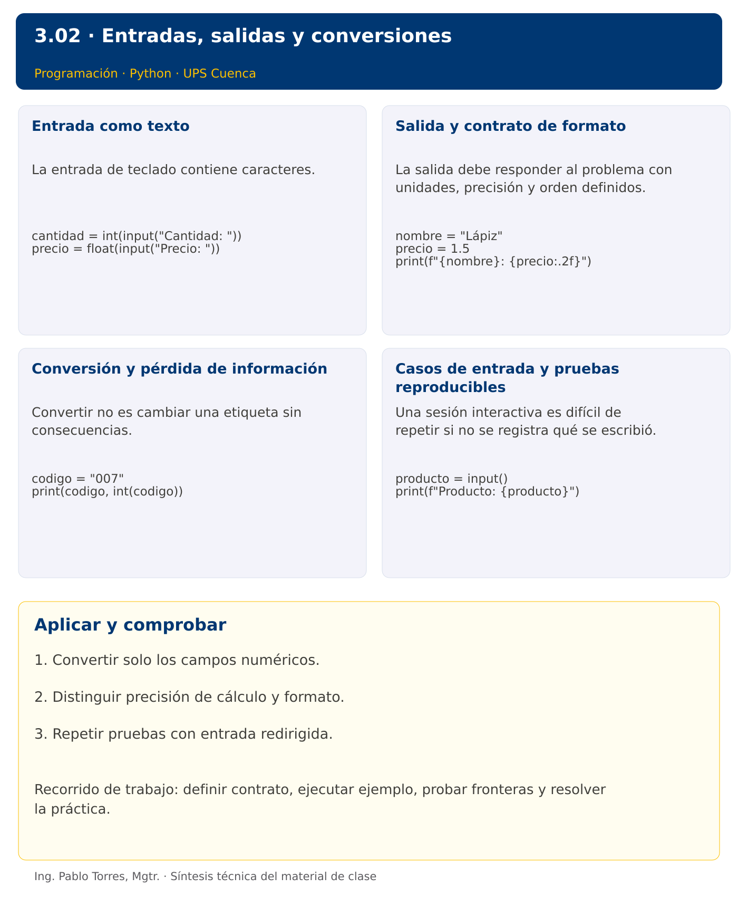

# Programación


## 3.02 · Entradas, salidas y conversiones · Python

**Autor:** Ing. Pablo Torres, Mgtr.  
**Unidad 3:** Lenguaje de Programación  


[Índice del curso](../../../README.md) · [Versión Java](../java/material.md) · [Presentación](../presentacion.pptx) · [Anterior](../../3.01-introduccion/python/material.md) · [Siguiente](../../3.03-estructuras-control/python/material.md)

[Conceptos](#concepto-1) · [Demostración](#demostracion) · [Práctica de clase](#pc) · [Lo esencial](#esencial)

**Contexto.** Generar un recibo a partir del nombre de un producto, su cantidad y su precio. Separar el texto ingresado del valor numérico que el cálculo requiere y especificar el formato exacto de la salida.

**Prerrequisitos.** Variables, tipos numéricos y operaciones.

## 1. Conceptos y ejemplos

<a id="concepto-1"></a>

### 1.1. Entrada como texto

La entrada de teclado contiene caracteres. Antes de operar, determinar qué campos son texto y cuáles deben convertirse. Conservar códigos y teléfonos como cadenas si no representan cantidades. Definir el separador decimal y el dominio de cada campo. En esta sección el contrato exige texto numérico válido; la recuperación de entradas inválidas se implementará después de estudiar decisiones.

**Aplicar en Python.** input devuelve str y elimina el salto de línea final. int convierte enteros representados en texto; float convierte decimales con punto. int("3.5") genera ValueError, no redondea. Convertir float a int trunca hacia cero y no valida que el original fuera entero.

```python
cantidad = int(input("Cantidad: "))
precio = float(input("Precio: "))
```

<a id="concepto-2"></a>

### 1.2. Salida y contrato de formato

La salida debe responder al problema con unidades, precisión y orden definidos. Separar mensajes de interacción de datos utilizados por una prueba automática. Acordar si se permiten espacios extra. Mostrar dos decimales mejora una presentación, pero no modifica el valor numérico almacenado ni corrige errores de precisión.

**Aplicar en Python.** print admite varios valores con sep y end. Una f-string inserta expresiones entre llaves; :.2f presenta dos decimales. No concatenar directamente una cadena y un entero con +. Convertir con str o usar formato.

```python
nombre = "Lápiz"
precio = 1.5
print(f"{nombre}: {precio:.2f}")
```

<a id="concepto-3"></a>

### 1.3. Conversión y pérdida de información

Convertir no es cambiar una etiqueta sin consecuencias. El texto "007" convertido a entero pierde los ceros de presentación. Un número real convertido a entero pierde su parte fraccionaria. Distinguir transformación necesaria para calcular de transformación necesaria para mostrar. Guardar datos originales cuando el contrato exija conservar su representación.

**Aplicar en Python.** str(12) produce "12". bool("False") da True porque la cadena no está vacía; no usar bool(input()) para interpretar respuestas sí/no. Todavía no aceptar comas decimales silenciosamente: explicar que el formato de entrada solicitado usa punto.

```python
codigo = "007"
print(codigo, int(codigo))
```

<a id="concepto-4"></a>

### 1.4. Casos de entrada y pruebas reproducibles

Una sesión interactiva es difícil de repetir si no se registra qué se escribió. Guardar un archivo de entrada con un dato por línea permite ejecutar la misma prueba varias veces. Calcular la salida esperada de forma independiente y compararla completa. Registrar también el comportamiento de un dato inválido como diagnóstico, sin afirmar que ya existe un manejo amigable del error.

**Aplicar en Python.** Usar python3 demo.py < entrada.txt. El ejemplo no imprime solicitudes para que stdout sea comparable. Una entrada no numérica interrumpe la ejecución con ValueError; esto queda documentado como límite de esta primera versión.

```python
producto = input()
print(f"Producto: {producto}")
```

Los bloques breves anteriores ilustran una operación y pueden requerir variables o imports del contexto. Utilizar la demostración siguiente como programa completo.


### Síntesis visual



<a id="demostracion"></a>

## 2. Demostración guiada

**Problema.** Leer producto, cantidad y precio, y producir el total de una compra.

**Contrato de esta demostración.** Leer tres líneas: texto de producto, cantidad entera no negativa y precio decimal no negativo con punto. Exigir formato numérico válido. Mostrar nombre e importe con dos decimales. Una entrada de formato inválido produce el error de conversión del lenguaje; aún no se recupera.

**Fuente:** [ejemplos/demo.py](ejemplos/demo.py).

<!-- example: demo.py -->
```python
producto = input()
cantidad = int(input())
precio = float(input())
print(f"Producto: {producto}")
print(f"Total: {cantidad * precio:.2f}")
```

### Ejecutar

Abrir una terminal dentro de `03/3.02-entradas-salidas/python/ejemplos/` y ejecutar:

```bash
python3 demo.py < entrada.txt
```

En Windows, usar `py` en lugar de `python3` si esa es la instalación disponible. Comprobar primero su versión.

**Contenido de entrada.txt:**

```text
Cuaderno
4
1.75
```

### Salida esperada

```text
Producto: Cuaderno
Total: 7.00
```

**Interpretación.** Seguir las asignaciones y los bloques en orden, identificar qué instrucción produce cada línea y contrastar con el contrato. Modificar un dato por vez y anticipar el resultado antes de ejecutar. La salida de referencia es una expectativa; el registro de verificaciones indica qué ejecuciones se realizaron.

<a id="ejercicios"></a>

### Ejercicios prácticos progresivos

Resolver los siguientes ejercicios en orden. Entregar enunciado, fuente y resultado propio. Los casos mostrados permiten comprobar el contrato y no sustituyen una prueba adicional de frontera.

#### Ejercicio 01. Saludo

Leer un nombre y mostrar “Hola, Ana” para la entrada Ana. Conservar los espacios interiores del nombre.

**Caso de comprobación:**

```text
Hola, Ana
```

#### Ejercicio 02. Suma de enteros

Leer dos enteros, uno por línea. Para 12 y 8 mostrar su suma.

**Caso de comprobación:**

```text
20
```

#### Ejercicio 03. Nombre y edad

Leer nombre y edad. Para Luis y 19 mostrar “Luis: 19 años”. Convertir edad a entero.

**Caso de comprobación:**

```text
Luis: 19 años
```

#### Ejercicio 04. Área de triángulo

Leer base y altura positivas. Para 10.5 y 4 mostrar área con dos decimales.

**Caso de comprobación:**

```text
21.00
```

#### Ejercicio 05. Temperatura

Leer grados Celsius y convertir a Fahrenheit. Para 25 mostrar 77.0.

**Caso de comprobación:**

```text
77.0
```

#### Ejercicio 06. Identificador

Leer código 007 y cantidad 3. Conservar los ceros del código y mostrar “007: 3”.

**Caso de comprobación:**

```text
007: 3
```

#### Ejercicio 07. Cociente decimal

Leer dividendo 7 y divisor 2, con divisor distinto de cero como precondición. Mostrar el cociente con tres decimales.

**Caso de comprobación:**

```text
3.500
```

#### Ejercicio 08. Promedio de mediciones

Leer tres decimales 8.5, 7.8 y 9.2. Mostrar promedio con dos decimales.

**Caso de comprobación:**

```text
8.50
```

#### Ejercicio 09. Total de servicio

Leer horas 3.5, tarifa 8 y recargo porcentual 10. Calcular base, recargo y total, cada uno con dos decimales.

**Caso de comprobación:**

```text
28.00 2.80 30.80
```

#### Ejercicio 10. Factura de dos productos

Leer nombre, cantidad y precio de dos productos. Para A, 2, 3.5 y B, 3, 2 mostrar un subtotal por línea y luego el total. No usar ciclos todavía.

**Caso de comprobación:**

```text
A: 7.00
B: 6.00
Total: 13.00
```

<a id="pc"></a>

## 3. PC3.02 · Práctica de clase

Leer nombre de un servicio, cantidad de horas y tarifa por hora. Calcular subtotal, descuento porcentual y total. Solicitar el descuento como cuarto dato numérico. Definir horas y tarifa no negativas y descuento entre 0 y 100 como precondiciones. Mostrar importes con dos decimales. Documentar el error obtenido al ingresar texto donde se requiere un número, sin añadir todavía recuperación mediante excepciones.

### Requisitos y restricciones

- Resolver en una sola versión, Python o Java.
- Mantener nombres y responsabilidades indicados; explicar cualquier adaptación idiomática.
- Aplicar únicamente los conceptos ya introducidos.
- Conservar las entradas cuando el enunciado lo exija.
- Distinguir valores fuera de contrato de errores que el programa debe gestionar.

### Casos de aceptación de la PC

| Entrada / escenario | Resultado esperado |
|---|---|
| Tutoría, 4, 10, 25 | subtotal 40.00; descuento 10.00; total 30.00 |
| Tutoría, 0, 10, 0 | total 0.00 |
| horas=abc | error de conversión documentado |

### Probar y registrar evidencia

Crear una carpeta personal `PC3.02` separada de las demostraciones. Guardar cada caso con entrada, resultado esperado y resultado real. Ejecutar `python3 solucion.py` desde esa carpeta. Para entradas de teclado, guardar `casos/entrada-01.txt` y redirigirla con `< casos/entrada-01.txt`. Para funciones, crear llamadas con los datos de la tabla.

- Registrar `evidencias/PC3.02.md` con comandos, versión real, salidas y explicación.
- Crear un commit funcional como `feat(pc3.02): implementar-regla-principal`.
- Obtener el hash real con `git rev-parse HEAD` y anotarlo en la evidencia.
- Revisar el cambio con `git show HASH` y comparar avances con `git diff HASH_ANTERIOR HASH_ACTUAL`. Sustituir los marcadores por hashes reales.
- Agregar una prueba de frontera distinta de las incluidas y justificar qué error detectaría.

No se requiere proyecto acumulativo ni rúbrica individual de esta PC.

<a id="esencial"></a>

## Lo esencial

- Convertir solo los campos numéricos.
- Distinguir precisión de cálculo y formato.
- Repetir pruebas con entrada redirigida.

## Referencias técnicas

- [Tutorial oficial de Python](https://docs.python.org/3.14/tutorial/)
- [Biblioteca estándar de Python](https://docs.python.org/3.14/library/)

[Índice del curso](../../../README.md) · [Versión Java](../java/material.md) · [Presentación](../presentacion.pptx) · [Anterior](../../3.01-introduccion/python/material.md) · [Siguiente](../../3.03-estructuras-control/python/material.md)
