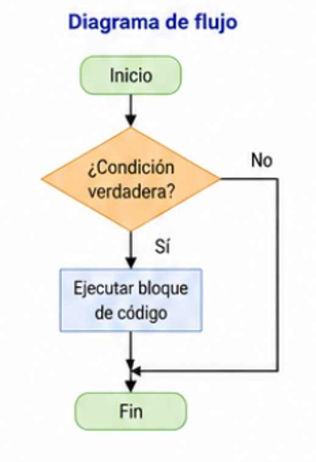
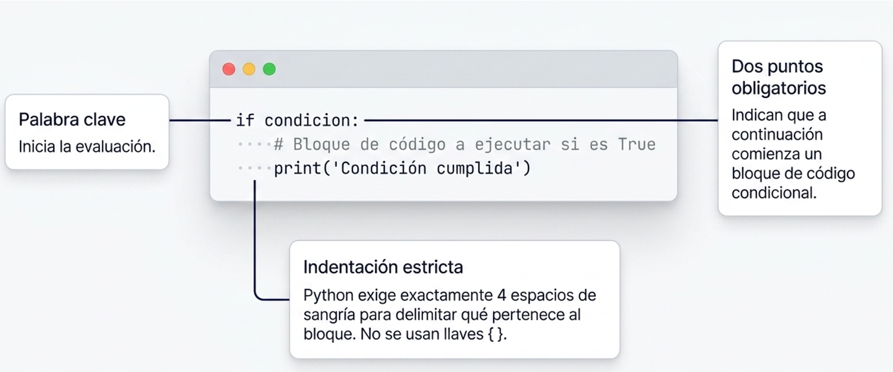
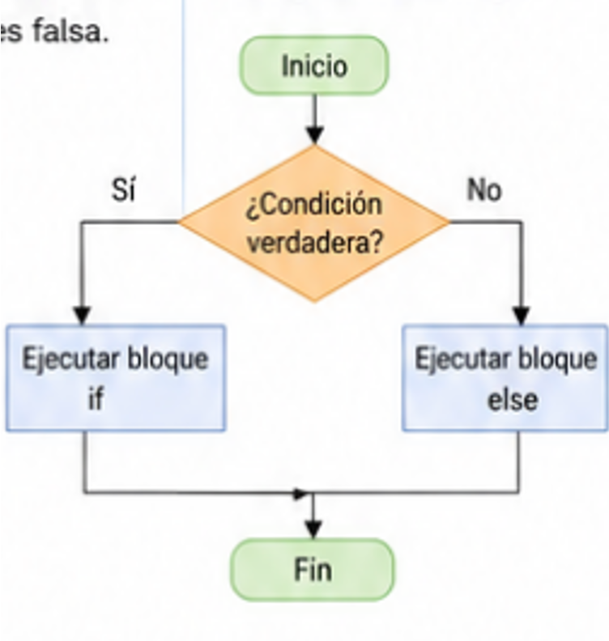
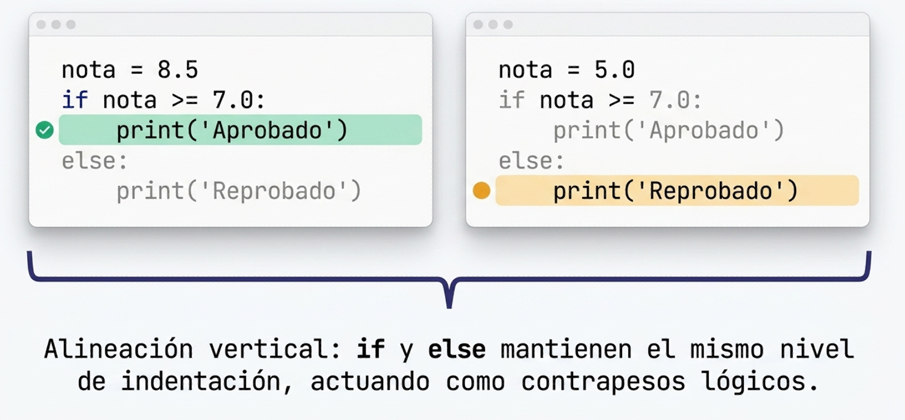
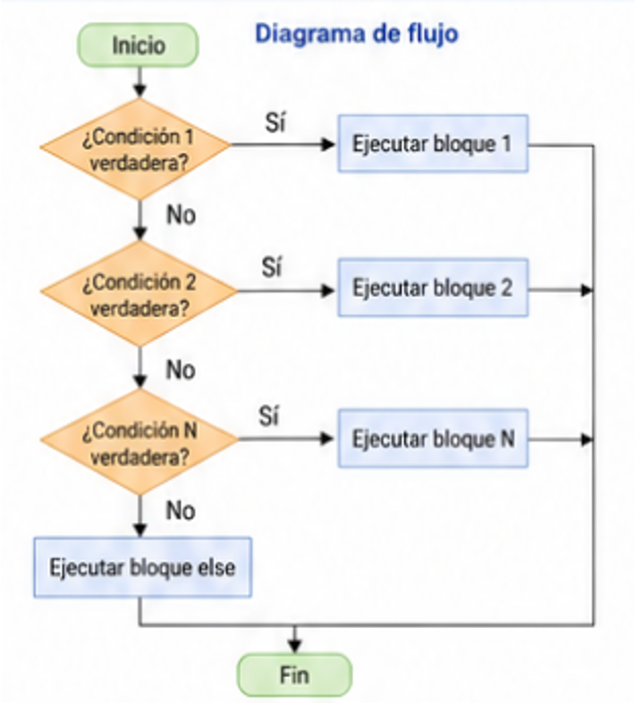
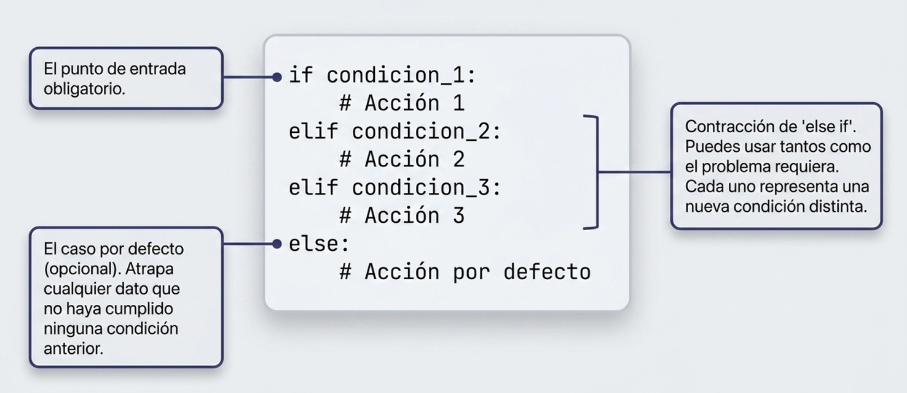
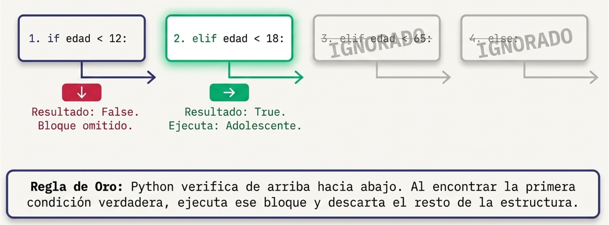

# Programación


## 3.03 · Condicionales y operadores lógicos · Python

**Universidad Politécnica Salesiana** · Ingeniería en Ciencias de la Computación · Cuenca  
**Unidad 3:** Lenguaje de Programación  
**Docente:** Ing. Pablo Torres, Mgtr.  
**Contacto:** ptorresp@ups.edu.ec

[Anterior: Entradas y salidas](../../3.02-entradas-salidas/python/material.md) · [Siguiente: Iteración](../../3.04-iteracion/python/material.md)

<a id="descripcion"></a>

## Descripción general

Después de leer, convertir y presentar datos, un programa necesita decidir qué operaciones realizar. Las condiciones permiten seleccionar un recorrido, validar un dominio y expresar reglas que dependen de varias circunstancias. Este tema conecta los diagramas de flujo de la unidad 2 con las estructuras `if`, `else` y `elif` de Python.

**Prerrequisitos:** variables, `input()`, conversiones, operadores aritméticos, booleanos y f-strings. No se necesitan bucles, funciones propias ni listas para resolver los ejercicios. La recuperación de errores se introduce al final del desarrollo conceptual.

## Índice

- [1.1 Condiciones, comparaciones y bloques](#concepto-1)
- [1.2 Selección simple: if](#if)
- [1.3 Dos alternativas: if y else](#else)
- [1.4 Selección múltiple: elif](#elif)
- [1.5 Orden de evaluación](#flujo)
- [1.6 Decisiones independientes y anidadas](#anidadas)
- [1.7 Operadores lógicos y cortocircuito](#logicos)
- [1.8 Contrato y pruebas de frontera](#contrato)
- [2. Demostraciones](#demostracion)
- [3. Ejercicios prácticos](#ejercicios)
- [PC3.03: tarifa de envío](#pc)
- [Lo esencial](#esencial)

<a id="conceptos"></a>
<a id="concepto-1"></a>

## 1. Conceptos

### 1.1 Condiciones, comparaciones y bloques

**Definición.** Una condición es una expresión cuyo valor de verdad decide si se ejecuta un bloque. Una comparación produce `True` o `False`. La decisión no repite instrucciones: selecciona un camino y continúa después de la estructura.

**Propósito.** Traducir una regla del problema a una pregunta verificable. «Edad» nombra un dato; `edad >= 18` expresa una condición. Escribir primero la regla y sus límites evita elegir operadores por intuición.

| Operador | Significado | Ejemplo |
|---|---|---|
| `==` | Igualdad | `opcion == "normal"` |
| `!=` | Diferencia | `divisor != 0` |
| `<` | Menor que | `nota < 5` |
| `<=` | Menor o igual | `peso <= 20` |
| `>` | Mayor que | `temperatura > 30` |
| `>=` | Mayor o igual | `edad >= 18` |

```python
edad = 18
es_mayor = edad >= 18
print(es_mayor)
```

**Salida:** `True`. La asignación `=` guarda un valor; `==` compara. No se usa `is` para sustituir una comparación de valores.

Python usa dos puntos para introducir el bloque y sangría para delimitarlo. Adoptaremos cuatro espacios por nivel. Todas las instrucciones al mismo nivel pertenecen al mismo bloque; volver a la sangría anterior termina ese bloque. Mezclar tabulaciones y espacios puede provocar errores o dificultar la lectura.

Los esquemas con nombres como `condicion` explican la sintaxis: esas variables deben definirse antes de ejecutarlos. Un bloque no puede contener solamente comentarios; se utiliza una instrucción o `pass`, que significa no realizar ninguna operación.

<a id="if"></a>

### 1.2 La estructura `if`



#### Definición

La estructura `if` es la forma más básica de control condicional en Python. Evalúa una expresión lógica y, si el resultado es `True`, ejecuta el bloque de código indentado que le sigue. Si la condición es `False`, el bloque se omite por completo y el programa continúa con la siguiente instrucción fuera del `if`.

#### Propósito

Se utiliza cuando se necesita ejecutar un conjunto de instrucciones **únicamente si se cumple una condición específica**, sin necesidad de definir qué ocurre si no se cumple.

#### Sintaxis

```python
if condicion:
    print("Condición verdadera")
```

> **Nota:** Python usa la indentación (sangría de 4 espacios) para delimitar el bloque de código. No se usan llaves `{}` como en otros lenguajes.

#### Ejemplo básico

**Contrato:** las entradas tienen el tipo indicado y cumplen el dominio del ejemplo; la edad es no negativa y la nota pertenece a [0,10].



```python
edad = int(input("Ingrese su edad: "))
if edad >= 18:
    print("Eres mayor de edad.")
print("Fin del programa.")
```

**Salida si se ingresa 20:**

```
Eres mayor de edad.
Fin del programa.
```

**Salida si se ingresa 15:**

```
Fin del programa.
```

---

<a id="else"></a>

### 1.3 La estructura `if...else`



#### Definición

La estructura `if...else` extiende la estructura `if` añadiendo un bloque alternativo que se ejecuta cuando la condición evaluada es `False`. De esta manera, el programa siempre ejecuta uno de los dos bloques: el del `if` o el del `else`, nunca ambos.

#### Propósito

Se utiliza cuando un problema tiene exactamente **dos caminos posibles**: uno para cuando la condición se cumple y otro para cuando no se cumple. Define una rama para cada resultado booleano; que el programa muestre una respuesta depende de las instrucciones de esas ramas.

#### Sintaxis

```python
if condicion:
    print("Condición verdadera")
else:
    print("Condición falsa")
```

#### Ejemplo básico

**Contrato:** las entradas tienen el tipo indicado y cumplen el dominio del ejemplo; la edad es no negativa y la nota pertenece a [0,10].



```python
nota = float(input("Ingrese su nota: "))
if nota >= 7.0:
    print("Aprobado")
else:
    print("Reprobado")
```

**Salida si se ingresa 8.5:**

```
Aprobado
```

**Salida si se ingresa 5.0:**

```
Reprobado
```

#### Ejemplo con f-string

```python
temperatura = float(input("Ingrese la temperatura en °C: "))
if temperatura > 30:
    estado = "caluroso"
else:
    estado = "fresco"
print(f"El clima está {estado} con {temperatura}°C.")
```

---

<a id="elif"></a>

### 1.4 La estructura `if...elif...else`



#### Definición

La estructura `if...elif...else` permite evaluar **múltiples condiciones en secuencia**. Python verifica cada condición de arriba hacia abajo y ejecuta únicamente el bloque correspondiente a la primera condición que resulte `True`. Si ninguna condición se cumple, se ejecuta el bloque `else` (si está presente). El término `elif` es una contracción de **else if**.

#### Propósito

Se utiliza cuando un problema tiene **tres o más resultados posibles** y cada uno depende de una condición distinta. Evita anidar múltiples estructuras `if...else` y hace el código más legible y ordenado.

#### Diferencias clave respecto a `if...else`

| Característica | `if...else` | `if...elif...else` |
|---|---|---|
| Número de condiciones | 1 | 2 o más |
| Caminos posibles | 2 (verdadero / falso) | 3 o más |
| Uso de `elif` | No | Sí (uno o varios) |
| Cuándo usarlo | Decisiones binarias | Decisiones múltiples |

#### Sintaxis

```python
if condicion_1:
    print("Primera alternativa")
elif condicion_2:
    print("Segunda alternativa")
elif condicion_3:
    print("Tercera alternativa")
else:
    print("Ninguna condición se cumple")
```

#### Ejemplo básico: clasificar una nota

**Contrato:** la entrada es un número finito de 0 a 10. La escala es didáctica. La validación explícita se incorpora más adelante.



```python
nota = float(input("Ingrese su nota (0 - 10): "))
if nota >= 9.0:
    print("Excelente")
elif nota >= 7.0:
    print("Aprobado")
elif nota >= 5.0:
    print("Recuperación")
else:
    print("Reprobado")
```

**Salida si se ingresa 9.5:**

```
Excelente
```

**Salida si se ingresa 6.0:**

```
Recuperación
```

#### Ejemplo: clasificar por rango de edad

**Contrato:** edad entera no negativa.

```python
edad = int(input("Ingrese su edad: "))
if edad < 12:
    categoria = "Niño"
elif edad < 18:
    categoria = "Adolescente"
elif edad < 65:
    categoria = "Adulto"
else:
    categoria = "Adulto mayor"
print(f"Con {edad} años, su categoría es: {categoria}.")
```

**Salida si se ingresa 14:**

```
Con 14 años, su categoría es: Adolescente.
```

---

<a id="flujo"></a>

### 1.5 Flujo de evaluación en `if...elif...else`

#### Definición

En una estructura `if...elif...else`, Python evalúa las condiciones de arriba hacia abajo. Al encontrar la primera condición que sea `True`, ejecuta su bloque de código y omite el resto de las condiciones, incluso si alguna de ellas también podría ser `True`. Si ninguna condición es `True`, se ejecuta el bloque `else` (si está presente).




<a id="anidadas"></a>
<a id="concepto-2"></a>

### 1.6 Decisiones independientes y anidadas

**Decisiones independientes.** Varios `if` consecutivos pueden ejecutar varios bloques. Son apropiados para avisos acumulables. Una cadena `if/elif` selecciona como máximo una rama.

```python
nota = 9
if nota >= 7:
    print("Alcanza el mínimo")
if nota >= 9:
    print("Alcanza la distinción")
```

**Salida:** se imprimen ambos mensajes, en ese orden. Si el segundo `if` fuera `elif`, con esta misma condición inicial nunca se alcanzaría la distinción para una nota 9. Para categorías excluyentes se comprueba primero el umbral mayor o se delimitan intervalos completos.

**Anidación.** Una decisión dentro de otra solo se evalúa cuando se llega a su rama. Permite revisar un requisito previo antes de efectuar una operación dependiente.

```python
cuenta_activa = True
permiso = False
if cuenta_activa:
    if permiso:
        print("Acceso permitido")
    else:
        print("Permiso requerido")
else:
    print("Cuenta inactiva")
```

**Salida:** `Permiso requerido`. Cada `else` corresponde al `if` de su mismo nivel de sangría. Combinar las condiciones con `and` puede simplificar la aceptación, pero una única condición no conserva por sí sola los mensajes específicos de rechazo.

Una variable asignada solamente en una rama podría no existir al salir de la estructura. Si después se imprime `resultado`, todas las rutas que llegan a esa impresión deben haberlo definido. No se debe inventar un valor por defecto que oculte una ruta sin resolver.

<a id="logicos"></a>
<a id="concepto-3"></a>

### 1.7 Operadores lógicos y cortocircuito

**Definición.** `and` exige ambos requisitos; `or` acepta al menos uno; `not` niega una condición. El OR es inclusivo: admite que ambos operandos sean verdaderos.

| A | B | A and B | A or B | not A |
|---|---|---|---|---|
| False | False | False | False | True |
| False | True | False | True | True |
| True | False | False | True | False |
| True | True | True | True | False |

```python
edad = 20
bloqueada = False
permitido = (18 <= edad <= 65) and not bloqueada
print(permitido)
```

**Salida:** `True`. `18 <= edad <= 65` es una comparación encadenada válida en Python. Dentro de un intervalo se exigen ambos límites; fuera de él basta incumplir uno: `edad < 18 or edad > 65`.

**Cortocircuito.** En `A and B`, si A es falsa, B no se evalúa. En `A or B`, si A es verdadera, B no se evalúa. Este comportamiento permite proteger operaciones que requieren una precondición.

```python
divisor = 0
print(divisor != 0 and 10 / divisor > 2)
```

**Salida:** `False`, sin división entre cero. Invertir los operandos evaluaría primero la división y produciría un error.

La prioridad entre operadores lógicos es `not`, después `and` y finalmente `or`. Utiliza paréntesis para expresar agrupaciones relevantes: `((credencial and reserva) or autorizacion) and not bloqueada` exige ausencia de bloqueo en todos los casos.

| Error | Causa | Corrección |
|---|---|---|
| `x == 1 or 2` | El segundo operando es el entero 2, verdadero en contexto booleano | `x == 1 or x == 2` |
| `nota < 0 and nota > 10` | Un número no puede estar en ambos extremos | `nota < 0 or nota > 10` |
| `bool(input())` para leer sí/no | Una cadena no vacía como `"no"` también es verdadera | Comparar el texto con respuestas admitidas |
| `&` o `|` en lugar de `and` u `or` | Son operadores distintos y no ofrecen el mismo cortocircuito | Usar operadores lógicos para estas condiciones |

En Python, `and` y `or` pueden devolver uno de sus operandos, no necesariamente un `bool`. La tabla anterior utiliza operandos booleanos. `not` sí produce un booleano. Para estos ejercicios se usan comparaciones o variables booleanas explícitas.


<a id="contrato"></a>

### 1.8 Contrato y pruebas de frontera

Antes de escribir condiciones, define orden de entradas, tipo, dominio, salidas y prioridad de los errores. Si varias reglas fallan, el programa necesita saber cuál comunicar primero.

Para una clasificación de notas, utiliza intervalos sin huecos: [9,10], [7,9), [5,7), [0,5). Escribir «7 a 8,9» deja fuera 8,95 si se admiten decimales arbitrarios. La notación [a,b) incluye a y excluye b.

| Prueba | Qué permite detectar |
|---|---|
| Un valor por rama | Categorías inalcanzables o salidas incorrectas |
| El límite exacto | Confusión entre `<` y `<=` |
| Justo antes y después | Huecos o solapamientos |
| Texto no convertible | Falta de control del formato |
| Número fuera del dominio | Clasificación de una entrada inválida |
| Dos errores simultáneos | Incumplimiento de la prioridad |

Los ejemplos iniciales presuponen entradas válidas para concentrarse en la estructura. Los ejercicios finales y la PC solicitan validaciones explícitas. Cada enunciado indica cuál de ambos contratos utiliza.

<a id="demostracion"></a>

## 2. Demostraciones

### 2.1 Clasificar una medición

**Problema.** Clasificar un entero entre 0 y 100. Baja: menor que 40; Adecuada: desde 40 hasta 75; Alta: mayor que 75. Fuera del dominio, mostrar Inválida.

```python
medicion = 72
if medicion < 0 or medicion > 100:
    categoria = "Inválida"
elif medicion < 40:
    categoria = "Baja"
elif medicion <= 75:
    categoria = "Adecuada"
else:
    categoria = "Alta"
print(categoria)
```

**Salida esperada:** `Adecuada`.

| Medición | Resultado esperado |
|---|---|
| −1 y 101 | Inválida |
| 0 y 39 | Baja |
| 40 y 75 | Adecuada |
| 76 y 100 | Alta |

Al evaluar `medicion <= 75` ya se descartaron los valores menores que 40. No es necesario repetir ese límite inferior. Una condición omitida por el flujo no significa que sea falsa: simplemente no se evalúa.

### 2.2 Nota interactiva con validación completa

**Contrato:** leer una línea; admitir un número finito en [0,10]. Mostrar un único resultado. La escala es una regla del ejercicio y no una norma institucional.

```python
import math
texto = input()
try:
    nota = float(texto)
except ValueError:
    print("Formato inválido")
else:
    if not math.isfinite(nota) or nota < 0 or nota > 10:
        print("Nota inválida")
    elif nota >= 9:
        print("Excelente")
    elif nota >= 7:
        print("Aprobado")
    elif nota >= 5:
        print("Recuperación")
    else:
        print("Refuerzo")
```

| Entrada | Salida esperada |
|---|---|
| abc | Formato inválido |
| nan, inf, −1 o 11 | Nota inválida |
| 0 o 4.99 | Refuerzo |
| 5 o 6.99 | Recuperación |
| 7 u 8.95 | Aprobado |
| 9 o 10 | Excelente |

Cada fila con alternativas representa ejecuciones separadas. Guarda el código en `nota.py` y ejecuta `python3 nota.py` o `py nota.py` en Windows. Escribe una entrada y pulsa Enter. Se usa `input()` sin mensaje para que la salida coincida exactamente con la tabla.

<a id="ejercicios"></a>

## 3. Ejercicios prácticos

Resolver en orden. Cada programa debe leer sus propios datos y producir las salidas indicadas. No usar bucles, funciones propias, `max()` ni listas para sustituir las decisiones. Los ejercicios 01–13 presuponen formato numérico correcto y números finitos; solo se valida el dominio cuando se solicita. El ejercicio 14 y la PC incorporan recuperación de formato. Para cada ejercicio, registrar un caso normal y uno de frontera adicionales.

### 3.01 Aviso opcional

Leer una edad entera no negativa. Mostrar «Mayor de edad» desde 18; mostrar siempre «Fin».

**Casos de comprobación.** Cada fila es una ejecución independiente; ` / ` separa líneas de entrada o salida.

| Entrada | Salida esperada |
|---|---|
| 18 | Mayor de edad / Fin |
| 17 | Fin |

### 3.02 Signo

Leer un entero y mostrar Positivo, Negativo o Cero.

**Casos de comprobación.** Cada fila es una ejecución independiente; ` / ` separa líneas de entrada o salida.

| Entrada | Salida esperada |
|---|---|
| -4 | Negativo |
| 0 | Cero |
| 2 | Positivo |

### 3.03 Paridad

Leer un entero y mostrar Par o Impar. El cero y los enteros negativos también están admitidos.

**Casos de comprobación.** Cada fila es una ejecución independiente; ` / ` separa líneas de entrada o salida.

| Entrada | Salida esperada |
|---|---|
| 18 | Par |
| -3 | Impar |
| 0 | Par |

### 3.04 Mayor de dos

Leer dos enteros en líneas separadas. Mostrar el mayor o Iguales.

**Casos de comprobación.** Cada fila es una ejecución independiente; ` / ` separa líneas de entrada o salida.

| Entrada | Salida esperada |
|---|---|
| 7 / 7 | Iguales |
| 2 / 8 | 8 |

### 3.05 Intervalo cerrado

Leer un real finito. Mostrar Dentro si pertenece a [5,10]; Fuera en otro caso.

**Casos de comprobación.** Cada fila es una ejecución independiente; ` / ` separa líneas de entrada o salida.

| Entrada | Salida esperada |
|---|---|
| 10 | Dentro |
| 4.99 | Fuera |
| 5 | Dentro |

### 3.06 Clasificación de edad

Leer una edad entera. Rechazar negativos con Edad inválida. Categorías: Menor de 18; 18 a 30; 31 a 50; Mayor de 50.

**Casos de comprobación.** Cada fila es una ejecución independiente; ` / ` separa líneas de entrada o salida.

| Entrada | Salida esperada |
|---|---|
| 31 | 31 a 50 |
| -1 | Edad inválida |
| 30 | 18 a 30 |

### 3.07 Calificación en letra

Leer una nota real finita. Rechazar valores fuera de [0,10] con Nota inválida. Asignar A en [9,10], B en [7,9), C en [5,7), F en [0,5). Mostrar solo la letra.

**Casos de comprobación.** Cada fila es una ejecución independiente; ` / ` separa líneas de entrada o salida.

| Entrada | Salida esperada |
|---|---|
| 8.95 | B |
| 10 | A |
| 11 | Nota inválida |

### 3.08 Mayor de tres

Leer tres enteros en líneas separadas y mostrar el mayor. Admitir empates. No usar max().

**Casos de comprobación.** Cada fila es una ejecución independiente; ` / ` separa líneas de entrada o salida.

| Entrada | Salida esperada |
|---|---|
| 4 / 9 / 6 | 9 |
| 9 / 9 / 2 | 9 |
| -4 / -2 / -8 | -2 |

### 3.09 Descuento por cantidad

Leer cantidad entera positiva y precio real no negativo, una línea por dato. El formato y el dominio están garantizados. Desde 10 unidades aplicar 10 % de descuento al subtotal. Mostrar solo el total con dos decimales.

**Casos de comprobación.** Cada fila es una ejecución independiente; ` / ` separa líneas de entrada o salida.

| Entrada | Salida esperada |
|---|---|
| 12 / 5 | 54.00 |
| 9 / 5 | 45.00 |
| 10 / 5 | 45.00 |

### 3.10 Descuento por monto

Leer un monto real finito no negativo. Aplicar 20 % desde 500; 10 % desde 200; 5 % desde 100; 0 % para los demás. No acumular descuentos. Mostrar porcentaje sin decimales y total con dos decimales, uno por línea.

**Casos de comprobación.** Cada fila es una ejecución independiente; ` / ` separa líneas de entrada o salida.

| Entrada | Salida esperada |
|---|---|
| 250 | 10 / 225.00 |
| 500 | 20 / 400.00 |
| 99 | 0 / 99.00 |

### 3.11 Año bisiesto

Leer un año entero positivo. Es bisiesto si es divisible por 400, o si es divisible por 4 y no por 100. Mostrar Bisiesto o No bisiesto.

**Casos de comprobación.** Cada fila es una ejecución independiente; ` / ` separa líneas de entrada o salida.

| Entrada | Salida esperada |
|---|---|
| 1900 | No bisiesto |
| 2000 | Bisiesto |
| 2024 | Bisiesto |
| 2023 | No bisiesto |

### 3.12 Triángulo válido

Leer tres longitudes reales finitas, una por línea. Rechazar lados no positivos o que no cumplan las tres desigualdades triangulares estrictas con Triángulo inválido. Para los válidos mostrar Equilátero, Isósceles o Escaleno. Las longitudes son datos exactos del ejercicio, no mediciones con tolerancia.

**Casos de comprobación.** Cada fila es una ejecución independiente; ` / ` separa líneas de entrada o salida.

| Entrada | Salida esperada |
|---|---|
| 3 / 4 / 5 | Escaleno |
| 1 / 2 / 3 | Triángulo inválido |
| 5 / 5 / 8 | Isósceles |
| 5 / 5 / 5 | Equilátero |

### 3.13 Calculadora

Leer dos reales finitos y después una operación +, -, * o /, cada dato en su línea. Mostrar el resultado con dos decimales. Para división entre cero mostrar Divisor inválido. Para otra operación mostrar Operación no reconocida.

**Casos de comprobación.** Cada fila es una ejecución independiente; ` / ` separa líneas de entrada o salida.

| Entrada | Salida esperada |
|---|---|
| 8 / 0 / / | Divisor inválido |
| 10 / 4 / + | 14.00 |
| 2 / 3 / x | Operación no reconocida |

### 3.14 Entrada y rango

Leer una línea para una nota entera entre 0 y 10. Distinguir Formato inválido, Rango inválido y Aceptada. No solicitar otra entrada.

**Casos de comprobación.** Cada fila es una ejecución independiente; ` / ` separa líneas de entrada o salida.

| Entrada | Salida esperada |
|---|---|
| abc | Formato inválido |
| 3.5 | Formato inválido |
| 11 | Rango inválido |
| 0 | Aceptada |

### 3.15 Acceso por condiciones compuestas

Leer tres líneas con valores exactamente si o no, garantizados válidos: cuenta activa, dispositivo conocido y segundo factor confirmado. Una cuenta inactiva siempre se rechaza. Para una cuenta activa basta dispositivo conocido o segundo factor confirmado. Mostrar Acceso permitido o Acceso denegado. Es una simulación lógica, sin credenciales reales.

**Casos de comprobación.** Cada fila es una ejecución independiente; ` / ` separa líneas de entrada o salida.

| Entrada | Salida esperada |
|---|---|
| si / no / si | Acceso permitido |
| no / si / si | Acceso denegado |
| si / no / no | Acceso denegado |

<a id="pc"></a>

### 3.16 PC3.03 · Tarifa de envío

Leer dos líneas: peso y modalidad. El peso debe convertirse directamente a entero y pertenecer a [1,20]. Normalizar la modalidad eliminando espacios de extremos y pasando a minúsculas; admitir normal o urgente. Tarifa base: 3 hasta 5 kg, 6 hasta 10 kg, 10 hasta 20 kg. Sumar 4 por urgencia. Mostrar solo el importe entero o un mensaje. Prioridad de errores: formato inválido, peso inválido, modalidad inválida. Leer ambas líneas antes de validar. No repetir la solicitud.

**Casos de comprobación.** Cada fila es una ejecución independiente; ` / ` separa líneas de entrada o salida.

| Entrada | Salida esperada |
|---|---|
| 5 / normal | 3 |
| 6 / urgente | 10 |
| 20 / urgente | 14 |
| 0 / normal | peso inválido |
| abc / normal | formato inválido |
| 5 / exprés | modalidad inválida |
| 10 /  URGENTE  | 10 |
| 0 / exprés | peso inválido |


<a id="esencial"></a>

## Lo esencial

- `if` ejecuta un bloque cuando su condición es verdadera; `else` define la alternativa.
- `elif` continúa la búsqueda solo si las condiciones previas fueron falsas.
- Varias decisiones independientes pueden ejecutar varios bloques.
- La sangría determina la pertenencia de las instrucciones y de cada `else`.
- Validar formato y dominio son tareas distintas.
- Revisar límites, rutas y prioridades es parte de construir la solución.

<a id="referencias"></a>

## Recursos y referencias

- [Python: estructuras de control](https://docs.python.org/3/tutorial/controlflow.html#if-statements).
- [Python: operaciones booleanas](https://docs.python.org/3/library/stdtypes.html#boolean-operations-and-or-not).
- [Python: manejo de excepciones](https://docs.python.org/3/tutorial/errors.html#handling-exceptions).
- [Python: math.isfinite](https://docs.python.org/3/library/math.html#math.isfinite).
- Lutz, M. *Learning Python*. O’Reilly Media.
- Matthes, E. *Python Crash Course*. No Starch Press.
