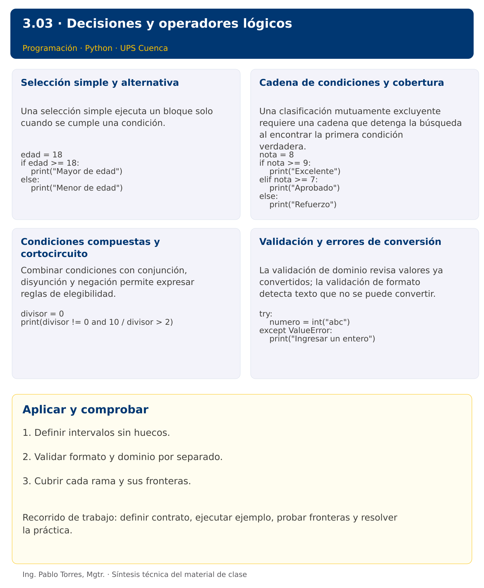

# Programación


## 3.03 · Decisiones y operadores lógicos · Python

**Autor:** Ing. Pablo Torres, Mgtr.  
**Unidad 3:** Lenguaje de Programación  
**Institución:** Universidad Politécnica Salesiana · Computación · Cuenca

[Índice del curso](../../../README.md) · [Versión Java](../java/material.md) · [Presentación](../presentacion.pptx) · [Anterior](../../3.02-entradas-salidas/python/material.md) · [Siguiente](../../3.04-iteracion/python/material.md)

[Conceptos](#concepto-1) · [Demostración](#demostracion) · [Práctica de clase](#pc) · [Lo esencial](#esencial)

**Contexto.** Clasificar una medición como inválida, baja, adecuada o alta. El orden de las decisiones determina si los límites se interpretan correctamente y si una medición obtiene una sola categoría.

**Prerrequisitos.** Conversiones, operadores y valores booleanos.

## 1. Conceptos y ejemplos

<a id="concepto-1"></a>

### 1.1. Selección simple y alternativa

Una selección simple ejecuta un bloque solo cuando se cumple una condición. Una alternativa completa define qué hacer también cuando no se cumple. La condición se evalúa antes del bloque. Escribir la regla en palabras y probar valores a ambos lados del umbral, incluido el propio umbral. No confundir “mayor que” con “mayor o igual que”.

**Aplicar en Python.** Usar if y else con dos puntos y sangría. else es opcional: una selección simple puede omitirlo. El texto fuera del bloque se ejecuta después de la selección si no hubo interrupción.

```python
edad = 18
if edad >= 18:
    print("Mayor de edad")
else:
    print("Menor de edad")
```

<a id="concepto-2"></a>

### 1.2. Cadena de condiciones y cobertura

Una clasificación mutuamente excluyente requiere una cadena que detenga la búsqueda al encontrar la primera condición verdadera. Varios if independientes pueden ejecutar más de una rama. Ordenar umbrales de forma coherente. Definir intervalos sin huecos ni solapamientos y establecer qué hacer con valores fuera del dominio antes de clasificarlos.

**Aplicar en Python.** Usar if, elif y else. Para una escala de 0 a 10, validar el rango y luego comprobar umbrales descendentes. Escribir 0 <= nota <= 10 es válido y expresa una comparación encadenada.

```python
nota = 8
if nota >= 9:
    print("Excelente")
elif nota >= 7:
    print("Aprobado")
else:
    print("Refuerzo")
```

<a id="concepto-3"></a>

### 1.3. Condiciones compuestas y cortocircuito

Combinar condiciones con conjunción, disyunción y negación permite expresar reglas de elegibilidad. El cortocircuito omite la evaluación derecha cuando la izquierda ya decide el resultado. Esto permite proteger una operación, pero el orden debe ser intencional. Aplicar De Morgan al negar rangos completos y no solo a una parte.

**Aplicar en Python.** Usar divisor != 0 and dividendo / divisor > 2 para proteger la división. Preferir condiciones sin efectos secundarios. Escribir x == 1 or x == 2; x == 1 or 2 no significa comparar x con ambos valores.

```python
divisor = 0
print(divisor != 0 and 10 / divisor > 2)
```

<a id="concepto-4"></a>

### 1.4. Validación y errores de conversión

La validación de dominio revisa valores ya convertidos; la validación de formato detecta texto que no se puede convertir. Son controles distintos. Una excepción no debe ocultarse como si el dato fuera válido. Capturar el error esperado, producir un mensaje concreto y mantener el contrato. Comprobar todas las ramas y las fronteras de cada intervalo.

**Aplicar en Python.** Introducir try/except ValueError para convertir una entrada. Mantener el bloque protegido pequeño. No usar except sin tipo para esconder fallos de lógica. La repetición de la solicitud se incorporará con while.

```python
try:
    numero = int("abc")
except ValueError:
    print("Ingresar un entero")
```

Los bloques breves anteriores ilustran una operación y pueden requerir variables o imports del contexto. Utilizar la demostración siguiente como programa completo.


### Síntesis visual



<a id="demostracion"></a>

## 2. Demostración guiada

**Problema.** Clasificar una medición entera de 0 a 100 como Baja si es menor que 40, Adecuada entre 40 y 75 inclusive y Alta por encima de 75.

**Contrato de esta demostración.** Aceptar la medición ya convertida. Mostrar Inválida fuera de [0,100]. Producir exactamente una categoría. La demostración usa 72; probar también -1, 0, 39, 40, 75, 76, 100 y 101.

**Fuente:** [ejemplos/demo.py](ejemplos/demo.py).

<!-- example: demo.py -->
```python
medicion = 72
if medicion < 0 or medicion > 100:
    categoria = "Inválida"
elif medicion < 40:
    categoria = "Baja"
elif medicion <= 75:
    categoria = "Adecuada"
else:
    categoria = "Alta"
print(categoria)
```

### Ejecutar

Abrir una terminal dentro de `03/3.03-estructuras-control/python/ejemplos/` y ejecutar:

```bash
python3 demo.py
```

En Windows, usar `py` en lugar de `python3` si esa es la instalación disponible. Comprobar primero su versión.

### Salida esperada

```text
Adecuada
```

**Interpretación.** Seguir las asignaciones y los bloques en orden, identificar qué instrucción produce cada línea y contrastar con el contrato. Modificar un dato por vez y anticipar el resultado antes de ejecutar. La salida de referencia es una expectativa; el registro de verificaciones indica qué ejecuciones se realizaron.

<a id="ejercicios"></a>

### Ejercicios prácticos progresivos

Resolver los siguientes ejercicios en orden. Entregar enunciado, fuente y resultado propio. Los casos mostrados permiten comprobar el contrato y no sustituyen una prueba adicional de frontera.

#### Ejercicio 01. Signo

Clasificar -4 como positivo, negativo o cero.

**Caso de comprobación:**

```text
Negativo
```

#### Ejercicio 02. Paridad

Indicar si 18 es par o impar.

**Caso de comprobación:**

```text
Par
```

#### Ejercicio 03. Mayor de dos

Comparar 7 y 7. Mostrar el mayor o “Iguales” cuando coincidan.

**Caso de comprobación:**

```text
Iguales
```

#### Ejercicio 04. Intervalo cerrado

Indicar si 10 pertenece al intervalo [5,10].

**Caso de comprobación:**

```text
Dentro
```

#### Ejercicio 05. Descuento por cantidad

Aplicar 10% de descuento desde 10 unidades. Para 12 unidades a 5 mostrar total con dos decimales.

**Caso de comprobación:**

```text
54.00
```

#### Ejercicio 06. División protegida

Para dividendo 8 y divisor 0 mostrar “Divisor inválido” sin intentar dividir.

**Caso de comprobación:**

```text
Divisor inválido
```

#### Ejercicio 07. Clasificación de edad

Clasificar 31 en menor de 18, de 18 a 30, de 31 a 50 o mayor de 50. Rechazar negativos.

**Caso de comprobación:**

```text
31 a 50
```

#### Ejercicio 08. Año bisiesto

Determinar si 1900 es bisiesto: divisible por 400 o divisible por 4 y no por 100.

**Caso de comprobación:**

```text
No bisiesto
```

#### Ejercicio 09. Triángulo válido

Recibir lados 3, 4 y 5. Rechazar lados no positivos o que incumplan desigualdad triangular. Clasificar equilátero, isósceles o escaleno.

**Caso de comprobación:**

```text
Escaleno
```

#### Ejercicio 10. Entrada y rango

Convertir el texto “abc” a nota entera entre 0 y 10. Distinguir formato inválido, rango inválido y valor aceptado.

**Caso de comprobación:**

```text
Formato inválido
```

<a id="pc"></a>

## 3. PC3.03 · Práctica de clase

Leer peso de un paquete y tipo de entrega. Aceptar peso entero entre 1 y 20 y modalidad normal o urgente. Cobrar 3 hasta 5 kg, 6 hasta 10 kg y 10 hasta 20 kg. Agregar 4 por urgencia. Rechazar textos no numéricos, modalidades desconocidas y pesos fuera de rango. Mostrar una única tarifa o un mensaje de error.

### Requisitos y restricciones

- Resolver en una sola versión, Python o Java.
- Mantener nombres y responsabilidades indicados; explicar cualquier adaptación idiomática.
- Aplicar únicamente los conceptos ya introducidos.
- Conservar las entradas cuando el enunciado lo exija.
- Distinguir valores fuera de contrato de errores que el programa debe gestionar.

### Casos de aceptación de la PC

| Entrada / escenario | Resultado esperado |
|---|---|
| 5, normal | 3 |
| 6, urgente | 10 |
| 20, urgente | 14 |
| 0, normal | peso inválido |
| abc, normal | formato inválido |
| 5, exprés | modalidad inválida |

### Probar y registrar evidencia

Crear una carpeta personal `PC3.03` separada de las demostraciones. Guardar cada caso con entrada, resultado esperado y resultado real. Ejecutar `python3 solucion.py` desde esa carpeta. Para entradas de teclado, guardar `casos/entrada-01.txt` y redirigirla con `< casos/entrada-01.txt`. Para funciones, crear llamadas con los datos de la tabla.

- Registrar `evidencias/PC3.03.md` con comandos, versión real, salidas y explicación.
- Crear un commit funcional como `feat(pc3.03): implementar-regla-principal`.
- Obtener el hash real con `git rev-parse HEAD` y anotarlo en la evidencia.
- Revisar el cambio con `git show HASH` y comparar avances con `git diff HASH_ANTERIOR HASH_ACTUAL`. Sustituir los marcadores por hashes reales.
- Agregar una prueba de frontera distinta de las incluidas y justificar qué error detectaría.

No se requiere proyecto acumulativo ni rúbrica individual de esta PC.

<a id="esencial"></a>

## Lo esencial

- Definir intervalos sin huecos.
- Validar formato y dominio por separado.
- Cubrir cada rama y sus fronteras.

## Referencias técnicas

- [Tutorial oficial de Python](https://docs.python.org/3.14/tutorial/)
- [Biblioteca estándar de Python](https://docs.python.org/3.14/library/)

[Índice del curso](../../../README.md) · [Versión Java](../java/material.md) · [Presentación](../presentacion.pptx) · [Anterior](../../3.02-entradas-salidas/python/material.md) · [Siguiente](../../3.04-iteracion/python/material.md)
