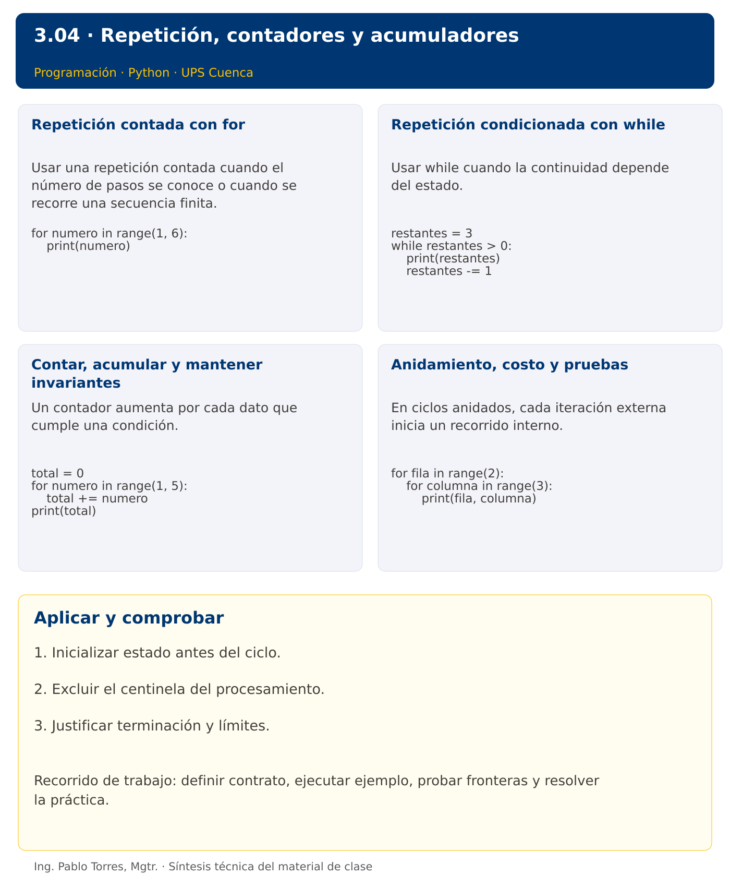

# Programación

## 3.04 · Repetición, contadores y acumuladores · Java

**Autor:** Ing. Pablo Torres, Mgtr.  
**Unidad 3:** Lenguaje de Programación  
**Institución:** Universidad Politécnica Salesiana · Computación · Cuenca

[Índice del curso](../../../README.md) · [Versión Python](../python/material.md) · [Presentación Python](../presentacion.pptx) · [Anterior](../../3.03-estructuras-control/java/material.md) · [Siguiente](../../3.05-funciones/java/material.md)

[Conceptos](#concepto-1) · [Demostración](#demostracion) · [Práctica de clase](#pc) · [Lo esencial](#esencial)

**Contexto.** Resumir varias mediciones requiere repetir la misma regla sin duplicar instrucciones. Diseñar el estado que debe conservarse entre iteraciones y demostrar que el ciclo termina.

**Prerrequisitos.** Decisiones, booleanos y validación.

**Versión complementaria.** Estudiar el mismo problema y los mismos casos de Python mediante construcciones idiomáticas de Java. La presentación compartida corresponde a Python.

## 1. Conceptos y ejemplos

<a id="concepto-1"></a>

### 1.1. Repetición contada con for

Usar una repetición contada cuando el número de pasos se conoce o cuando se recorre una secuencia finita. Separar el número de iteraciones de los valores que toma el contador. Para sumar desde 1 hasta n, incluir n es una decisión del contrato. Probar n igual a cero y a uno para descubrir límites incorrectos.

**Aplicar en Java.** for(int i=1; i<=5; i++) tiene inicialización, condición y actualización. La condición se comprueba antes de cada iteración. Declarar i dentro del for limita su alcance. Un for-each recorrerá arreglos y listas en temas posteriores.

```java
for (int numero = 1; numero <= 5; numero++) {
    System.out.println(numero);
}
```

<a id="concepto-2"></a>

### 1.2. Repetición condicionada con while

Usar while cuando la continuidad depende del estado. El cuerpo puede ejecutarse cero veces. Identificar una cantidad que progrese hacia la terminación. Un centinela termina la lectura y no debe procesarse como dato. Un menú repite hasta una opción de salida, pero cada opción inválida también debe permitir una nueva entrada.

**Aplicar en Java.** while también verifica primero la condición. Java ofrece do-while para ejecutar al menos una vez; explicar esa diferencia cuando se use. No trasladar mecánicamente continue si la actualización ocurre dentro del cuerpo.

```java
int restantes = 3;
while (restantes > 0) {
    System.out.println(restantes);
    restantes--;
}
```

<a id="concepto-3"></a>

### 1.3. Contar, acumular y mantener invariantes

Un contador aumenta por cada dato que cumple una condición. Un acumulador combina magnitudes. Definir qué representa después de k iteraciones: por ejemplo, total es la suma de los primeros k datos. Esta afirmación es un invariante útil para revisar el algoritmo. Calcular un promedio solo si la cantidad es positiva. No reiniciar el acumulador dentro del ciclo si debe conservar el historial.

**Aplicar en Java.** Aplicar las mismas invariantes. Usar long si una suma de enteros puede superar int. Al calcular promedio, convertir antes de dividir, por ejemplo (double)total/cantidad.

```java
int total = 0;
for (int numero = 1; numero <= 4; numero++) total += numero;
System.out.println(total);
```

<a id="concepto-4"></a>

### 1.4. Anidamiento, costo y pruebas

En ciclos anidados, cada iteración externa inicia un recorrido interno. Si existen f filas y c columnas, se realizan f por c visitas cuando ambos límites son fijos. Restablecer los acumuladores por fila dentro del ciclo externo y los globales antes de ambos. Una traza pequeña de dos por tres elementos revela el orden de recorrido sin producir una salida excesiva.

**Aplicar en Java.** Usar variables diferentes y llaves claras. Para un patrón rectangular, i controla filas y j columnas. Distinguir print para una celda de println para finalizar la fila.

```java
for (int fila = 0; fila < 2; fila++) {
    for (int columna = 0; columna < 3; columna++) {
        System.out.println(fila + " " + columna);
    }
}
```

Los bloques breves anteriores ilustran una operación y pueden requerir variables o imports del contexto. Utilizar la demostración siguiente como programa completo.


### Síntesis visual



<a id="demostracion"></a>

## 2. Demostración guiada

**Problema.** Contar y sumar los enteros pares del intervalo de 1 a 10 inclusive.

**Contrato de esta demostración.** Recorrer los diez enteros una vez, iniciar cantidad y total en cero y actualizar solo ante paridad. Producir cantidad 5 y suma 30. No almacenar los valores en una lista.

**Fuente:** [ejemplos/Demo.java](ejemplos/Demo.java).

<!-- example: Demo.java -->
```java
public class Demo {
    public static void main(String[] args) {
        int total = 0, cantidad = 0;
        for (int numero = 1; numero <= 10; numero++) {
            if (numero % 2 == 0) { total += numero; cantidad++; }
        }
        System.out.println("Cantidad: " + cantidad);
        System.out.println("Suma: " + total);
    }
}
```

### Ejecutar

Abrir una terminal dentro de `03/3.04-iteracion/java/ejemplos/` y ejecutar:

```bash
javac -encoding UTF-8 -d build *.java
java -cp build Demo
```

### Salida esperada

```text
Cantidad: 5
Suma: 30
```

**Interpretación.** Seguir las asignaciones y los bloques en orden, identificar qué instrucción produce cada línea y contrastar con el contrato. Modificar un dato por vez y anticipar el resultado antes de ejecutar. La salida de referencia es una expectativa; el registro de verificaciones indica qué ejecuciones se realizaron.

<a id="ejercicios"></a>

### Ejercicios prácticos progresivos

Resolver los siguientes ejercicios en orden. Entregar enunciado, fuente y resultado propio. Los casos mostrados permiten comprobar el contrato y no sustituyen una prueba adicional de frontera.

Adaptar los mismos datos y resultados a Java. Usar `record` para registros y bibliotecas estándar para archivos y procesos. Para resultados booleanos, aceptar `true/false` en Java frente a `True/False` en Python. Los ejercicios que inspeccionan el intérprete deben inspeccionar la JVM y el JDK equivalentes.

#### Ejercicio 01. Secuencia ascendente

Mostrar enteros de 1 a 5, uno por línea.

**Caso de comprobación:**

```text
1
2
3
4
5
```

#### Ejercicio 02. Secuencia descendente

Mostrar 5, 3 y 1 mediante un ciclo.

**Caso de comprobación:**

```text
5
3
1
```

#### Ejercicio 03. Suma hasta n

Sumar enteros de 1 a n para n=10. Admitir n=0 con suma cero.

**Caso de comprobación:**

```text
55
```

#### Ejercicio 04. Contar múltiplos

Contar múltiplos de 3 entre 1 y 20 inclusive.

**Caso de comprobación:**

```text
6
```

#### Ejercicio 05. Factorial

Calcular 5! mediante ciclo. Definir 0!=1 y rechazar negativos en el diseño.

**Caso de comprobación:**

```text
120
```

#### Ejercicio 06. Suma de dígitos

Sumar los dígitos del entero no negativo 4072 utilizando división entera y residuo.

**Caso de comprobación:**

```text
13
```

#### Ejercicio 07. Potencia por repetición

Calcular 3 elevado a 4 sin operador de potencia ni bibliotecas. Aceptar exponente no negativo.

**Caso de comprobación:**

```text
81
```

#### Ejercicio 08. Número primo

Determinar si 29 es primo mediante divisores. Tratar n<2 como no primo.

**Caso de comprobación:**

```text
Primo
```

#### Ejercicio 09. Patrón triangular

Mostrar tres filas de asteriscos: uno, dos y tres, usando ciclos anidados.

**Caso de comprobación:**

```text
*
**
***
```

#### Ejercicio 10. Lectura con centinela

Procesar 4, -2, 6 y -1. Finalizar con -1, rechazar otros negativos y mostrar cantidad y suma de los aceptados. Usar while y lectura simulada.

**Caso de comprobación:**

```text
2 10
```

<a id="pc"></a>

## 3. PC3.04 · Práctica de clase

Leer temperaturas enteras entre -20 y 50 hasta recibir 999. Rechazar datos fuera de rango sin contarlos. Mostrar cantidad, mínimo, máximo y promedio con dos decimales. Si no existen datos, mostrar “Sin datos”. Recuperarse de entradas no numéricas y no usar listas para resolver este ejercicio.

### Requisitos y restricciones

- Resolver en una sola versión, Python o Java.
- Mantener nombres y responsabilidades indicados; explicar cualquier adaptación idiomática.
- Aplicar únicamente los conceptos ya introducidos.
- Conservar las entradas cuando el enunciado lo exija.
- Distinguir valores fuera de contrato de errores que el programa debe gestionar.

### Casos de aceptación de la PC

| Entrada / escenario | Resultado esperado |
|---|---|
| 10, 20, 999 | cantidad 2; mínimo 10; máximo 20; promedio 15.00 |
| 999 | Sin datos |
| -30, -10, 999 | rechazar -30; promedio -10.00 |
| abc, 0, 999 | rechazar abc; promedio 0.00 |

### Probar y registrar evidencia

Crear una carpeta personal `PC3.04` separada de las demostraciones. Guardar cada caso con entrada, resultado esperado y resultado real. Compilar `javac -encoding UTF-8 -d build *.java` y ejecutar `java -cp build Solucion`; usar `Solucion.java` como entrada personal. Para entradas de teclado, guardar `casos/entrada-01.txt` y redirigirla con `< casos/entrada-01.txt`. Para funciones, crear llamadas con los datos de la tabla.

- Registrar `evidencias/PC3.04.md` con comandos, versión real, salidas y explicación.
- Crear un commit funcional como `feat(pc3.04): implementar-regla-principal`.
- Obtener el hash real con `git rev-parse HEAD` y anotarlo en la evidencia.
- Revisar el cambio con `git show HASH` y comparar avances con `git diff HASH_ANTERIOR HASH_ACTUAL`. Sustituir los marcadores por hashes reales.
- Agregar una prueba de frontera distinta de las incluidas y justificar qué error detectaría.

No se requiere proyecto acumulativo ni rúbrica individual de esta PC.

<a id="esencial"></a>

## Lo esencial

- Inicializar estado antes del ciclo.
- Excluir el centinela del procesamiento.
- Justificar terminación y límites.

## Referencias técnicas

- [Aprender Java, sitio oficial](https://dev.java/learn/)
- [API de Java SE 27](https://docs.oracle.com/en/java/javase/27/docs/api/)

[Índice del curso](../../../README.md) · [Versión Python](../python/material.md) · [Presentación Python](../presentacion.pptx) · [Anterior](../../3.03-estructuras-control/java/material.md) · [Siguiente](../../3.05-funciones/java/material.md)
