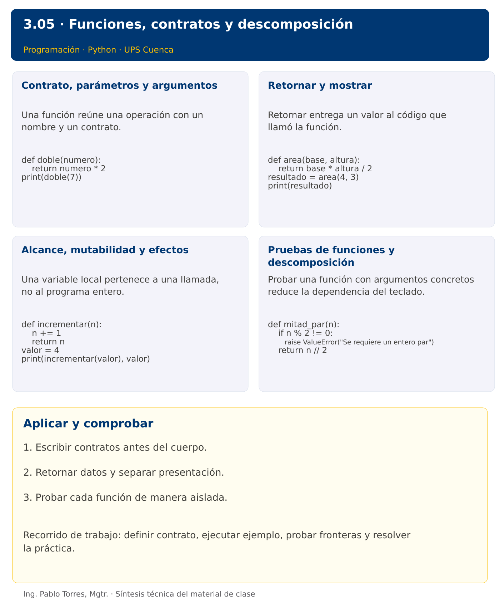

# Programación

## 3.05 · Funciones, contratos y descomposición · Python

**Autor:** Ing. Pablo Torres, Mgtr.  
**Unidad 3:** Lenguaje de Programación  
**Institución:** Universidad Politécnica Salesiana · Computación · Cuenca

[Índice del curso](../../../README.md) · [Versión Java](../java/material.md) · [Presentación](../presentacion.pptx) · [Anterior](../../3.04-iteracion/python/material.md) · [Siguiente](../../3.06-cadenas/python/material.md)

[Conceptos](#concepto-1) · [Demostración](#demostracion) · [Práctica de clase](#pc) · [Lo esencial](#esencial)

**Contexto.** Calcular un resumen desde varios lugares del programa sin duplicar las reglas. Separar funciones que calculan de funciones que presentan resultados permite probar cada responsabilidad con datos concretos.

**Prerrequisitos.** Decisiones, ciclos y trazas.

## 1. Conceptos y ejemplos

<a id="concepto-1"></a>

### 1.1. Contrato, parámetros y argumentos

Una función reúne una operación con un nombre y un contrato. Los parámetros describen los datos que necesita; los argumentos son los valores de una llamada. Especificar precondiciones, resultado y efectos permite utilizarla sin leer su implementación. Elegir una responsabilidad precisa: validar una cantidad, calcular una tarifa o mostrar un informe. Evitar una función que simultáneamente lea, modifique datos y decida toda la aplicación.

**Aplicar en Python.** Definir con def y devolver con return. Los nombres de parámetros pertenecen al alcance local. Una anotación de tipo documenta, pero no valida automáticamente los argumentos. Comenzar con parámetros posicionales y luego usar nombres cuando aporten claridad.

```python
def doble(numero):
    return numero * 2
print(doble(7))
```

<a id="concepto-2"></a>

### 1.2. Retornar y mostrar

Retornar entrega un valor al código que llamó la función. Mostrar escribe en una salida y produce un efecto observable. Una función de cálculo que solo imprime dificulta reutilizar su resultado en otra operación. Separar ambas responsabilidades cuando el resultado se necesita después. return también finaliza la llamada, por lo que instrucciones posteriores en ese camino no se ejecutan.

**Aplicar en Python.** Una función sin return explícito devuelve None. print también devuelve None. No asignar resultado = print(...) esperando recuperar el texto mostrado. Usar return para resultados y dejar print en una capa de presentación.

```python
def area(base, altura):
    return base * altura / 2
resultado = area(4, 3)
print(resultado)
```

<a id="concepto-3"></a>

### 1.3. Alcance, mutabilidad y efectos

Una variable local pertenece a una llamada, no al programa entero. Evitar estado global para que una función dependa de argumentos visibles. Al pasar una colección, distinguir reasignar el parámetro de modificar el objeto compartido. La mutación se estudiará con listas; desde ahora, indicar si una función conserva o cambia sus entradas. Una función pura devuelve el mismo resultado para los mismos argumentos y no produce efectos externos.

**Aplicar en Python.** Reasignar un parámetro no reasigna el nombre usado por quien llama. Los nombres se enlazan a objetos. No usar listas mutables como valores predeterminados de parámetros: el mismo objeto se reutiliza entre llamadas.

```python
def incrementar(n):
    n += 1
    return n
valor = 4
print(incrementar(valor), valor)
```

<a id="concepto-4"></a>

### 1.4. Pruebas de funciones y descomposición

Probar una función con argumentos concretos reduce la dependencia del teclado. Comparar resultado y valor esperado, incluir fronteras y entrada inválida. Descomponer un problema en funciones que tengan nombres relacionados con el dominio. No crear funciones solo para ocultar una línea si no mejora el contrato. Mantener la validación donde corresponda y evitar que una función devuelva a veces número y a veces mensaje de error sin especificarlo.

**Aplicar en Python.** Usar assert en comprobaciones docentes y excepciones explícitas para precondiciones incumplidas. No usar assert como validación de entrada de una aplicación porque puede desactivarse. raise ValueError comunica un argumento fuera de dominio.

```python
def mitad_par(n):
    if n % 2 != 0:
        raise ValueError("Se requiere un entero par")
    return n // 2
```

Los bloques breves anteriores ilustran una operación y pueden requerir variables o imports del contexto. Utilizar la demostración siguiente como programa completo.


### Síntesis visual



<a id="demostracion"></a>

## 2. Demostración guiada

**Problema.** Implementar costo_horas y comprobar un cálculo válido y una llamada con horas negativas.

**Contrato de esta demostración.** Recibir horas enteras no negativas y tarifa numérica no negativa. Retornar su producto sin imprimir dentro del cálculo. Lanzar error de argumento si existe un valor negativo. El llamador muestra el resultado y gestiona el error.

**Fuente:** [ejemplos/demo.py](ejemplos/demo.py).

<!-- example: demo.py -->
```python
def costo_horas(horas, tarifa):
    if horas < 0 or tarifa < 0:
        raise ValueError("Valores negativos")
    return horas * tarifa

print(f"Costo: {costo_horas(3, 2.5):.2f}")
try:
    costo_horas(-1, 2.5)
except ValueError as error:
    print(error)
```

### Ejecutar

Abrir una terminal dentro de `03/3.05-funciones/python/ejemplos/` y ejecutar:

```bash
python3 demo.py
```

En Windows, usar `py` en lugar de `python3` si esa es la instalación disponible. Comprobar primero su versión.

### Salida esperada

```text
Costo: 7.50
Valores negativos
```

**Interpretación.** Seguir las asignaciones y los bloques en orden, identificar qué instrucción produce cada línea y contrastar con el contrato. Modificar un dato por vez y anticipar el resultado antes de ejecutar. La salida de referencia es una expectativa; el registro de verificaciones indica qué ejecuciones se realizaron.

<a id="ejercicios"></a>

### Ejercicios prácticos progresivos

Resolver los siguientes ejercicios en orden. Entregar enunciado, fuente y resultado propio. Los casos mostrados permiten comprobar el contrato y no sustituyen una prueba adicional de frontera.

#### Ejercicio 01. Doble

Definir doble(n) y comprobar doble(6).

**Caso de comprobación:**

```text
12
```

#### Ejercicio 02. Área

Definir area_rectangulo(base,altura) y comprobar 5 por 4.

**Caso de comprobación:**

```text
20
```

#### Ejercicio 03. Paridad retornada

Definir es_par(n) que retorne bool. Mostrar el resultado para 7.

**Caso de comprobación:**

```text
False
```

#### Ejercicio 04. Máximo de tres

Definir mayor(a,b,c) sin usar max. Probar 8, 3 y 8.

**Caso de comprobación:**

```text
8
```

#### Ejercicio 05. Suma de rango

Definir sumar_rango(inicio,fin) inclusivo. Rechazar inicio mayor que fin. Probar 3 a 6.

**Caso de comprobación:**

```text
18
```

#### Ejercicio 06. Factorial validado

Definir factorial(n) para enteros no negativos. Probar cero y cinco.

**Caso de comprobación:**

```text
1 120
```

#### Ejercicio 07. Contar divisores

Definir contar_divisores(n) para n>0. Probar 12.

**Caso de comprobación:**

```text
6
```

#### Ejercicio 08. Número perfecto

Definir es_perfecto(n) utilizando suma de divisores propios. Probar 6 y 8.

**Caso de comprobación:**

```text
True False
```

#### Ejercicio 09. Máximo común divisor

Definir mcd(a,b) mediante Euclides. Aceptar enteros, usar valores absolutos y definir mcd(0,0)=0. Probar 48 y 18.

**Caso de comprobación:**

```text
6
```

#### Ejercicio 10. Composición

Definir costo(cantidad,precio) y aplicar_descuento(total,porcentaje). Validar dominios y componerlas para 4 artículos a 12 con 25% de descuento.

**Caso de comprobación:**

```text
36.00
```

<a id="pc"></a>

## 3. PC3.05 · Práctica de clase

Definir es_primo(n), contar_primos(inicio, fin) y una función de presentación. Aceptar enteros y un intervalo con inicio <= fin. Considerar que números menores que 2 no son primos. Retornar resultados desde las funciones de cálculo y mostrar desde la función de presentación. Rechazar intervalos invertidos con un error explícito.

### Requisitos y restricciones

- Resolver en una sola versión, Python o Java.
- Mantener nombres y responsabilidades indicados; explicar cualquier adaptación idiomática.
- Aplicar únicamente los conceptos ya introducidos.
- Conservar las entradas cuando el enunciado lo exija.
- Distinguir valores fuera de contrato de errores que el programa debe gestionar.

### Casos de aceptación de la PC

| Entrada / escenario | Resultado esperado |
|---|---|
| 2, 10 | 4 primos |
| -3, 1 | 0 primos |
| 7, 7 | 1 primo |
| 10, 2 | intervalo inválido |

### Probar y registrar evidencia

Crear una carpeta personal `PC3.05` separada de las demostraciones. Guardar cada caso con entrada, resultado esperado y resultado real. Ejecutar `python3 solucion.py` desde esa carpeta. Para entradas de teclado, guardar `casos/entrada-01.txt` y redirigirla con `< casos/entrada-01.txt`. Para funciones, crear llamadas con los datos de la tabla.

- Registrar `evidencias/PC3.05.md` con comandos, versión real, salidas y explicación.
- Crear un commit funcional como `feat(pc3.05): implementar-regla-principal`.
- Obtener el hash real con `git rev-parse HEAD` y anotarlo en la evidencia.
- Revisar el cambio con `git show HASH` y comparar avances con `git diff HASH_ANTERIOR HASH_ACTUAL`. Sustituir los marcadores por hashes reales.
- Agregar una prueba de frontera distinta de las incluidas y justificar qué error detectaría.

No se requiere proyecto acumulativo ni rúbrica individual de esta PC.

<a id="esencial"></a>

## Lo esencial

- Escribir contratos antes del cuerpo.
- Retornar datos y separar presentación.
- Probar cada función de manera aislada.

## Referencias técnicas

- [Tutorial oficial de Python](https://docs.python.org/3.14/tutorial/)
- [Biblioteca estándar de Python](https://docs.python.org/3.14/library/)

[Índice del curso](../../../README.md) · [Versión Java](../java/material.md) · [Presentación](../presentacion.pptx) · [Anterior](../../3.04-iteracion/python/material.md) · [Siguiente](../../3.06-cadenas/python/material.md)
