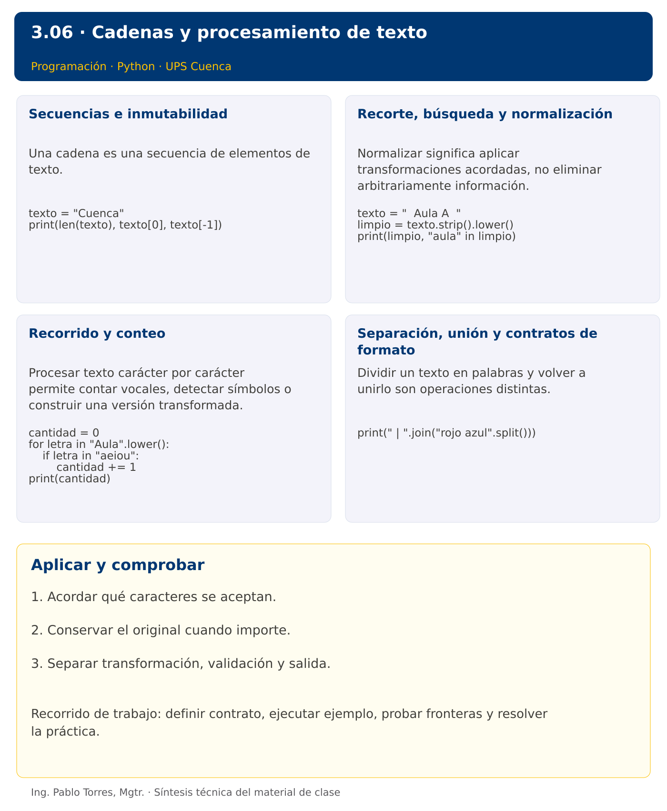

# Programación


## 3.06 · Cadenas y procesamiento de texto · Python

**Autor:** Ing. Pablo Torres, Mgtr.  
**Unidad 3:** Lenguaje de Programación  


 [Anterior](../../3.05-funciones/python/material.md) · [Siguiente](../../3.07-listas/python/material.md)

[Conceptos](#concepto-1) · [Demostración](#demostracion) · [Práctica de clase](#pc) · [Lo esencial](#esencial)

**Contexto.** Normalizar nombres y extraer información de mensajes requiere tratar el texto como una secuencia. Definir qué cuenta como letra, vocal o palabra evita que dos programas aparentemente correctos resuelvan problemas diferentes.

**Prerrequisitos.** Funciones, ciclos y decisiones.

## 1. Conceptos y ejemplos

<a id="concepto-1"></a>

### 1.1. Secuencias e inmutabilidad

Una cadena es una secuencia de elementos de texto. Su longitud, índices y reglas de comparación dependen del lenguaje. Las cadenas son inmutables: una transformación produce otro valor. Definir si espacios, tildes y mayúsculas son significativos. Un carácter visible puede requerir varios puntos de código, por lo que “cantidad de letras” no siempre coincide con una longitud técnica.

**Aplicar en Python.** Los índices de str seleccionan puntos de código Unicode. len cuenta esos puntos de código, no grafemas visibles. Usar texto[0] solo cuando no esté vacío. Un índice negativo cuenta desde el final. Asignar texto[0] = "A" produce TypeError.

```python
texto = "Cuenca"
print(len(texto), texto[0], texto[-1])
```

<a id="concepto-2"></a>

### 1.2. Recorte, búsqueda y normalización

Normalizar significa aplicar transformaciones acordadas, no eliminar arbitrariamente información. Quitar espacios externos no quita todos los espacios interiores. Buscar una subcadena puede servir para clasificar, pero no demuestra que un texto cumpla un formato completo. Conservar el original cuando se necesite mostrar exactamente lo recibido.

**Aplicar en Python.** strip elimina espacios en extremos. lower o casefold sirven para comparaciones sin distinguir mayúsculas, con diferencias Unicode. in comprueba pertenencia de una subcadena. El corte [inicio:fin] excluye fin y no modifica el texto.

```python
texto = "  Aula A  "
limpio = texto.strip().lower()
print(limpio, "aula" in limpio)
```

<a id="concepto-3"></a>

### 1.3. Recorrido y conteo

Procesar texto carácter por carácter permite contar vocales, detectar símbolos o construir una versión transformada. Inicializar un acumulador, evaluar cada elemento y definir qué hacer con los no reconocidos. Si el problema cuenta solo a, e, i, o, u, las vocales acentuadas no se incluyen a menos que el contrato lo indique. Probar cadena vacía y texto compuesto únicamente por separadores.

**Aplicar en Python.** for letra in texto recorre caracteres. Para conservar claridad, empezar con un contador explícito. La concatenación repetida puede ser costosa en textos grandes; reunir partes y unirlas será útil después de listas.

```python
cantidad = 0
for letra in "Aula".lower():
    if letra in "aeiou":
        cantidad += 1
print(cantidad)
```

<a id="concepto-4"></a>

### 1.4. Separación, unión y contratos de formato

Dividir un texto en palabras y volver a unirlo son operaciones distintas. Definir qué ocurre con separadores repetidos, espacios vacíos y signos. Una salida sin corchetes ni comas debe construirse desde los elementos, no desde la representación de una colección. Estas operaciones preparan el procesamiento de filas y archivos.

**Aplicar en Python.** split sin argumento agrupa espacios consecutivos y omite vacíos en extremos. split(",") conserva campos vacíos entre comas. join requiere elementos str. No confundir replace con una modificación del mismo objeto.

```python
print(" | ".join("rojo azul".split()))
```

Los bloques breves anteriores ilustran una operación y pueden requerir variables o imports del contexto. Utilizar la demostración siguiente como programa completo.


### Síntesis visual



<a id="demostracion"></a>

## 2. Demostración guiada

**Problema.** Quitar espacios externos del nombre Cuenca y contar sus vocales ASCII sin distinguir mayúsculas.

**Contrato de esta demostración.** Recibir una cadena no nula. Contar únicamente a, e, i, o, u después de normalizar mayúsculas. Retornar cero para la cadena vacía. No contar vocales con tilde en este contrato. Mostrar nombre normalizado y conteo.

**Fuente:** [ejemplos/demo.py](ejemplos/demo.py).

<!-- example: demo.py -->
```python
def contar_vocales(texto):
    cantidad = 0
    for letra in texto.lower():
        if letra in "aeiou":
            cantidad += 1
    return cantidad

nombre = "  Cuenca  ".strip()
print(nombre)
print(f"Vocales: {contar_vocales(nombre)}")
```

### Ejecutar

Abrir una terminal dentro de `03/3.06-cadenas/python/ejemplos/` y ejecutar:

```bash
python3 demo.py
```

En Windows, usar `py` en lugar de `python3` si esa es la instalación disponible. Comprobar primero su versión.

### Salida esperada

```text
Cuenca
Vocales: 3
```

**Interpretación.** Seguir las asignaciones y los bloques en orden, identificar qué instrucción produce cada línea y contrastar con el contrato. Modificar un dato por vez y anticipar el resultado antes de ejecutar. La salida de referencia es una expectativa; el registro de verificaciones indica qué ejecuciones se realizaron.

<a id="ejercicios"></a>

### Ejercicios prácticos progresivos

Resolver los siguientes ejercicios en orden. Entregar enunciado, fuente y resultado propio. Los casos mostrados permiten comprobar el contrato y no sustituyen una prueba adicional de frontera.

#### Ejercicio 01. Longitud y extremos

Para “Cuenca” mostrar longitud, primer y último carácter. Definir cómo evitar acceso a extremos de cadena vacía.

**Caso de comprobación:**

```text
6 C a
```

#### Ejercicio 02. Normalización básica

Quitar espacios externos de “  Aula  ” y convertir a mayúsculas.

**Caso de comprobación:**

```text
AULA
```

#### Ejercicio 03. Conteo de vocales

Contar vocales aeiou sin distinguir mayúsculas en “Educacion”.

**Caso de comprobación:**

```text
5
```

#### Ejercicio 04. Conteo de dígitos ASCII

Contar caracteres 0 a 9 en “A2B45”. No aceptar dígitos de otros alfabetos.

**Caso de comprobación:**

```text
3
```

#### Ejercicio 05. Inversión

Invertir “sol” mediante recorrido, sin slicing inverso.

**Caso de comprobación:**

```text
los
```

#### Ejercicio 06. Palíndromo

Comprobar “Anita lava la tina” ignorando espacios ASCII y mayúsculas. No eliminar otros símbolos.

**Caso de comprobación:**

```text
True
```

#### Ejercicio 07. Comprimir espacios

Convertir “  uno   dos  tres ” en “uno dos tres”.

**Caso de comprobación:**

```text
uno dos tres
```

#### Ejercicio 08. Máscara selectiva

Reemplazar cada vocal ASCII de “programar” por * y conservar los demás caracteres.

**Caso de comprobación:**

```text
pr*gr*m*r
```

#### Ejercicio 09. Iniciales

Obtener iniciales en mayúsculas de “  ana maria torres ”, ignorando espacios repetidos.

**Caso de comprobación:**

```text
AMT
```

#### Ejercicio 10. Contraseña básica

Validar longitud mínima de ocho, al menos una mayúscula ASCII, una minúscula ASCII y un dígito. Rechazar espacios. Probar “Clave123”. No presentar estas reglas como una política de seguridad completa.

**Caso de comprobación:**

```text
True
```

<a id="pc"></a>

## 3. PC3.06 · Práctica de clase

Definir analizar_codigo(texto): quitar espacios externos, aceptar de 3 a 8 caracteres ASCII alfanuméricos y exigir al menos una letra y un dígito. Retornar una versión en mayúsculas cuando sea válido; lanzar un error concreto cuando no lo sea. No aceptar espacios internos, tildes ni símbolos. Separar validación y presentación.

### Requisitos y restricciones

- Resolver en una sola versión, Python o Java.
- Mantener nombres y responsabilidades indicados; explicar cualquier adaptación idiomática.
- Aplicar únicamente los conceptos ya introducidos.
- Conservar las entradas cuando el enunciado lo exija.
- Distinguir valores fuera de contrato de errores que el programa debe gestionar.

### Casos de aceptación de la PC

| Entrada / escenario | Resultado esperado |
|---|---|
|  ab3  | AB3 |
| abc | falta dígito |
| 123 | falta letra |
| a 1 | carácter inválido |
| a1 | longitud inválida |
| á12 | carácter inválido |

### Probar y registrar evidencia

Crear una carpeta personal `PC3.06` separada de las demostraciones. Guardar cada caso con entrada, resultado esperado y resultado real. Ejecutar `python3 solucion.py` desde esa carpeta. Para entradas de teclado, guardar `casos/entrada-01.txt` y redirigirla con `< casos/entrada-01.txt`. Para funciones, crear llamadas con los datos de la tabla.

- Registrar `evidencias/PC3.06.md` con comandos, versión real, salidas y explicación.
- Crear un commit funcional como `feat(pc3.06): implementar-regla-principal`.
- Obtener el hash real con `git rev-parse HEAD` y anotarlo en la evidencia.
- Revisar el cambio con `git show HASH` y comparar avances con `git diff HASH_ANTERIOR HASH_ACTUAL`. Sustituir los marcadores por hashes reales.
- Agregar una prueba de frontera distinta de las incluidas y justificar qué error detectaría.

No se requiere proyecto acumulativo ni rúbrica individual de esta PC.

<a id="esencial"></a>

## Lo esencial

- Acordar qué caracteres se aceptan.
- Conservar el original cuando importe.
- Separar transformación, validación y salida.

## Referencias técnicas

- [Tutorial oficial de Python](https://docs.python.org/3.14/tutorial/)
- [Biblioteca estándar de Python](https://docs.python.org/3.14/library/)

 [Anterior](../../3.05-funciones/python/material.md) · [Siguiente](../../3.07-listas/python/material.md)
