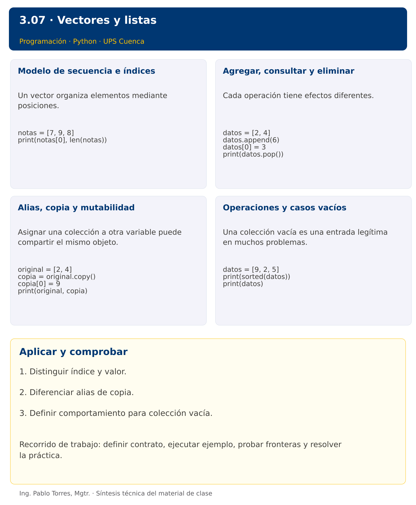

# Programación


## 3.07 · Vectores y listas · Python

**Autor:** Ing. Pablo Torres, Mgtr.  
**Unidad 3:** Lenguaje de Programación  


[Índice del curso](../../../README.md) · [Versión Java](../java/material.md) · [Presentación](../presentacion.pptx) · [Anterior](../../3.06-cadenas/python/material.md) · [Siguiente](../../3.08-listas-recorridos/python/material.md)

[Conceptos](#concepto-1) · [Demostración](#demostracion) · [Práctica de clase](#pc) · [Lo esencial](#esencial)

**Contexto.** Guardar varias mediciones permite consultarlas y transformarlas sin crear una variable por observación. Elegir una estructura según su tamaño y mutabilidad, y distinguir una copia de otro nombre para la misma colección.

**Prerrequisitos.** Cadenas, funciones y ciclos.

## 1. Conceptos y ejemplos

<a id="concepto-1"></a>

### 1.1. Modelo de secuencia e índices

Un vector organiza elementos mediante posiciones. Una lista ofrece una secuencia cuyo tamaño puede cambiar. El primer índice suele ser cero y el último válido es longitud menos uno. Separar posición y valor: buscar la medición 20 no equivale a consultar la posición 20. Antes de acceder, comprobar que la colección tenga elementos y que el índice pertenezca al dominio.

**Aplicar en Python.** list es una secuencia mutable y dinámica de referencias. Puede contener tipos distintos, pero usar elementos homogéneos simplifica el contrato de estos ejercicios. Los índices negativos cuentan desde el final; los positivos fuera de rango producen IndexError.

```python
notas = [7, 9, 8]
print(notas[0], len(notas))
```

<a id="concepto-2"></a>

### 1.2. Agregar, consultar y eliminar

Cada operación tiene efectos diferentes. Agregar aumenta el tamaño, reemplazar conserva el tamaño y eliminar desplaza las posiciones posteriores. Al borrar por valor puede haber duplicados y solo eliminarse la primera aparición. Definir si ausencia de un elemento es error o resultado normal. No modificar mientras se recorre hasta comprender cómo cambian los índices.

**Aplicar en Python.** append agrega al final, insert inserta, pop elimina y devuelve por índice, remove elimina la primera coincidencia. Estos métodos mutadores generalmente no devuelven la lista. No escribir lista = lista.append(x), porque append devuelve None.

```python
datos = [2, 4]
datos.append(6)
datos[0] = 3
print(datos.pop())
```

<a id="concepto-3"></a>

### 1.3. Alias, copia y mutabilidad

Asignar una colección a otra variable puede compartir el mismo objeto. Una copia superficial crea un contenedor nuevo, pero puede compartir elementos internos. Con números inmutables basta para muchas transformaciones. Con listas anidadas, copiar solo el contenedor externo no aísla las filas. Definir expresamente si una función puede modificar la entrada.

**Aplicar en Python.** copia = datos.copy() o datos[:] crea una copia superficial. alias = datos comparte la misma lista. is compara identidad y == compara valores de listas. En matrices será necesario copiar cada fila para independizar su estructura.

```python
original = [2, 4]
copia = original.copy()
copia[0] = 9
print(original, copia)
```

<a id="concepto-4"></a>

### 1.4. Operaciones y casos vacíos

Una colección vacía es una entrada legítima en muchos problemas. La suma vacía puede definirse como cero, mientras que un mínimo sin datos requiere un error o un resultado de ausencia. El ordenamiento cambia el orden, por lo que puede destruir una correspondencia con posiciones originales. Decidir si el algoritmo debe conservar orden, duplicados y valores de entrada.

**Aplicar en Python.** sorted devuelve una lista nueva; sort ordena la existente y devuelve None. min y max fallan sobre una secuencia vacía sin valor predeterminado. Slices permiten seleccionar rangos sin lanzar IndexError por un extremo superior grande.

```python
datos = [9, 2, 5]
print(sorted(datos))
print(datos)
```

Los bloques breves anteriores ilustran una operación y pueden requerir variables o imports del contexto. Utilizar la demostración siguiente como programa completo.


### Síntesis visual



<a id="demostracion"></a>

## 2. Demostración guiada

**Problema.** Copiar las mediciones [18,21,19], agregar 22 a la copia y mostrar ambas colecciones.

**Contrato de esta demostración.** Construir un contenedor nuevo. Conservar los tres elementos originales y su orden. Agregar el cuarto elemento solo a la copia. Mostrar elementos separados por espacios y distinguir Original de Copia.

**Fuente:** [ejemplos/demo.py](ejemplos/demo.py).

<!-- example: demo.py -->
```python
mediciones = [18, 21, 19]
copia = mediciones.copy()
copia.append(22)
print("Original:", " ".join(str(x) for x in mediciones))
print("Copia:", " ".join(str(x) for x in copia))
```

### Ejecutar

Abrir una terminal dentro de `03/3.07-listas/python/ejemplos/` y ejecutar:

```bash
python3 demo.py
```

En Windows, usar `py` en lugar de `python3` si esa es la instalación disponible. Comprobar primero su versión.

### Salida esperada

```text
Original: 18 21 19
Copia: 18 21 19 22
```

**Interpretación.** Seguir las asignaciones y los bloques en orden, identificar qué instrucción produce cada línea y contrastar con el contrato. Modificar un dato por vez y anticipar el resultado antes de ejecutar. La salida de referencia es una expectativa; el registro de verificaciones indica qué ejecuciones se realizaron.

<a id="ejercicios"></a>

### Ejercicios prácticos progresivos

Resolver los siguientes ejercicios en orden. Entregar enunciado, fuente y resultado propio. Los casos mostrados permiten comprobar el contrato y no sustituyen una prueba adicional de frontera.

#### Ejercicio 01. Consulta inicial

Crear [4,7,9] y mostrar su longitud y primer elemento.

**Caso de comprobación:**

```text
3 4
```

#### Ejercicio 02. Agregar al final

Agregar 8 a [2,4] y mostrar elementos separados por espacios.

**Caso de comprobación:**

```text
2 4 8
```

#### Ejercicio 03. Reemplazo

Reemplazar la posición 1 de [5,6,7] por 20.

**Caso de comprobación:**

```text
5 20 7
```

#### Ejercicio 04. Eliminar por posición

Eliminar posición 1 de [5,6,7] y mostrar elemento eliminado y lista final.

**Caso de comprobación:**

```text
6
5 7
```

#### Ejercicio 05. Copia independiente

Copiar [1,2], agregar 3 solo a la copia y mostrar ambas.

**Caso de comprobación:**

```text
1 2
1 2 3
```

#### Ejercicio 06. Selección de rango

Extraer posiciones 1, 2 y 3 de [10,20,30,40,50] sin modificarla.

**Caso de comprobación:**

```text
20 30 40
```

#### Ejercicio 07. Orden conservado

Obtener una versión ordenada de [8,2,5] conservando el original.

**Caso de comprobación:**

```text
2 5 8
8 2 5
```

#### Ejercicio 08. Rotación simple

Mover el último elemento de [1,2,3,4] al inicio. Admitir vacía sin error y devolver una colección nueva.

**Caso de comprobación:**

```text
4 1 2 3
```

#### Ejercicio 09. Inserción validada

Insertar 9 en posición 2 de [1,2,3]. Exigir índice entre 0 y longitud inclusive, sin usar tolerancia automática de insert.

**Caso de comprobación:**

```text
1 2 9 3
```

#### Ejercicio 10. Intercambio de extremos

Devolver una copia con extremos intercambiados para [8,2,3,4]. Mantener vacías y unitarias sin cambios.

**Caso de comprobación:**

```text
4 2 3 8
```

<a id="pc"></a>

## 3. PC3.07 · Práctica de clase

Implementar actualizar_copia(datos, posicion, valor): devolver una colección nueva con un elemento reemplazado. Conservar tamaño y original. Exigir 0 <= posicion < longitud, incluso en Python. Rechazar índice inválido y colección vacía. Mostrar ambos valores desde una función separada.

### Requisitos y restricciones

- Resolver en una sola versión, Python o Java.
- Mantener nombres y responsabilidades indicados; explicar cualquier adaptación idiomática.
- Aplicar únicamente los conceptos ya introducidos.
- Conservar las entradas cuando el enunciado lo exija.
- Distinguir valores fuera de contrato de errores que el programa debe gestionar.

### Casos de aceptación de la PC

| Entrada / escenario | Resultado esperado |
|---|---|
| [4, 8, 2], 1, 9 | [4, 9, 2]; original [4, 8, 2] |
| [4], 0, 0 | [0] |
| [], 0, 1 | índice inválido |
| [4], -1, 3 | índice inválido |

### Probar y registrar evidencia

Crear una carpeta personal `PC3.07` separada de las demostraciones. Guardar cada caso con entrada, resultado esperado y resultado real. Ejecutar `python3 solucion.py` desde esa carpeta. Para entradas de teclado, guardar `casos/entrada-01.txt` y redirigirla con `< casos/entrada-01.txt`. Para funciones, crear llamadas con los datos de la tabla.

- Registrar `evidencias/PC3.07.md` con comandos, versión real, salidas y explicación.
- Crear un commit funcional como `feat(pc3.07): implementar-regla-principal`.
- Obtener el hash real con `git rev-parse HEAD` y anotarlo en la evidencia.
- Revisar el cambio con `git show HASH` y comparar avances con `git diff HASH_ANTERIOR HASH_ACTUAL`. Sustituir los marcadores por hashes reales.
- Agregar una prueba de frontera distinta de las incluidas y justificar qué error detectaría.

No se requiere proyecto acumulativo ni rúbrica individual de esta PC.

<a id="esencial"></a>

## Lo esencial

- Distinguir índice y valor.
- Diferenciar alias de copia.
- Definir comportamiento para colección vacía.

## Referencias técnicas

- [Tutorial oficial de Python](https://docs.python.org/3.14/tutorial/)
- [Biblioteca estándar de Python](https://docs.python.org/3.14/library/)

[Índice del curso](../../../README.md) · [Versión Java](../java/material.md) · [Presentación](../presentacion.pptx) · [Anterior](../../3.06-cadenas/python/material.md) · [Siguiente](../../3.08-listas-recorridos/python/material.md)
