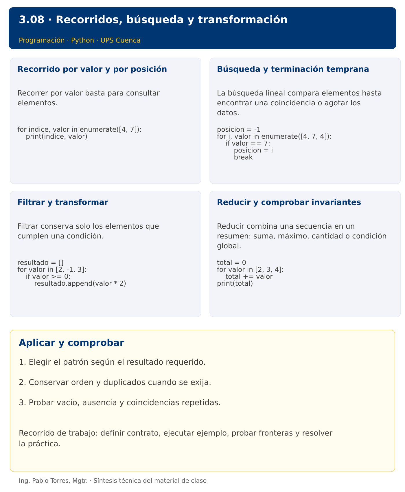

# Programación


## 3.08 · Recorridos, búsqueda y transformación · Java

**Autor:** Ing. Pablo Torres, Mgtr.  
**Unidad 3:** Lenguaje de Programación  
**Institución:** Universidad Politécnica Salesiana · Computación · Cuenca

[Índice del curso](../../../README.md) · [Versión Python](../python/material.md) · [Presentación Python](../presentacion.pptx) · [Anterior](../../3.07-listas/java/material.md) · [Siguiente](../../3.09-matrices/java/material.md)

[Conceptos](#concepto-1) · [Demostración](#demostracion) · [Práctica de clase](#pc) · [Lo esencial](#esencial)

**Contexto.** Revisar un conjunto de consumos permite practicar búsqueda, filtrado, transformación y reducción. Cada patrón produce un tipo de resultado diferente y requiere un estado distinto.

**Prerrequisitos.** Listas, funciones y ciclos.

**Versión complementaria.** Estudiar el mismo problema y los mismos casos de Python mediante construcciones idiomáticas de Java. La presentación compartida corresponde a Python.

## 1. Conceptos y ejemplos

<a id="concepto-1"></a>

### 1.1. Recorrido por valor y por posición

Recorrer por valor basta para consultar elementos. Recorrer por posición es útil cuando se necesita relacionar índices o actualizar lugares concretos. Mantener la colección estable durante una lectura simplifica el razonamiento. Si se elimina un elemento durante un recorrido por índice, el siguiente puede desplazarse y quedar sin visitar.

**Aplicar en Java.** Usar for-each para lectura y for con índice cuando se requiere posición. Modificar estructuralmente ArrayList durante for-each puede producir ConcurrentModificationException; construir otro contenedor para filtrar.

```java
int[] datos = {4, 7};
for (int i = 0; i < datos.length; i++) {
    System.out.println(i + " " + datos[i]);
}
```

<a id="concepto-2"></a>

### 1.2. Búsqueda y terminación temprana

La búsqueda lineal compara elementos hasta encontrar una coincidencia o agotar los datos. Definir si se necesita primera posición, todas las posiciones o solo existencia. Usar -1 como ausencia es una convención válida si los índices aceptados son no negativos. Para todas las coincidencias, no detenerse tras la primera.

**Aplicar en Java.** Un ciclo permite buscar tanto en arreglos como en listas. List.indexOf devuelve -1 si no existe. Comparar objetos con equals cuando corresponda. El costo de búsqueda lineal crece con la cantidad de elementos examinados.

```java
int posicion = -1;
for (int i = 0; i < datos.length; i++) {
    if (datos[i] == 7) { posicion = i; break; }
}
```

<a id="concepto-3"></a>

### 1.3. Filtrar y transformar

Filtrar conserva solo los elementos que cumplen una condición. Transformar produce un resultado por cada elemento. Una combinación puede cambiar tanto contenido como cantidad. Establecer si se conservan orden y duplicados. No usar un conjunto para eliminar duplicados cuando el contrato también exige conservar el primer orden sin una estrategia explícita.

**Aplicar en Java.** Crear ArrayList con tipo de elemento adecuado y usar add. Mantener ciclos explícitos en este nivel, sin introducir streams como requisito. Si el resultado es un arreglo, su tamaño debe conocerse o calcularse.

```java
var resultado = new ArrayList<Integer>();
for (int valor : new int[]{2,-1,3}) {
    if (valor >= 0) resultado.add(valor * 2);
}
```

<a id="concepto-4"></a>

### 1.4. Reducir y comprobar invariantes

Reducir combina una secuencia en un resumen: suma, máximo, cantidad o condición global. Para “alguno” basta una coincidencia; para “todos” basta un contraejemplo para refutar. Definir el caso vacío de acuerdo con la lógica y el dominio. Comparar invariantes antes y después de cada iteración ayuda a detectar acumuladores reiniciados o resultados incompletos.

**Aplicar en Java.** Inicializar hayCoincidencia=false y todosCumplen=true si se sigue la semántica lógica habitual. Agregar una comprobación explícita de no vacío cuando el dominio lo requiera. Conservar la entrada al producir resultados.

```java
int total = 0;
for (int valor : new int[]{2,3,4}) total += valor;
System.out.println(total);
```

Los bloques breves anteriores ilustran una operación y pueden requerir variables o imports del contexto. Utilizar la demostración siguiente como programa completo.


### Síntesis visual



<a id="demostracion"></a>

## 2. Demostración guiada

**Problema.** Seleccionar positivos de [-2,5,0,8,5] y mostrar su suma.

**Contrato de esta demostración.** Aceptar una secuencia de enteros. Retornar una secuencia nueva con valores estrictamente positivos, conservar orden y duplicados y no modificar la entrada. La selección vacía suma cero. Mostrar la selección y la suma por separado.

**Fuente:** [ejemplos/Demo.java](ejemplos/Demo.java).

<!-- example: Demo.java -->
```java
import java.util.ArrayList;
import java.util.List;
public class Demo {
    static List<Integer> filtrarPositivos(int[] datos) {
        var resultado = new ArrayList<Integer>();
        for (int valor : datos) if (valor > 0) resultado.add(valor);
        return resultado;
    }
    public static void main(String[] args) {
        var resultado = filtrarPositivos(new int[]{-2,5,0,8,5});
        int suma = 0;
        for (int i=0; i<resultado.size(); i++) {
            if (i > 0) System.out.print(" ");
            System.out.print(resultado.get(i)); suma += resultado.get(i);
        }
        System.out.println();
        System.out.println("Suma: " + suma);
    }
}
```

### Ejecutar

Abrir una terminal dentro de `03/3.08-listas-recorridos/java/ejemplos/` y ejecutar:

```bash
javac -encoding UTF-8 -d build *.java
java -cp build Demo
```

### Salida esperada

```text
5 8 5
Suma: 18
```

**Interpretación.** Seguir las asignaciones y los bloques en orden, identificar qué instrucción produce cada línea y contrastar con el contrato. Modificar un dato por vez y anticipar el resultado antes de ejecutar. La salida de referencia es una expectativa; el registro de verificaciones indica qué ejecuciones se realizaron.

<a id="ejercicios"></a>

### Ejercicios prácticos progresivos

Resolver los siguientes ejercicios en orden. Entregar enunciado, fuente y resultado propio. Los casos mostrados permiten comprobar el contrato y no sustituyen una prueba adicional de frontera.

Adaptar los mismos datos y resultados a Java. Usar `record` para registros y bibliotecas estándar para archivos y procesos. Para resultados booleanos, aceptar `true/false` en Java frente a `True/False` en Python. Los ejercicios que inspeccionan el intérprete deben inspeccionar la JVM y el JDK equivalentes.

#### Ejercicio 01. Suma explícita

Sumar [3,5,2] con un ciclo, sin sum.

**Caso de comprobación:**

```text
10
```

#### Ejercicio 02. Cantidad de negativos

Contar negativos de [-2,0,4,-1].

**Caso de comprobación:**

```text
2
```

#### Ejercicio 03. Máximo sin cero artificial

Calcular máximo de [-8,-2,-5]. Rechazar lista vacía.

**Caso de comprobación:**

```text
-2
```

#### Ejercicio 04. Primera posición

Retornar primera posición de 7 en [4,7,7], o -1 si no existe.

**Caso de comprobación:**

```text
1
```

#### Ejercicio 05. Todas las posiciones

Obtener índices de 4 en [4,1,4,4].

**Caso de comprobación:**

```text
0 2 3
```

#### Ejercicio 06. Filtrado de pares

Seleccionar pares de [3,2,4,2,5] conservando orden y duplicados.

**Caso de comprobación:**

```text
2 4 2
```

#### Ejercicio 07. Transformar por signo

Transformar negativos a cero y duplicar los demás en [-2,0,3]. Conservar la entrada.

**Caso de comprobación:**

```text
0 0 6
```

#### Ejercicio 08. Eliminar duplicados estables

Eliminar repetidos de [3,1,3,2,1], conservando primera aparición. No usar conjuntos.

**Caso de comprobación:**

```text
3 1 2
```

#### Ejercicio 09. Acumulados parciales

Producir [2,7,8] desde [2,5,1], donde cada posición contiene la suma hasta ese lugar.

**Caso de comprobación:**

```text
2 7 8
```

#### Ejercicio 10. Mezcla ordenada

Mezclar [1,4,7] y [2,4,8] en orden, conservando duplicados, sin ordenar el resultado después.

**Caso de comprobación:**

```text
1 2 4 4 7 8
```

<a id="pc"></a>

## 3. PC3.08 · Práctica de clase

Definir seleccionar_palabras(datos, minimo): devolver palabras cuya longitud sea al menos minimo y que contengan una vocal ASCII. Conservar orden, duplicados y lista original. Ignorar diferencias de mayúsculas al buscar vocales. Rechazar minimo negativo. Agregar una función que retorne la suma de longitudes seleccionadas.

### Requisitos y restricciones

- Resolver en una sola versión, Python o Java.
- Mantener nombres y responsabilidades indicados; explicar cualquier adaptación idiomática.
- Aplicar únicamente los conceptos ya introducidos.
- Conservar las entradas cuando el enunciado lo exija.
- Distinguir valores fuera de contrato de errores que el programa debe gestionar.

### Casos de aceptación de la PC

| Entrada / escenario | Resultado esperado |
|---|---|
| ["SOL", "rhythm", "luz", "a"], 3 | ["SOL", "luz"]; suma 6 |
| [], 2 | []; suma 0 |
| ["sol", "sol"], 3 | conservar ambas |
| minimo=-1 | error de argumento |

### Probar y registrar evidencia

Crear una carpeta personal `PC3.08` separada de las demostraciones. Guardar cada caso con entrada, resultado esperado y resultado real. Compilar `javac -encoding UTF-8 -d build *.java` y ejecutar `java -cp build Solucion`; usar `Solucion.java` como entrada personal. Para entradas de teclado, guardar `casos/entrada-01.txt` y redirigirla con `< casos/entrada-01.txt`. Para funciones, crear llamadas con los datos de la tabla.

- Registrar `evidencias/PC3.08.md` con comandos, versión real, salidas y explicación.
- Crear un commit funcional como `feat(pc3.08): implementar-regla-principal`.
- Obtener el hash real con `git rev-parse HEAD` y anotarlo en la evidencia.
- Revisar el cambio con `git show HASH` y comparar avances con `git diff HASH_ANTERIOR HASH_ACTUAL`. Sustituir los marcadores por hashes reales.
- Agregar una prueba de frontera distinta de las incluidas y justificar qué error detectaría.

No se requiere proyecto acumulativo ni rúbrica individual de esta PC.

<a id="esencial"></a>

## Lo esencial

- Elegir el patrón según el resultado requerido.
- Conservar orden y duplicados cuando se exija.
- Probar vacío, ausencia y coincidencias repetidas.

## Referencias técnicas

- [Aprender Java, sitio oficial](https://dev.java/learn/)
- [API de Java SE 27](https://docs.oracle.com/en/java/javase/27/docs/api/)

[Índice del curso](../../../README.md) · [Versión Python](../python/material.md) · [Presentación Python](../presentacion.pptx) · [Anterior](../../3.07-listas/java/material.md) · [Siguiente](../../3.09-matrices/java/material.md)
