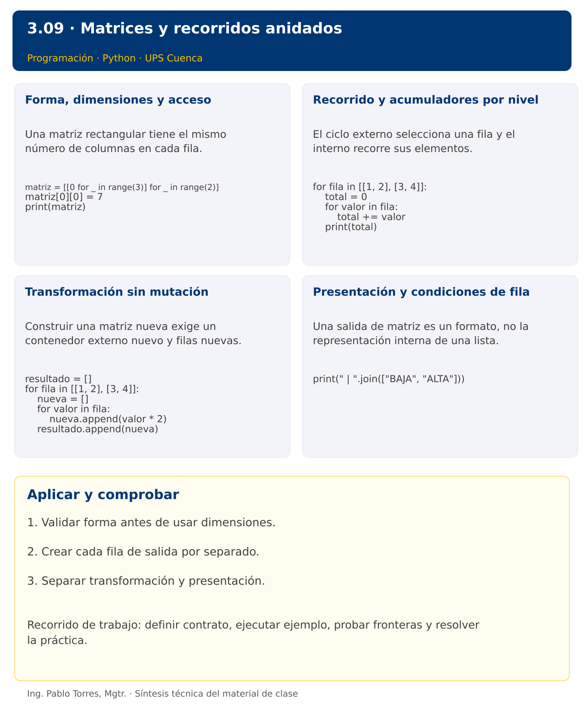

# Programación


## 3.09 · Matrices y recorridos anidados · Python

**Autor:** Ing. Pablo Torres, Mgtr.  
**Unidad 3:** Lenguaje de Programación  
**Institución:** Universidad Politécnica Salesiana · Computación · Cuenca

[Índice del curso](../../../README.md) · [Versión Java](../java/material.md) · [Presentación](../presentacion.pptx) · [Anterior](../../3.08-listas-recorridos/python/material.md) · [Siguiente](../../3.10-tuplas/python/material.md)

[Conceptos](#concepto-1) · [Demostración](#demostracion) · [Práctica de clase](#pc) · [Lo esencial](#esencial)

**Contexto.** Procesar mediciones organizadas por días y estaciones requiere conservar filas y columnas. Una transformación puede producir etiquetas sin modificar los datos numéricos originales, y un resumen por fila necesita reiniciar su estado en el lugar correcto.

**Prerrequisitos.** Listas, recorridos y funciones.

## 1. Conceptos y ejemplos

<a id="concepto-1"></a>

### 1.1. Forma, dimensiones y acceso

Una matriz rectangular tiene el mismo número de columnas en cada fila. Una colección de filas puede ser irregular; no asumir rectangularidad sin comprobarla. Distinguir número de filas, columnas por fila y cantidad total de elementos. Una matriz vacía no tiene primera fila, por lo que acceder a ella para obtener columnas genera un error.

**Aplicar en Python.** Representar con lista de listas. matriz[fila][columna] accede a un elemento. Crear filas independientes con una comprensión o un ciclo; [[0]*c]*f comparte la misma fila y causa cambios inesperados.

```python
matriz = [[0 for _ in range(3)] for _ in range(2)]
matriz[0][0] = 7
print(matriz)
```

<a id="concepto-2"></a>

### 1.2. Recorrido y acumuladores por nivel

El ciclo externo selecciona una fila y el interno recorre sus elementos. Un acumulador global se inicializa antes de ambos; uno por fila al comenzar cada iteración externa. Una suma por columna requiere mantener un resultado por columna. Usar una matriz pequeña no cuadrada para comprobar que no se intercambian límites.

**Aplicar en Python.** Recorrer filas directamente cuando no se necesita posición. Usar enumerate para conservar coordenadas. No fijar el número de columnas con una constante si los datos forman parte de la entrada.

```python
for fila in [[1, 2], [3, 4]]:
    total = 0
    for valor in fila:
        total += valor
    print(total)
```

<a id="concepto-3"></a>

### 1.3. Transformación sin mutación

Construir una matriz nueva exige un contenedor externo nuevo y filas nuevas. Copiar solo el contenedor externo comparte filas. Definir una regla local para cada celda y conservar la forma original. Separar transformar de mostrar: la primera función retorna estructura y la segunda la presenta. Comprobar la entrada después de llamar a la función para detectar mutación accidental.

**Aplicar en Python.** Crear nueva_fila=[] dentro del ciclo externo, agregar resultados y finalmente agregar la fila a resultado. No reutilizar la misma lista para todas las filas. Para copiar números sin transformar, copiar cada fila es suficiente.

```python
resultado = []
for fila in [[1, 2], [3, 4]]:
    nueva = []
    for valor in fila:
        nueva.append(valor * 2)
    resultado.append(nueva)
```

<a id="concepto-4"></a>

### 1.4. Presentación y condiciones de fila

Una salida de matriz es un formato, no la representación interna de una lista. Definir separador de celdas y mensaje de cierre por fila. Para una mayoría, comparar conteos y decidir explícitamente los empates. Verificar que una categoría pueda realmente aparecer después de la transformación: contar minúsculas después de convertir todo a mayúsculas produce una condición incoherente.

**Aplicar en Python.** Usar " | ".join(fila) para cadenas, o convertir cada valor cuando sea numérico. Reiniciar conteos al entrar a cada fila. Una fila vacía requiere una salida definida si el contrato la admite.

```python
print(" | ".join(["BAJA", "ALTA"]))
```

Los bloques breves anteriores ilustran una operación y pueden requerir variables o imports del contexto. Utilizar la demostración siguiente como programa completo.


### Síntesis visual



<a id="demostracion"></a>

## 2. Demostración guiada

**Problema.** Clasificar cada medición de [[18,22,20],[25,15,19]] como ALTA desde 20 y BAJA en otro caso.

**Contrato de esta demostración.** Aceptar filas de enteros; la demostración admite filas de distintas longitudes porque recorre cada fila. Construir contenedor externo y filas nuevos, conservando forma y original. La PC posterior añade rectangularidad como requisito propio. Mostrar cada fila con separador | y comprobar la primera celda original.

**Fuente:** [ejemplos/demo.py](ejemplos/demo.py).

<!-- example: demo.py -->
```python
def clasificar(matriz):
    resultado = []
    for fila in matriz:
        nueva = []
        for valor in fila:
            nueva.append("ALTA" if valor >= 20 else "BAJA")
        resultado.append(nueva)
    return resultado

original = [[18, 22, 20], [25, 15, 19]]
for fila in clasificar(original):
    print(" | ".join(fila))
print(f"Original: {original[0][0]}")
```

### Ejecutar

Abrir una terminal dentro de `03/3.09-matrices/python/ejemplos/` y ejecutar:

```bash
python3 demo.py
```

En Windows, usar `py` en lugar de `python3` si esa es la instalación disponible. Comprobar primero su versión.

### Salida esperada

```text
BAJA | ALTA | ALTA
ALTA | BAJA | BAJA
Original: 18
```

**Interpretación.** Seguir las asignaciones y los bloques en orden, identificar qué instrucción produce cada línea y contrastar con el contrato. Modificar un dato por vez y anticipar el resultado antes de ejecutar. La salida de referencia es una expectativa; el registro de verificaciones indica qué ejecuciones se realizaron.

<a id="ejercicios"></a>

### Ejercicios prácticos progresivos

Resolver los siguientes ejercicios en orden. Entregar enunciado, fuente y resultado propio. Los casos mostrados permiten comprobar el contrato y no sustituyen una prueba adicional de frontera.

#### Ejercicio 01. Dimensiones

Obtener filas y columnas de [[1,2,3],[4,5,6]], asumiendo rectangularidad validada. Para [] definir cero columnas.

**Caso de comprobación:**

```text
2 3
```

#### Ejercicio 02. Recorrido por filas

Mostrar [[1,2],[3,4]] sin corchetes ni comas y con un espacio entre elementos.

**Caso de comprobación:**

```text
1 2
3 4
```

#### Ejercicio 03. Suma total

Sumar todas las celdas de [[1,2],[3,4]] con ciclos anidados.

**Caso de comprobación:**

```text
10
```

#### Ejercicio 04. Sumas por fila

Producir una suma por fila de [[2,3],[4,7]].

**Caso de comprobación:**

```text
5 11
```

#### Ejercicio 05. Sumas por columna

Sumar columnas de [[1,2,3],[4,5,6]], con rectangularidad como precondición.

**Caso de comprobación:**

```text
5 7 9
```

#### Ejercicio 06. Diagonal principal

Sumar diagonal de [[1,2,3],[4,5,6],[7,8,9]]. Exigir matriz cuadrada.

**Caso de comprobación:**

```text
15
```

#### Ejercicio 07. Transposición rectangular

Transponer [[1,2,3],[4,5,6]] a tres filas de dos elementos.

**Caso de comprobación:**

```text
1 4
2 5
3 6
```

#### Ejercicio 08. Copia con umbral

Reemplazar por cero valores menores que 5 de [[2,8],[5,1]], devolviendo nueva matriz. Comprobar original intacto.

**Caso de comprobación:**

```text
0 8
5 0
```

#### Ejercicio 09. Transformar palabras

Convertir a mayúsculas palabras con longitud al menos cuatro y conservar las otras en [["sol","luna"],["mar","cielo"]]. Crear filas independientes.

**Caso de comprobación:**

```text
sol | LUNA
mar | CIELO
```

#### Ejercicio 10. Mayoría por fila

Para [[2,3,4],[1,3,2],[2,1]] mostrar cantidad de pares y clasificación “Mayoría par”, “Mayoría impar” o “Empate”. Admitir filas de distinto tamaño para este ejercicio.

**Caso de comprobación:**

```text
2 Mayoría par
1 Mayoría impar
1 Empate
```

<a id="pc"></a>

## 3. PC3.09 · Práctica de clase

Transformar una matriz rectangular de enteros en etiquetas NEGATIVO, CERO o POSITIVO. Retornar una matriz nueva y conservar la entrada. Mostrar cada fila separada por “ / ” y agregar el conteo de POSITIVO. Aceptar matriz vacía como cero filas, rechazar matrices irregulares y definir filas vacías como válidas solo si todas tienen longitud cero.

### Requisitos y restricciones

- Resolver en una sola versión, Python o Java.
- Mantener nombres y responsabilidades indicados; explicar cualquier adaptación idiomática.
- Aplicar únicamente los conceptos ya introducidos.
- Conservar las entradas cuando el enunciado lo exija.
- Distinguir valores fuera de contrato de errores que el programa debe gestionar.

### Casos de aceptación de la PC

| Entrada / escenario | Resultado esperado |
|---|---|
| [[-1,0,2],[3,4,-2]] | dos filas; conteos positivos 1 y 2 |
| [] | cero filas |
| [[1],[2,3]] | matriz irregular |
| [[],[]] | dos filas vacías; conteos 0 |

### Probar y registrar evidencia

Crear una carpeta personal `PC3.09` separada de las demostraciones. Guardar cada caso con entrada, resultado esperado y resultado real. Ejecutar `python3 solucion.py` desde esa carpeta. Para entradas de teclado, guardar `casos/entrada-01.txt` y redirigirla con `< casos/entrada-01.txt`. Para funciones, crear llamadas con los datos de la tabla.

- Registrar `evidencias/PC3.09.md` con comandos, versión real, salidas y explicación.
- Crear un commit funcional como `feat(pc3.09): implementar-regla-principal`.
- Obtener el hash real con `git rev-parse HEAD` y anotarlo en la evidencia.
- Revisar el cambio con `git show HASH` y comparar avances con `git diff HASH_ANTERIOR HASH_ACTUAL`. Sustituir los marcadores por hashes reales.
- Agregar una prueba de frontera distinta de las incluidas y justificar qué error detectaría.

No se requiere proyecto acumulativo ni rúbrica individual de esta PC.

<a id="esencial"></a>

## Lo esencial

- Validar forma antes de usar dimensiones.
- Crear cada fila de salida por separado.
- Separar transformación y presentación.

## Referencias técnicas

- [Tutorial oficial de Python](https://docs.python.org/3.14/tutorial/)
- [Biblioteca estándar de Python](https://docs.python.org/3.14/library/)

[Índice del curso](../../../README.md) · [Versión Java](../java/material.md) · [Presentación](../presentacion.pptx) · [Anterior](../../3.08-listas-recorridos/python/material.md) · [Siguiente](../../3.10-tuplas/python/material.md)
