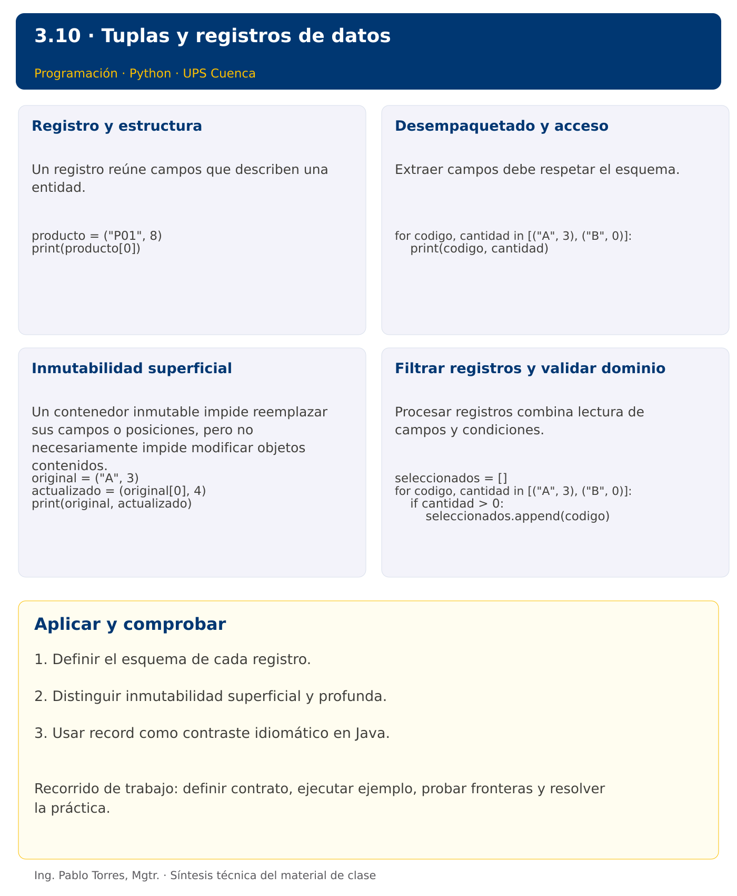

# Programación


## 3.10 · Tuplas y registros de datos · Python

**Autor:** Ing. Pablo Torres, Mgtr.  
**Unidad 3:** Lenguaje de Programación  


 [Anterior](../../3.09-matrices/python/material.md) · [Siguiente](../../3.11-archivos/python/material.md)

[Conceptos](#concepto-1) · [Demostración](#demostracion) · [Práctica de clase](#pc) · [Lo esencial](#esencial)

**Contexto.** Representar un producto mediante código, nombre y cantidad. Agrupar campos evita mantener varias listas paralelas y obliga a definir el significado de cada posición o componente.

**Prerrequisitos.** Listas, funciones y cadenas.

## 1. Conceptos y ejemplos

<a id="concepto-1"></a>

### 1.1. Registro y estructura

Un registro reúne campos que describen una entidad. A diferencia de una lista de mediciones, cada campo puede tener un significado y tipo diferente. Definir un esquema antes de procesar varios registros. No intercambiar cantidad y precio solo porque ambos son números. Un nombre de campo reduce ambigüedad cuando la estructura crece.

**Aplicar en Python.** Una tupla ordena valores y no permite reemplazar sus posiciones. La coma construye la tupla: (5,) tiene un elemento y (5) es solo un entero entre paréntesis. Para este tema, usar tuplas pequeñas con esquema documentado.

```python
producto = ("P01", 8)
print(producto[0])
```

<a id="concepto-2"></a>

### 1.2. Desempaquetado y acceso

Extraer campos debe respetar el esquema. Una cantidad de campos distinta puede indicar datos mal formados. Validar en el límite de entrada y mantener estructuras consistentes en el procesamiento. Cuando existan muchos campos, preferir acceso por nombre para reducir dependencia de posiciones.

**Aplicar en Python.** codigo, cantidad = producto desempaqueta dos elementos. Una cantidad diferente produce ValueError. Puede usarse desempaquetado directamente en for. No mezclar tuplas de dos y tres campos en una colección que espera un esquema uniforme.

```python
for codigo, cantidad in [("A", 3), ("B", 0)]:
    print(codigo, cantidad)
```

<a id="concepto-3"></a>

### 1.3. Inmutabilidad superficial

Un contenedor inmutable impide reemplazar sus campos o posiciones, pero no necesariamente impide modificar objetos contenidos. Una tupla con una lista puede observar cambios en esa lista. Un record con un componente ArrayList también puede observar mutaciones. Usar componentes inmutables o copias defensivas cuando se requiera un valor realmente estable.

**Aplicar en Python.** Para actualizar un dato escalar, construir una nueva tupla. tuple no garantiza que todos sus componentes sean inmutables ni que siempre sea utilizable como clave de diccionario.

```python
original = ("A", 3)
actualizado = (original[0], 4)
print(original, actualizado)
```

<a id="concepto-4"></a>

### 1.4. Filtrar registros y validar dominio

Procesar registros combina lectura de campos y condiciones. Mantener orden y duplicados según el contrato. Un esquema correcto no garantiza datos válidos: una edad negativa tiene tipo entero, pero puede violar el dominio. Definir si un registro inválido detiene todo el proceso o se reporta y se omite.

**Aplicar en Python.** Usar funciones con parámetros claros y devolver una lista nueva. No cambiar silenciosamente tuplas de entrada. Validar longitudes antes de desempaquetar si los datos provienen de una fuente no confiable.

```python
seleccionados = []
for codigo, cantidad in [("A", 3), ("B", 0)]:
    if cantidad > 0:
        seleccionados.append(codigo)
```

Los bloques breves anteriores ilustran una operación y pueden requerir variables o imports del contexto. Utilizar la demostración siguiente como programa completo.


### Síntesis visual



<a id="demostracion"></a>

## 2. Demostración guiada

**Problema.** Mostrar códigos y cantidades de productos con existencias estrictamente positivas.

**Contrato de esta demostración.** Aceptar registros de dos campos: código de texto y cantidad entera no negativa. La demostración presupone esquema y dominio válidos. Conservar orden y omitir cantidad cero. Utilizar tuplas en Python y record Producto en Java.

**Fuente:** [ejemplos/demo.py](ejemplos/demo.py).

<!-- example: demo.py -->
```python
productos = [("P01", 8), ("P02", 0), ("P03", 4)]
for codigo, cantidad in productos:
    if cantidad > 0:
        print(f"{codigo}: {cantidad}")
```

### Ejecutar

Abrir una terminal dentro de `03/3.10-tuplas/python/ejemplos/` y ejecutar:

```bash
python3 demo.py
```

En Windows, usar `py` en lugar de `python3` si esa es la instalación disponible. Comprobar primero su versión.

### Salida esperada

```text
P01: 8
P03: 4
```

**Interpretación.** Seguir las asignaciones y los bloques en orden, identificar qué instrucción produce cada línea y contrastar con el contrato. Modificar un dato por vez y anticipar el resultado antes de ejecutar. La salida de referencia es una expectativa; el registro de verificaciones indica qué ejecuciones se realizaron.

<a id="ejercicios"></a>

### Ejercicios prácticos progresivos

Resolver los siguientes ejercicios en orden. Entregar enunciado, fuente y resultado propio. Los casos mostrados permiten comprobar el contrato y no sustituyen una prueba adicional de frontera.

#### Ejercicio 01. Registro simple

Crear el registro de código A y cantidad 3. Mostrar ambos campos. En Java usar record.

**Caso de comprobación:**

```text
A 3
```

#### Ejercicio 02. Registro unitario

Crear una tupla Python de un elemento con valor 5 y mostrar su longitud. En Java contrastar con un record de un componente.

**Caso de comprobación:**

```text
1
```

#### Ejercicio 03. Desempaquetado

Desempaquetar nombre Ana y edad 20 y mostrar “Ana: 20”. En Java utilizar accesores.

**Caso de comprobación:**

```text
Ana: 20
```

#### Ejercicio 04. Actualización por reemplazo

Crear una nueva tupla desde ("A",3) con cantidad 4. Conservar y mostrar original y nueva.

**Caso de comprobación:**

```text
A 3
A 4
```

#### Ejercicio 05. Recorrer registros

Mostrar códigos con cantidad positiva en [("A",0),("B",4),("C",2)].

**Caso de comprobación:**

```text
B
C
```

#### Ejercicio 06. Suma de cantidades

Sumar cantidades en [("A",3),("B",5)] mediante un ciclo.

**Caso de comprobación:**

```text
8
```

#### Ejercicio 07. Filtrar por edad

Devolver nombres con edad estrictamente mayor que 18 en [("Ana",18),("Luis",21),("Eva",30)].

**Caso de comprobación:**

```text
Luis Eva
```

#### Ejercicio 08. Registro máximo

Encontrar el código con mayor cantidad de [("A",4),("B",9),("C",9)]. Conservar la primera aparición en empate y rechazar vacío.

**Caso de comprobación:**

```text
B
```

#### Ejercicio 09. Costo de registros

Calcular costo total desde (código,cantidad,precio) para [("A",2,3.5),("B",4,2)]. Rechazar cantidades o precios negativos.

**Caso de comprobación:**

```text
15.00
```

#### Ejercicio 10. Filtro combinado

Seleccionar nombres con edad al menos 20 y dos o más vocales ASCII en [("Ana",20),("Luis",19),("Eva",25),("Rhys",30)]. Conservar el orden.

**Caso de comprobación:**

```text
Ana Eva
```

<a id="pc"></a>

## 3. PC3.10 · Práctica de clase

Recibir registros (codigo, horas, tarifa). Retornar códigos cuyo costo horas*tarifa supere estrictamente un umbral. Conservar orden y datos originales. Rechazar horas o tarifas negativas. Definir el equivalente Java mediante un record y exigir el mismo resultado.

### Requisitos y restricciones

- Resolver en una sola versión, Python o Java.
- Mantener nombres y responsabilidades indicados; explicar cualquier adaptación idiomática.
- Aplicar únicamente los conceptos ya introducidos.
- Conservar las entradas cuando el enunciado lo exija.
- Distinguir valores fuera de contrato de errores que el programa debe gestionar.

### Casos de aceptación de la PC

| Entrada / escenario | Resultado esperado |
|---|---|
| [("A",2,5),("B",4,3)], umbral=10 | ["B"] |
| [], umbral=10 | [] |
| [("A",-1,5)] | registro inválido |
| [("A",2,5)], umbral=10 | [] |

### Probar y registrar evidencia

Crear una carpeta personal `PC3.10` separada de las demostraciones. Guardar cada caso con entrada, resultado esperado y resultado real. Ejecutar `python3 solucion.py` desde esa carpeta. Para entradas de teclado, guardar `casos/entrada-01.txt` y redirigirla con `< casos/entrada-01.txt`. Para funciones, crear llamadas con los datos de la tabla.

- Registrar `evidencias/PC3.10.md` con comandos, versión real, salidas y explicación.
- Crear un commit funcional como `feat(pc3.10): implementar-regla-principal`.
- Obtener el hash real con `git rev-parse HEAD` y anotarlo en la evidencia.
- Revisar el cambio con `git show HASH` y comparar avances con `git diff HASH_ANTERIOR HASH_ACTUAL`. Sustituir los marcadores por hashes reales.
- Agregar una prueba de frontera distinta de las incluidas y justificar qué error detectaría.

No se requiere proyecto acumulativo ni rúbrica individual de esta PC.

<a id="esencial"></a>

## Lo esencial

- Definir el esquema de cada registro.
- Distinguir inmutabilidad superficial y profunda.
- Usar record como contraste idiomático en Java.

## Referencias técnicas

- [Tutorial oficial de Python](https://docs.python.org/3.14/tutorial/)
- [Biblioteca estándar de Python](https://docs.python.org/3.14/library/)

 [Anterior](../../3.09-matrices/python/material.md) · [Siguiente](../../3.11-archivos/python/material.md)
