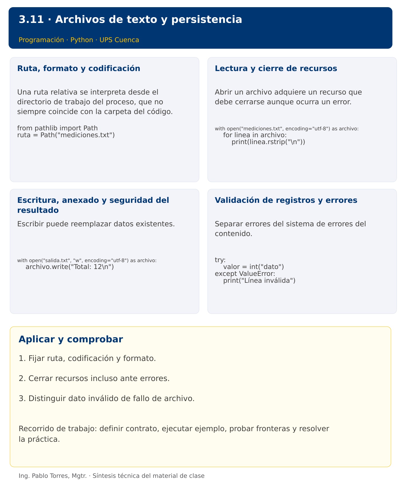

# Programación

## 3.11 · Archivos de texto y persistencia · Java

**Autor:** Ing. Pablo Torres, Mgtr.  
**Unidad 3:** Lenguaje de Programación  
**Institución:** Universidad Politécnica Salesiana · Computación · Cuenca

[Índice del curso](../../../README.md) · [Versión Python](../python/material.md) · [Presentación Python](../presentacion.pptx) · [Anterior](../../3.10-tuplas/java/material.md) · [Siguiente](../../3.12-main-modulos/java/material.md)

[Conceptos](#concepto-1) · [Demostración](#demostracion) · [Práctica de clase](#pc) · [Lo esencial](#esencial)

**Contexto.** Guardar mediciones permite continuar el análisis después de terminar el programa. Un archivo agrega decisiones sobre ruta, codificación, formato, errores y cierre de recursos.

**Prerrequisitos.** Funciones, cadenas, listas y excepciones.

**Versión complementaria.** Estudiar el mismo problema y los mismos casos de Python mediante construcciones idiomáticas de Java. La presentación compartida corresponde a Python.

## 1. Conceptos y ejemplos

<a id="concepto-1"></a>

### 1.1. Ruta, formato y codificación

Una ruta relativa se interpreta desde el directorio de trabajo del proceso, que no siempre coincide con la carpeta del código. Especificar cómo localizar los datos y usar UTF-8 para intercambiar texto con tildes. El formato describe cómo se separan registros y campos. Una extensión .txt no garantiza contenido válido. No confundir bytes con caracteres.

**Aplicar en Java.** Path.of construye rutas. Usar StandardCharsets.UTF_8 al leer y escribir. El directorio de ejecución se puede consultar con Path.of("").toAbsolutePath(). No codificar rutas personales dentro del material.

```java
Path ruta = Path.of("mediciones.txt");
```

<a id="concepto-2"></a>

### 1.2. Lectura y cierre de recursos

Abrir un archivo adquiere un recurso que debe cerrarse aunque ocurra un error. Leer línea por línea permite procesar sin cargar todo el archivo. Una línea vacía requiere una política: ignorar, aceptar como dato o rechazar. Validar cada conversión y conservar número de línea para producir diagnósticos útiles.

**Aplicar en Java.** Usar try-with-resources con BufferedReader. Files.readAllLines es cómodo para archivos pequeños, pero carga todo el contenido. Integer.parseInt requiere gestionar NumberFormatException además de posibles errores de E/S.

```java
try (var lector = Files.newBufferedReader(ruta, StandardCharsets.UTF_8)) {
    String linea;
    while ((linea = lector.readLine()) != null) System.out.println(linea);
}
```

<a id="concepto-3"></a>

### 1.3. Escritura, anexado y seguridad del resultado

Escribir puede reemplazar datos existentes. Distinguir crear, sobrescribir y anexar. Decidir si la nueva salida debe construirse completamente antes de sustituir la anterior. Nunca escribir sobre el archivo de entrada por accidente. En ejercicios reproducibles, utilizar una carpeta temporal o una ruta de salida controlada y comparar el contenido final.

**Aplicar en Java.** Files.writeString crea o trunca por defecto. Usar opciones explícitas para anexar. try-with-resources cierra el recurso, pero no revierte escrituras anteriores ante un fallo. Diferenciar cierre de atomicidad.

```java
Files.writeString(Path.of("salida.txt"), "Total: 12\n", StandardCharsets.UTF_8);
```

<a id="concepto-4"></a>

### 1.4. Validación de registros y errores

Separar errores del sistema de errores del contenido. Un archivo inexistente no equivale a un archivo vacío; una línea inválida no equivale a cero. Registrar qué filas se rechazaron y por qué. Para un CSV real, las comas entre comillas requieren un parser; split(",") solo sirve cuando el formato restringe explícitamente las comas dentro de campos.

**Aplicar en Java.** Capturar IOException para errores de archivo y NumberFormatException para conversiones. Java estándar no incluye un lector CSV general comparable a csv de Python: mantener un formato de una cifra por línea para la equivalencia del curso.

```java
try {
    Integer.parseInt("dato");
} catch (NumberFormatException e) {
    System.out.println("Línea inválida");
}
```

Los bloques breves anteriores ilustran una operación y pueden requerir variables o imports del contexto. Utilizar la demostración siguiente como programa completo.


### Síntesis visual



<a id="demostracion"></a>

## 2. Demostración guiada

**Problema.** Crear un archivo temporal con mediciones 12, 8 y 15, leerlo y sumar sus valores.

**Contrato de esta demostración.** Usar UTF-8 y un entero válido por línea. Escribir y leer dentro de una carpeta temporal controlada, cerrar recursos y eliminar temporales al terminar. No modificar archivos del usuario. Mostrar Total: 35. La PC añade validación de líneas externas.

**Fuente:** [ejemplos/Demo.java](ejemplos/Demo.java).

<!-- example: Demo.java -->
```java
import java.nio.file.Files;
import java.nio.file.Path;
import java.nio.charset.StandardCharsets;
import java.io.IOException;
public class Demo {
    public static void main(String[] args) throws IOException {
        Path carpeta = Files.createTempDirectory("programacion-");
        Path ruta = carpeta.resolve("mediciones.txt");
        try {
            Files.writeString(ruta, "12\n8\n15\n", StandardCharsets.UTF_8);
            int total = 0;
            try (var lector = Files.newBufferedReader(ruta, StandardCharsets.UTF_8)) {
                String linea;
                while ((linea=lector.readLine()) != null) total += Integer.parseInt(linea.strip());
            }
            System.out.println("Total: " + total);
        } finally { Files.deleteIfExists(ruta); Files.deleteIfExists(carpeta); }
    }
}
```

### Ejecutar

Abrir una terminal dentro de `03/3.11-archivos/java/ejemplos/` y ejecutar:

```bash
javac -encoding UTF-8 -d build *.java
java -cp build Demo
```

### Salida esperada

```text
Total: 35
```

**Interpretación.** Seguir las asignaciones y los bloques en orden, identificar qué instrucción produce cada línea y contrastar con el contrato. Modificar un dato por vez y anticipar el resultado antes de ejecutar. La salida de referencia es una expectativa; el registro de verificaciones indica qué ejecuciones se realizaron.

<a id="ejercicios"></a>

### Ejercicios prácticos progresivos

Resolver los siguientes ejercicios en orden. Entregar enunciado, fuente y resultado propio. Los casos mostrados permiten comprobar el contrato y no sustituyen una prueba adicional de frontera.

Adaptar los mismos datos y resultados a Java. Usar `record` para registros y bibliotecas estándar para archivos y procesos. Para resultados booleanos, aceptar `true/false` en Java frente a `True/False` en Python. Los ejercicios que inspeccionan el intérprete deben inspeccionar la JVM y el JDK equivalentes.

#### Ejercicio 01. Escritura UTF-8

Escribir “Cuenca” en un archivo temporal UTF-8 y leerlo de nuevo.

**Caso de comprobación:**

```text
Cuenca
```

#### Ejercicio 02. Dos líneas

Guardar y leer dos líneas: sol y luna. Conservar un salto final.

**Caso de comprobación:**

```text
sol
luna
```

#### Ejercicio 03. Anexado

Crear una línea A y anexar B sin eliminar A.

**Caso de comprobación:**

```text
A
B
```

#### Ejercicio 04. Contar líneas no vacías

Contar líneas con texto en “a”, vacía y “b”. Ignorar espacios externos.

**Caso de comprobación:**

```text
2
```

#### Ejercicio 05. Suma de archivo

Leer enteros 4, 8 y 3, uno por línea, y mostrar suma.

**Caso de comprobación:**

```text
15
```

#### Ejercicio 06. Archivo inexistente

Intentar leer ausente.txt dentro de una carpeta temporal y producir mensaje controlado.

**Caso de comprobación:**

```text
Archivo no encontrado
```

#### Ejercicio 07. Errores por línea

Leer 4, x y 6. Sumar válidos y registrar número de línea inválida.

**Caso de comprobación:**

```text
Línea 2: inválida
Total: 10
```

#### Ejercicio 08. Filtrar a otro archivo

Leer 2, 7, 4 y escribir solo valores mayores que 3 en un archivo nuevo. Conservar entrada.

**Caso de comprobación:**

```text
7
4
```

#### Ejercicio 09. Promedio sin datos

Leer archivo vacío y mostrar “Sin datos” sin dividir por cero.

**Caso de comprobación:**

```text
Sin datos
```

#### Ejercicio 10. Registros delimitados

Leer A;3 y B;5. Exigir exactamente dos campos, código no vacío y cantidad entera no negativa. Mostrar suma y conservar número de línea en errores. El formato no permite ; dentro de campos.

**Caso de comprobación:**

```text
8
```

<a id="pc"></a>

## 3. PC3.11 · Práctica de clase

Leer un archivo UTF-8 con un entero por línea. Ignorar líneas vacías, aceptar valores de 0 a 100 y registrar número de línea y causa de cada rechazo. Escribir un informe nuevo con cantidad válida y promedio; usar “Sin datos” cuando no haya valores válidos. Conservar el archivo de entrada y gestionar archivo inexistente.

### Requisitos y restricciones

- Resolver en una sola versión, Python o Java.
- Mantener nombres y responsabilidades indicados; explicar cualquier adaptación idiomática.
- Aplicar únicamente los conceptos ya introducidos.
- Conservar las entradas cuando el enunciado lo exija.
- Distinguir valores fuera de contrato de errores que el programa debe gestionar.

### Casos de aceptación de la PC

| Entrada / escenario | Resultado esperado |
|---|---|
| 10<br>20<br> | cantidad 2; promedio 15.00 |
| abc<br>120<br>5<br> | rechazos en líneas 1 y 2; promedio 5.00 |
| archivo vacío | Sin datos |
| ruta inexistente | mensaje de archivo no encontrado |

### Probar y registrar evidencia

Crear una carpeta personal `PC3.11` separada de las demostraciones. Guardar cada caso con entrada, resultado esperado y resultado real. Compilar `javac -encoding UTF-8 -d build *.java` y ejecutar `java -cp build Solucion`; usar `Solucion.java` como entrada personal. Para entradas de teclado, guardar `casos/entrada-01.txt` y redirigirla con `< casos/entrada-01.txt`. Para funciones, crear llamadas con los datos de la tabla.

- Registrar `evidencias/PC3.11.md` con comandos, versión real, salidas y explicación.
- Crear un commit funcional como `feat(pc3.11): implementar-regla-principal`.
- Obtener el hash real con `git rev-parse HEAD` y anotarlo en la evidencia.
- Revisar el cambio con `git show HASH` y comparar avances con `git diff HASH_ANTERIOR HASH_ACTUAL`. Sustituir los marcadores por hashes reales.
- Agregar una prueba de frontera distinta de las incluidas y justificar qué error detectaría.

No se requiere proyecto acumulativo ni rúbrica individual de esta PC.

<a id="esencial"></a>

## Lo esencial

- Fijar ruta, codificación y formato.
- Cerrar recursos incluso ante errores.
- Distinguir dato inválido de fallo de archivo.

## Referencias técnicas

- [Aprender Java, sitio oficial](https://dev.java/learn/)
- [API de Java SE 27](https://docs.oracle.com/en/java/javase/27/docs/api/)

[Índice del curso](../../../README.md) · [Versión Python](../python/material.md) · [Presentación Python](../presentacion.pptx) · [Anterior](../../3.10-tuplas/java/material.md) · [Siguiente](../../3.12-main-modulos/java/material.md)
