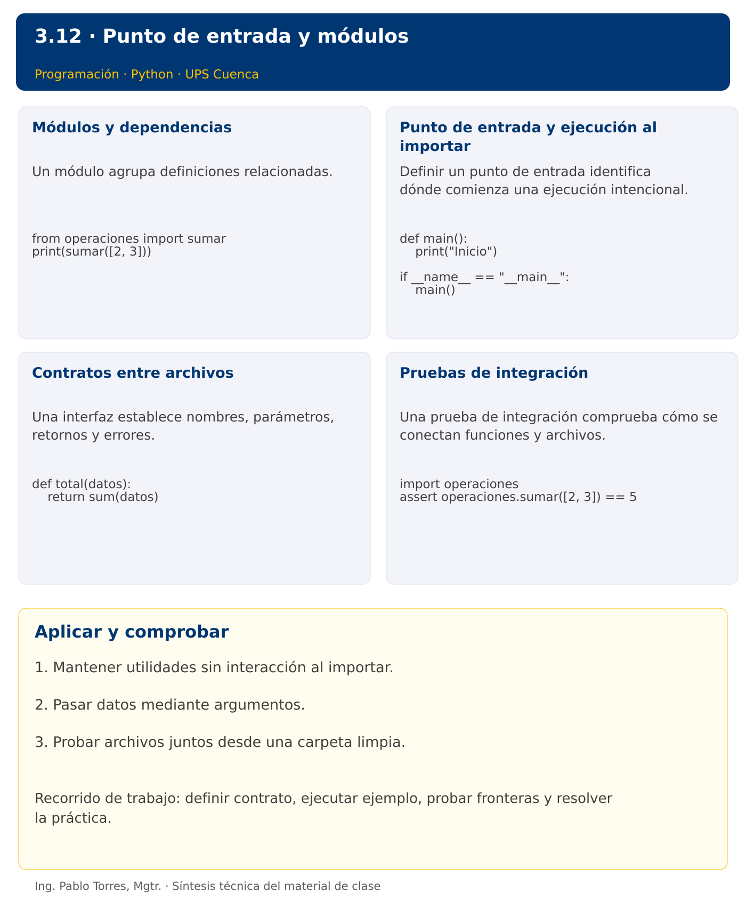

# Programación


## 3.12 · Punto de entrada y módulos · Java

**Autor:** Ing. Pablo Torres, Mgtr.  
**Unidad 3:** Lenguaje de Programación  


[Versión Python](../python/material.md) · [Presentación Python](../presentacion.pptx) · [Anterior](../../3.11-archivos/java/material.md) · [Siguiente](../../3.13-entornos/java/material.md)

[Conceptos](#concepto-1) · [Demostración](#demostracion) · [Práctica de clase](#pc) · [Lo esencial](#esencial)

**Contexto.** Separar cálculo, presentación y punto de entrada permite reutilizar operaciones sin ejecutar automáticamente una sesión interactiva. Organizar responsabilidades debe reducir acoplamiento, no solo aumentar el número de archivos.

**Prerrequisitos.** Funciones, registros, archivos y manejo de errores.

**Versión complementaria.** Estudiar el mismo problema y los mismos casos de Python mediante construcciones idiomáticas de Java. La presentación compartida corresponde a Python.

## 1. Conceptos y ejemplos

<a id="concepto-1"></a>

### 1.1. Módulos y dependencias

Un módulo agrupa definiciones relacionadas. Una dependencia aparece cuando un archivo utiliza operaciones definidas en otro. Definir una dirección clara: la entrada llama a operaciones, y las operaciones no importan la entrada para pedir datos. Evitar nombres de archivo que oculten bibliotecas estándar. Mantener interfaces pequeñas y documentadas.

**Aplicar en Java.** Cada clase pública se guarda en un archivo del mismo nombre. Para ejemplos sin paquetes, compilar desde la carpeta con javac *.java. Una clase Operaciones contiene métodos static y Demo orquesta las llamadas. No se requiere un gestor de dependencias.

```java
System.out.println(Operaciones.sumar(new int[]{2, 3}));
```

<a id="concepto-2"></a>

### 1.2. Punto de entrada y ejecución al importar

Definir un punto de entrada identifica dónde comienza una ejecución intencional. Importar utilidades no debería pedir datos ni imprimir informes. Mantener datos de ejemplo y coordinación en la entrada. Esta separación permite probar funciones y reutilizarlas sin efectos inesperados.

**Aplicar en Java.** Usar public static void main(String[] args) como forma explícita y compatible del punto de entrada. Java reciente ofrece formas adicionales, pero este curso conserva una estructura uniforme. Métodos utilitarios se llaman desde main y no necesitan otro main.

```java
public static void main(String[] args) {
    System.out.println("Inicio");
}
```

<a id="concepto-3"></a>

### 1.3. Contratos entre archivos

Una interfaz establece nombres, parámetros, retornos y errores. Cambiarla afecta a quienes la utilizan. Si transformar retorna una lista, mostrar debe recibir esa lista; no llamar a mostrar con el resultado de otra función que solo imprime. Mantener datos en un lugar y pasar argumentos para evitar variables globales compartidas.

**Aplicar en Java.** Evitar que Operaciones lea campos estáticos mutables de Demo. Pasar datos como argumentos. El compilador identifica métodos o tipos faltantes, pero no detecta todas las dependencias conceptuales mal diseñadas.

```java
static int total(int[] datos) {
    int suma = 0;
    for (int x : datos) suma += x;
    return suma;
}
```

<a id="concepto-4"></a>

### 1.4. Pruebas de integración

Una prueba de integración comprueba cómo se conectan funciones y archivos. Ejecutar desde una carpeta limpia detecta dependencias ocultas de archivos o estado. Probar la importación sin salida y luego ejecutar la entrada con datos conocidos. Registrar versiones y comandos exactos para repetir el resultado.

**Aplicar en Java.** Compilar todos los fuentes a un directorio temporal con javac -d salida *.java y ejecutar java -cp salida Demo. Los .class son compilados y no forman parte del entregable de fuentes. Probar clases utilitarias desde otra entrada.

```java
if (Operaciones.sumar(new int[]{2,3}) != 5) {
    throw new AssertionError("Suma incorrecta");
}
```

Los bloques breves anteriores ilustran una operación y pueden requerir variables o imports del contexto. Utilizar la demostración siguiente como programa completo.


### Síntesis visual



<a id="demostracion"></a>

## 2. Demostración guiada

**Problema.** Separar la función sumar en un archivo utilitario y llamarla desde el punto de entrada con [4,7,2].

**Contrato de esta demostración.** La utilidad recibe una secuencia de enteros y retorna su suma, con cero para la secuencia vacía. No leer ni imprimir al importar la utilidad. Definir datos y presentación en la entrada. Incluir ambos fuentes para ejecutar.

**Fuente:** [ejemplos/Demo.java](ejemplos/Demo.java).

<!-- example: Demo.java -->
```java
public class Demo {
    public static void main(String[] args) {
        int[] datos = {4,7,2};
        System.out.println("Total: " + Operaciones.sumar(datos));
    }
}
```

**Archivo complementario:** [ejemplos/Operaciones.java](ejemplos/Operaciones.java).

<!-- example: Operaciones.java -->
```java
public class Operaciones {
    public static int sumar(int[] datos) {
        int total = 0;
        for (int valor : datos) total += valor;
        return total;
    }
}
```

### Ejecutar

Abrir una terminal dentro de `03/3.12-main-modulos/java/ejemplos/` y ejecutar:

```bash
javac -encoding UTF-8 -d build *.java
java -cp build Demo
```

### Salida esperada

```text
Total: 13
```

**Interpretación.** Seguir las asignaciones y los bloques en orden, identificar qué instrucción produce cada línea y contrastar con el contrato. Modificar un dato por vez y anticipar el resultado antes de ejecutar. La salida de referencia es una expectativa; el registro de verificaciones indica qué ejecuciones se realizaron.

<a id="ejercicios"></a>

### Ejercicios prácticos progresivos

Resolver los siguientes ejercicios en orden. Entregar enunciado, fuente y resultado propio. Los casos mostrados permiten comprobar el contrato y no sustituyen una prueba adicional de frontera.

Adaptar los mismos datos y resultados a Java. Usar `record` para registros y bibliotecas estándar para archivos y procesos. Para resultados booleanos, aceptar `true/false` en Java frente a `True/False` en Python. Los ejercicios que inspeccionan el intérprete deben inspeccionar la JVM y el JDK equivalentes.

#### Ejercicio 01. Entrada explícita

Definir main que muestre “Inicio” y llamarla mediante el guard de ejecución. En Java utilizar main estático.

**Caso de comprobación:**

```text
Inicio
```

#### Ejercicio 02. Cálculo separado

Definir sumar(a,b) y utilizarla desde main para sumar 4 y 6.

**Caso de comprobación:**

```text
10
```

#### Ejercicio 03. Presentación separada

Definir calcular_doble y mostrar. Coordinar desde main para 7.

**Caso de comprobación:**

```text
Resultado: 14
```

#### Ejercicio 04. Sin globales

Calcular total de [2,5,8] mediante una función que reciba los datos. Definir los datos exclusivamente en main.

**Caso de comprobación:**

```text
15
```

#### Ejercicio 05. Cadena de procesamiento

Normalizar “ sol ” y mostrar el resultado desde main, sin imprimir dentro de normalizar.

**Caso de comprobación:**

```text
SOL
```

#### Ejercicio 06. Error en la frontera

Definir dividir que lance error para divisor cero. Gestionarlo en main con datos 4 y 0.

**Caso de comprobación:**

```text
Divisor cero
```

#### Ejercicio 07. Módulo utilitario real

Crear temporalmente operaciones.py con suma(a,b), importarlo sin salida y utilizar suma(3,4). En Java crear Operaciones.java y compilar ambos fuentes.

**Caso de comprobación:**

```text
7
```

#### Ejercicio 08. Importación sin interacción

Crear un módulo con main protegido. Importarlo y comprobar que no produjo salida. Mostrar “Importación limpia” al terminar.

**Caso de comprobación:**

```text
Importación limpia
```

#### Ejercicio 09. Integración de funciones

Filtrar pares, elevarlos al cuadrado y mostrarlos desde main para [1,2,3,4]. Separar tres responsabilidades.

**Caso de comprobación:**

```text
4 16
```

#### Ejercicio 10. Ejecución en proceso nuevo

Crear temporalmente util.py y main.py. Ejecutar main.py en un proceso nuevo y obtener “Total: 6” para [1,2,3]. En Java compilar utilidades y entrada juntas.

**Caso de comprobación:**

```text
Total: 6
```

<a id="pc"></a>

## 3. PC3.12 · Práctica de clase

Crear main.py, texto_utils.py y datos_utils.py. Implementar funciones para normalizar nombres, filtrar registros por cantidad mínima y presentar resultados desde main. No leer ni imprimir al importar utilidades. En Java, crear Demo.java, TextoUtils.java y DatosUtils.java con responsabilidades equivalentes. Entregar una versión y comprobar los mismos casos.

### Requisitos y restricciones

- Resolver en una sola versión, Python o Java.
- Mantener nombres y responsabilidades indicados; explicar cualquier adaptación idiomática.
- Aplicar únicamente los conceptos ya introducidos.
- Conservar las entradas cuando el enunciado lo exija.
- Distinguir valores fuera de contrato de errores que el programa debe gestionar.

### Casos de aceptación de la PC

| Entrada / escenario | Resultado esperado |
|---|---|
| [("  sol ",3),("LUNA",1)], mínimo=2 | SOL |
| [], mínimo=2 | Sin datos |
| importar utilidades | sin salida ni solicitud de entrada |
| mínimo negativo | error de argumento |

### Probar y registrar evidencia

Crear una carpeta personal `PC3.12` separada de las demostraciones. Guardar cada caso con entrada, resultado esperado y resultado real. Compilar `javac -encoding UTF-8 -d build *.java` y ejecutar `java -cp build Solucion`; usar `Solucion.java` como entrada personal. Para entradas de teclado, guardar `casos/entrada-01.txt` y redirigirla con `< casos/entrada-01.txt`. Para funciones, crear llamadas con los datos de la tabla.

- Registrar `evidencias/PC3.12.md` con comandos, versión real, salidas y explicación.
- Crear un commit funcional como `feat(pc3.12): implementar-regla-principal`.
- Obtener el hash real con `git rev-parse HEAD` y anotarlo en la evidencia.
- Revisar el cambio con `git show HASH` y comparar avances con `git diff HASH_ANTERIOR HASH_ACTUAL`. Sustituir los marcadores por hashes reales.
- Agregar una prueba de frontera distinta de las incluidas y justificar qué error detectaría.

No se requiere proyecto acumulativo ni rúbrica individual de esta PC.

<a id="esencial"></a>

## Lo esencial

- Mantener utilidades sin interacción al importar.
- Pasar datos mediante argumentos.
- Probar archivos juntos desde una carpeta limpia.

## Referencias técnicas

- [Aprender Java, sitio oficial](https://dev.java/learn/)
- [API de Java SE 27](https://docs.oracle.com/en/java/javase/27/docs/api/)

[Versión Python](../python/material.md) · [Presentación Python](../presentacion.pptx) · [Anterior](../../3.11-archivos/java/material.md) · [Siguiente](../../3.13-entornos/java/material.md)
