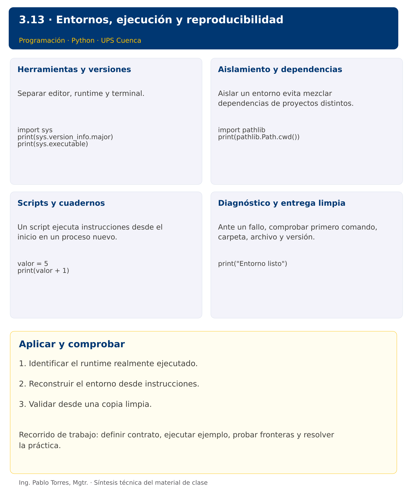

# Programación


## 3.13 · Entornos, ejecución y reproducibilidad · Python

**Autor:** Ing. Pablo Torres, Mgtr.  
**Unidad 3:** Lenguaje de Programación  


 [Anterior](../../3.12-main-modulos/python/material.md)

[Conceptos](#concepto-1) · [Demostración](#demostracion) · [Práctica de clase](#pc) · [Lo esencial](#esencial)

**Contexto.** Un programa debe ejecutarse fuera de la sesión donde fue escrito. Identificar intérprete, directorio de trabajo y dependencias evita que el resultado dependa accidentalmente de un editor o de celdas ejecutadas en otro orden.

**Prerrequisitos.** Módulos, punto de entrada y terminal.

## 1. Conceptos y ejemplos

<a id="concepto-1"></a>

### 1.1. Herramientas y versiones

Separar editor, runtime y terminal. El editor no garantiza qué intérprete ejecuta. Registrar versión del lenguaje y comandos de ejecución. En este curso, los programas solo utilizan bibliotecas estándar. La configuración debe ser suficiente para repetir ejemplos y no añadir servicios, bases de datos o gestores que no intervienen en el problema.

**Aplicar en Python.** Comprobar python3 --version y python3 -c "import sys; print(sys.executable)". En Windows usar py --version y py -c. Elegir ese mismo intérprete en el editor. La versión objetivo se fija en .python-version como dato para herramientas compatibles, no como instalación automática.

```python
import sys
print(sys.version_info.major)
print(sys.executable)
```

<a id="concepto-2"></a>

### 1.2. Aislamiento y dependencias

Aislar un entorno evita mezclar dependencias de proyectos distintos. Un entorno no es una máquina virtual ni garantiza reproducibilidad por sí solo: también se necesitan fuentes, versiones y datos. No distribuir binarios del entorno como parte del repositorio. Crear de nuevo desde instrucciones documentadas.

**Aplicar en Python.** Crear con python3 -m venv .venv. Activar en POSIX con source .venv/bin/activate y en PowerShell con .venv\Scripts\Activate.ps1 si la política local lo permite. También ejecutar directamente .venv/bin/python sin activar. No instalar paquetes para los ejemplos .py del curso.

```python
import pathlib
print(pathlib.Path.cwd())
```

<a id="concepto-3"></a>

### 1.3. Scripts y cuadernos

Un script ejecuta instrucciones desde el inicio en un proceso nuevo. Un cuaderno conserva estado en el kernel entre celdas y puede aparentar funcionar gracias a variables definidas antes. Reiniciar y ejecutar todas las celdas en orden comprueba dependencias. Guardar código reutilizable en módulos y reservar el cuaderno para exploración.

**Aplicar en Python.** Un .ipynb es un documento JSON con celdas, metadatos y salidas. Su ejecución requiere un entorno compatible con Jupyter y un kernel Python, herramientas opcionales para el docente. Los ejercicios .py y las demostraciones no dependen de Jupyter.

```python
valor = 5
print(valor + 1)
```

<a id="concepto-4"></a>

### 1.4. Diagnóstico y entrega limpia

Ante un fallo, comprobar primero comando, carpeta, archivo y versión. Separar error de instalación de error de sintaxis o de datos. Registrar stdout, stderr y código de salida cuando sea relevante. Una entrega reproducible incluye fuentes, datos autorizados e instrucciones, y excluye cachés, entornos y archivos personales.

**Aplicar en Python.** Usar python3 -m py_compile demo.py para comprobar sintaxis, sabiendo que no prueba el comportamiento. Agregar .venv y __pycache__ a .gitignore. Ejecutar desde una copia limpia con entradas conocidas.

```python
print("Entorno listo")
```

Los bloques breves anteriores ilustran una operación y pueden requerir variables o imports del contexto. Utilizar la demostración siguiente como programa completo.


### Síntesis visual



<a id="demostracion"></a>

## 2. Demostración guiada

**Problema.** Comprobar escritura y lectura UTF-8 en una ubicación temporal mediante la biblioteca estándar.

**Contrato de esta demostración.** Crear un archivo temporal, guardar Entorno listo, leer exactamente ese contenido y eliminarlo al finalizar. Esta prueba comprueba una capacidad concreta del entorno, no toda la instalación ni sus versiones.

**Fuente:** [ejemplos/demo.py](ejemplos/demo.py).

<!-- example: demo.py -->
```python
from pathlib import Path
from tempfile import TemporaryDirectory

with TemporaryDirectory() as carpeta:
    ruta = Path(carpeta) / "prueba.txt"
    ruta.write_text("Entorno listo", encoding="utf-8")
    print(ruta.read_text(encoding="utf-8"))
```

### Ejecutar

Abrir una terminal dentro de `03/3.13-entornos/python/ejemplos/` y ejecutar:

```bash
python3 demo.py
```

En Windows, usar `py` en lugar de `python3` si esa es la instalación disponible. Comprobar primero su versión.

### Salida esperada

```text
Entorno listo
```

**Interpretación.** Seguir las asignaciones y los bloques en orden, identificar qué instrucción produce cada línea y contrastar con el contrato. Modificar un dato por vez y anticipar el resultado antes de ejecutar. La salida de referencia es una expectativa; el registro de verificaciones indica qué ejecuciones se realizaron.

<a id="ejercicios"></a>

### Ejercicios prácticos progresivos

Resolver los siguientes ejercicios en orden. Entregar enunciado, fuente y resultado propio. Los casos mostrados permiten comprobar el contrato y no sustituyen una prueba adicional de frontera.

#### Ejercicio 01. Versión principal

Consultar el runtime desde código y comprobar que se ejecuta Python 3. En Java consultar java.version y comprobar la versión configurada sin codificar una ruta.

**Caso de comprobación:**

```text
Python 3
```

#### Ejercicio 02. Ruta de intérprete

Obtener la ruta del intérprete y comprobar que existe. Mostrar únicamente “Intérprete localizado” para mantener portable la prueba.

**Caso de comprobación:**

```text
Intérprete localizado
```

#### Ejercicio 03. Directorio de trabajo

Consultar el directorio de trabajo y verificar que es una carpeta. Mostrar “Directorio válido”.

**Caso de comprobación:**

```text
Directorio válido
```

#### Ejercicio 04. Ruta relativa

Construir datos/entrada.txt con la biblioteca de rutas y mostrar su forma con barras /. No crear el archivo.

**Caso de comprobación:**

```text
datos/entrada.txt
```

#### Ejercicio 05. Comprobación sintáctica

Compilar sintácticamente un script que muestra 2+3, sin ejecutarlo. Guardar cualquier compilado en carpeta temporal.

**Caso de comprobación:**

```text
Sintaxis válida
```

#### Ejercicio 06. Proceso independiente

Ejecutar un programa temporal que muestre 2+3. Capturar y mostrar su salida.

**Caso de comprobación:**

```text
5
```

#### Ejercicio 07. Entrada automatizada

Ejecutar un programa nuevo que lea un entero y muestre su doble. Enviar 9 por entrada estándar y capturar la salida.

**Caso de comprobación:**

```text
18
```

#### Ejercicio 08. Código de error

Ejecutar un programa que termine con código 2. Detectar el código sin presentar la ejecución como exitosa.

**Caso de comprobación:**

```text
Código: 2
```

#### Ejercicio 09. Comparación exacta

Ejecutar un programa que muestre “Total: 12”. Comparar stdout con “Total: 12” seguido de salto de línea y mostrar “Coincide”.

**Caso de comprobación:**

```text
Coincide
```

#### Ejercicio 10. Entrega limpia

Simular una carpeta con main.py, README.md, .venv y __pycache__. Obtener solo los archivos entregables y mostrar sus nombres ordenados. No borrar carpetas reales.

**Caso de comprobación:**

```text
README.md main.py
```

<a id="pc"></a>

## 3. PC3.13 · Práctica de clase

Preparar una entrega reproducible de un programa propio de clasificación de datos. Incluir fuentes, entrada.txt, salida-esperada.txt, README y evidencia. Ejecutar desde una copia nueva fuera de la carpeta original. Verificar un caso normal y uno inválido. Excluir entornos, cachés y compilados. Registrar la versión real, sin copiar una versión supuesta.

### Requisitos y restricciones

- Resolver en una sola versión, Python o Java.
- Mantener nombres y responsabilidades indicados; explicar cualquier adaptación idiomática.
- Aplicar únicamente los conceptos ya introducidos.
- Conservar las entradas cuando el enunciado lo exija.
- Distinguir valores fuera de contrato de errores que el programa debe gestionar.

### Casos de aceptación de la PC

| Entrada / escenario | Resultado esperado |
|---|---|
| copia limpia con entrada válida | salida idéntica a salida-esperada.txt |
| entrada inválida | diagnóstico documentado |
| sin editor abierto | ejecución mediante terminal |
| inventario de entrega | sin .venv, __pycache__ ni .class |

### Probar y registrar evidencia

Crear una carpeta personal `PC3.13` separada de las demostraciones. Guardar cada caso con entrada, resultado esperado y resultado real. Ejecutar `python3 solucion.py` desde esa carpeta. Para entradas de teclado, guardar `casos/entrada-01.txt` y redirigirla con `< casos/entrada-01.txt`. Para funciones, crear llamadas con los datos de la tabla.

- Registrar `evidencias/PC3.13.md` con comandos, versión real, salidas y explicación.
- Crear un commit funcional como `feat(pc3.13): implementar-regla-principal`.
- Obtener el hash real con `git rev-parse HEAD` y anotarlo en la evidencia.
- Revisar el cambio con `git show HASH` y comparar avances con `git diff HASH_ANTERIOR HASH_ACTUAL`. Sustituir los marcadores por hashes reales.
- Agregar una prueba de frontera distinta de las incluidas y justificar qué error detectaría.

No se requiere proyecto acumulativo ni rúbrica individual de esta PC.

<a id="esencial"></a>

## Lo esencial

- Identificar el runtime realmente ejecutado.
- Reconstruir el entorno desde instrucciones.
- Validar desde una copia limpia.

## Referencias técnicas

- [Tutorial oficial de Python](https://docs.python.org/3.14/tutorial/)
- [Biblioteca estándar de Python](https://docs.python.org/3.14/library/)

 [Anterior](../../3.12-main-modulos/python/material.md)
